<p>
  
  &nbsp;
  <a href="https://www.paypal.com/donate/?hosted_button_id=UFCVX9QYCB8F8"></a>
</p>

# Misty Engine

Misty Engine is a free, open source game engine and editor written in Rust. If you have used Unity, it
will feel familiar: a Hierarchy, a Scene view, an Inspector, a Project window, Play mode, prefabs and
scripts on your objects. The goal is to bring the best of several engines into one: the Unity
workflow, high-end visuals, open source, and lots of tools built in. It is built on wgpu, egui, hecs,
rapier and Lua.

> **Early test version (0.3.1).** Things will change and some things will break. Please try it, and
> tell us what you find.

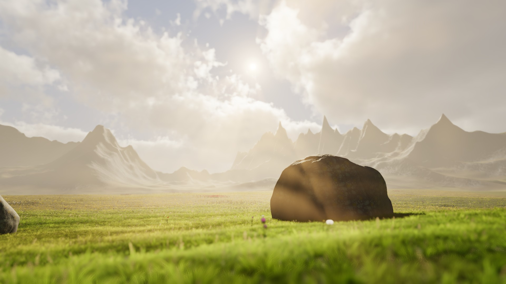

*MeadowDemo, rendered by the engine: looking into the low sun through volumetric fog, with sun
shafts, millions of grass blades, rocks in focus and a soft depth of field. It is also a project
template you can start from.*

## Download

Get the newest version from the
**[Releases page](https://github.com/Aalzard/MistyEngine/releases)**:

- **Windows:** **`MistyEngine-Setup-vX.Y.Z-windows-x64.exe`** (recommended) installs Misty Engine for
  your user, with Start menu and desktop shortcuts and an uninstaller; or
  **`MistyEngine-vX.Y.Z-windows-x64.zip`**: unzip it anywhere and start `MistyEngine.exe`.
- **Linux:** **`MistyEngine-vX.Y.Z-linux-x64.tar.gz`**: extract it anywhere and run `./MistyEngine`
  (see the README inside for the few system libraries it needs).

Misty Engine tells you when a new version is out and updates itself with one click (the green
**Update** button). Windows may say "Windows protected your PC" because the app is not signed yet:
click **More info ▸ Run anyway**.

**You need:** Windows 10 or 11 (64-bit) or a 64-bit Linux (glibc 2.35 or newer, X11 or Wayland), and
a graphics card with Vulkan (or DirectX 12 on Windows). A macOS version is coming.

## What you get

- **Misty Hub:** the start screen, with your recent projects (each showing the last view you were
  looking at) and tutorials. New projects start from a template:
  - **MeadowDemo:** the walkable meadow above, with a **first-person player** ready to walk, run,
    jump and crouch; thin grass, trees and Misty GI. Its grass, trees and textures are free to use
    in your games.
  - **First Person:** the same first-person player on an endless flat white plain, ready to press
    Play.
  - **Racing:** an arcade racer on a 1.2 km circuit: a car with three bodies to pick from, boost,
    reset to the track, a chase camera, a lap timer and live settings (gravity, mass, grip, top
    speed). The car, camera, timer and settings are Lua scripts you can edit.
  - **2D Platformer:** a pixel-art player that runs and jumps (A/D or the arrows, Space) through a
    tilemap level painted with a Rule Tile, coins to collect, a camera that follows the player,
    torches with 2D lights and shadows, and a Tile Palette ready to paint more. The Scene view
    starts in 2D.
  - **Floating Platform:** a platform floating in the sky, to start from scratch.

  Every 3D template starts with post-processing on: bloom, tonemapping, volumetric clouds and sun
  shafts; the 2D Platformer has bloom.

  You can also include all the sample scenes.
- **Editor:**
  - Frameless window with its own title bar, and dockable windows with saved layouts.
  - Inspector cards with clear titles; a Hierarchy with tree lines and colour-coded folders.
  - Undo history, Ctrl+K search for anything, multiple scenes open at once, prefabs and presets.
  - A built-in code editor, so you don't need Visual Studio.
  - A smooth Scene camera (gliding fly, orbit and zoom to the cursor), and **editor scripting in
    Lua**: your own menu items, tool windows, custom Inspectors and gizmos.
- **Next-generation rendering** (experimental, switch them on in Quality settings):
  - **Misty GI, Lumen-like real-time global illumination:** bounce light, colour bleeding and sky
    occlusion that update live as lights and objects move, with nothing baked. It traces a
    distance-field version of the scene and gathers light through probes; in our test room it lands
    within 1–2 brightness levels of an offline path-traced bake, in about 1.1 ms on High.
  - **Virtual geometry, Nanite-like:** dense meshes are cut into small clusters with a hierarchy of
    simpler versions, and the GPU picks the detail per cluster every frame, so thousands of
    high-poly rocks draw as fast as a hand-made LOD chain, with no LODs to make. One click turns
    it on: **GameObject ▸ Enable Virtual Geometry** on the selection, or **Tools ▸ Rendering ▸
    Convert Scene to Virtual Geometry** for every dense mesh in the scene.
  - **Virtual shadow maps:** sharp sun shadows from a cached page system, with grass and swaying
    trees in a near layer.
  - **Upscaling** (Off / Quality / Balanced / Performance): render below full resolution and rebuild
    a sharp image.
- **Grass and trees:** dense, thin field grass drawn with a visibility buffer (each grass pixel is
  shaded once), soft shadows from trees on the turf, and procedural trees (oak, linden, birch) with
  PBR bark, wind, LODs and far impostors, painted onto terrains like in Unity.
- **Rendering:**
  - Physically based materials, soft shadows, area lights and reflection probes.
  - **Baked global illumination** (a lightmapper), **light probes** and **occlusion culling**.
  - Ambient occlusion, bloom and other post-processing, HDRI skies, light halos and lens flares.
  - Quality settings, FXAA and render scale right in the Scene view.
- **Atmosphere:** volumetric fog with sharp sun shafts, volumetric clouds, an ocean and lakes with
  waves, foam and fog.
- **Content tools:**
  - **Mesh Builder** for modelling in the editor (extrude, inset, bevel, loop cut and more).
  - **Splines** (roads, tubes, objects along a path), and **Tilemaps** with a Tile Palette and 2D
    lights.
  - **Shader Graph** and the **Effect Graph** (GPU particles, millions of them).
  - Terrain, and the World Builder (mountains, erosion, biomes, trees and rocks from a few settings).
- **Gameplay:**
  - Physics with joints, a character controller and **vehicles** (wheel colliders).
  - **Skinned characters** with blend shapes, **animation rigging and IK**, animator controllers.
  - The **Timeline** for cutscenes, and **virtual cameras** with blends, follow, orbit and shake.
  - Navigation meshes, particles, audio with mixers, UI, input actions.
- **Multiplayer:** Network Manager, Network Object and Network Transform (interpolation and
  prediction), network variables and RPCs from Lua, LAN discovery, and a Multiplayer Play Mode that
  opens extra player windows.
- **Systems:**
  - Save system and localization, a video player, and rich text.
  - Asset groups loaded by address, and a package manager.
  - A **Test Runner** for Lua tests, plus a **Frame Debugger** and **Memory Profiler**.
- **Scripting:** Lua scripts with `Start`, `Update`, collisions and more
  ([scripting guide](docs/scripting.md)), **visual scripting** with node-based Script Graphs and a
  live debugger ([visual scripting guide](docs/visual-scripting.md)), and custom shaders in WGSL
  ([shaders guide](docs/shaders.md)).
- **Builds:** File ▸ Build makes a stand-alone game you can share ([building guide](docs/building.md)).
- **AI tools (MCP):** `misty --mcp <project>` lets AI agents such as Claude and Codex edit scenes,
  write scripts, read the Console, take screenshots, run tests and build, also in the running
  editor, local only and undoable ([MCP guide](docs/mcp.md)).

| | |
|---|---|
| 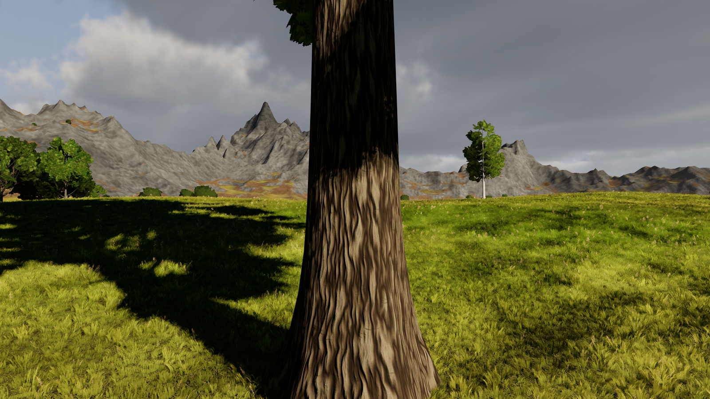 | 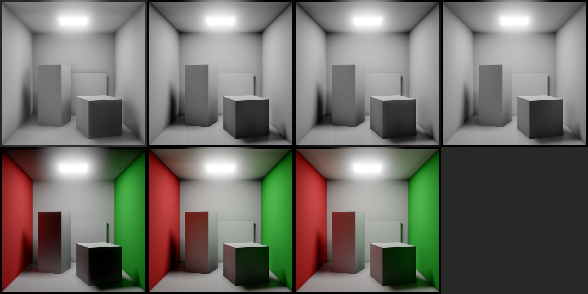 |
| 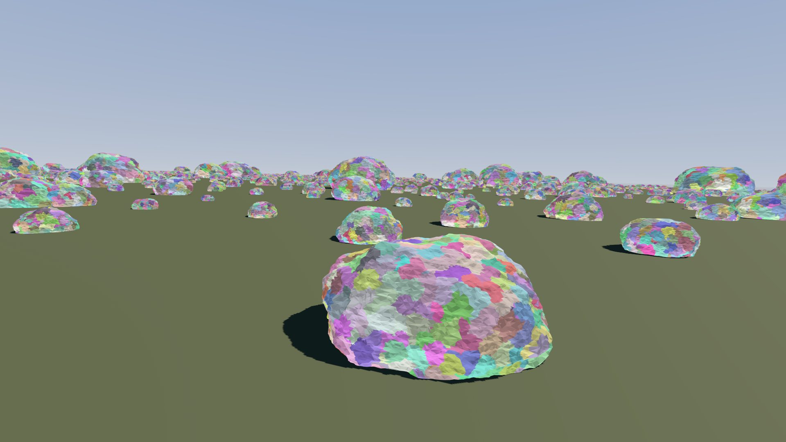 | 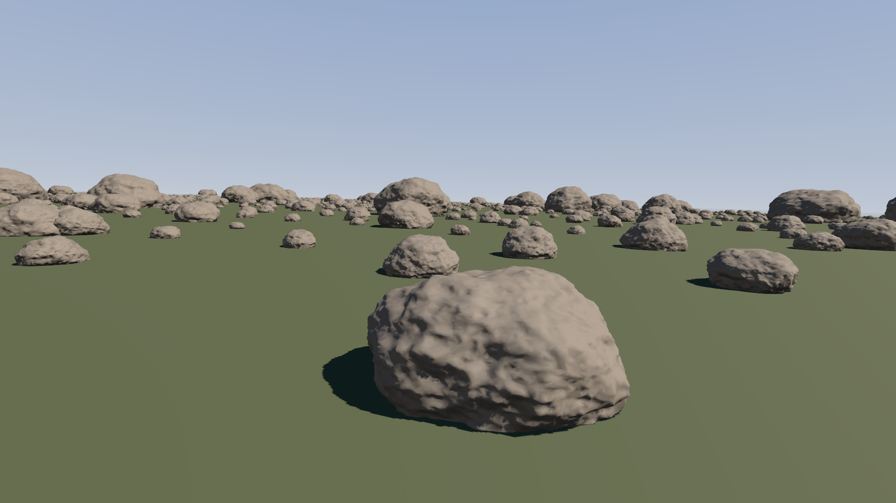 |
| 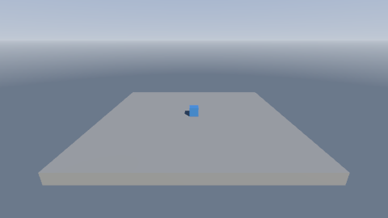 | 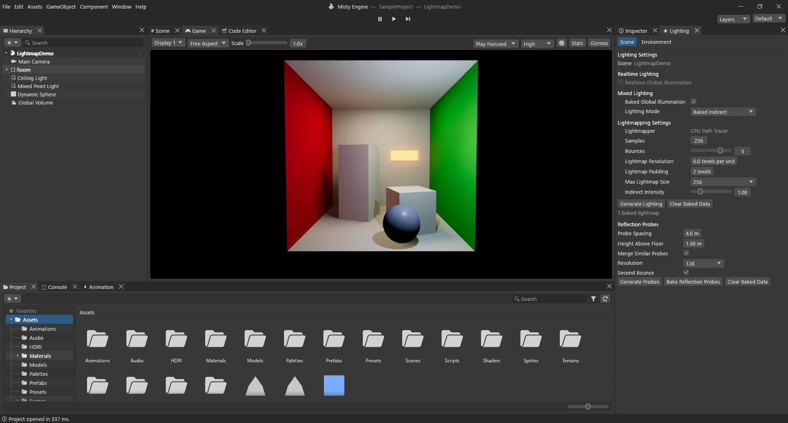 |
| 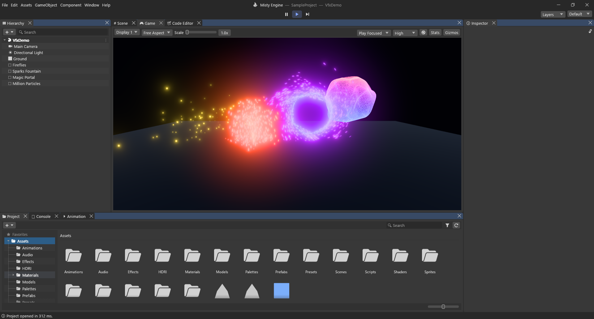 | 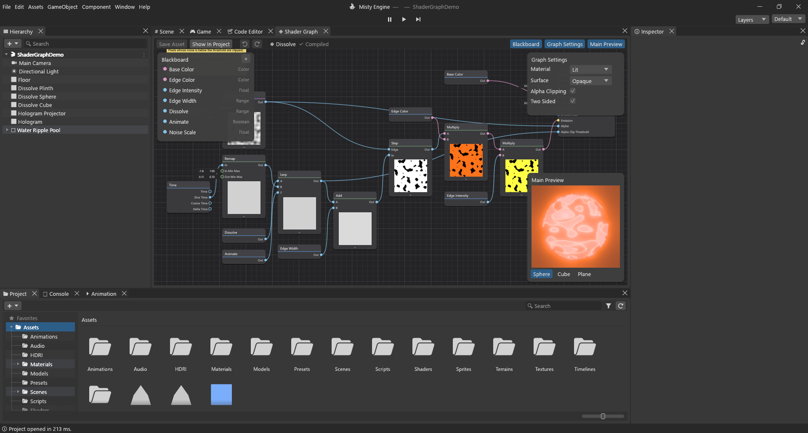 |
| 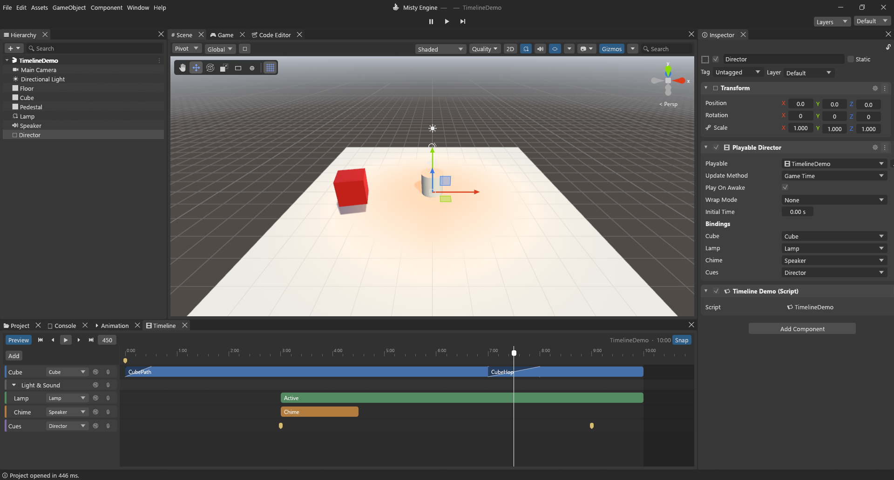 | 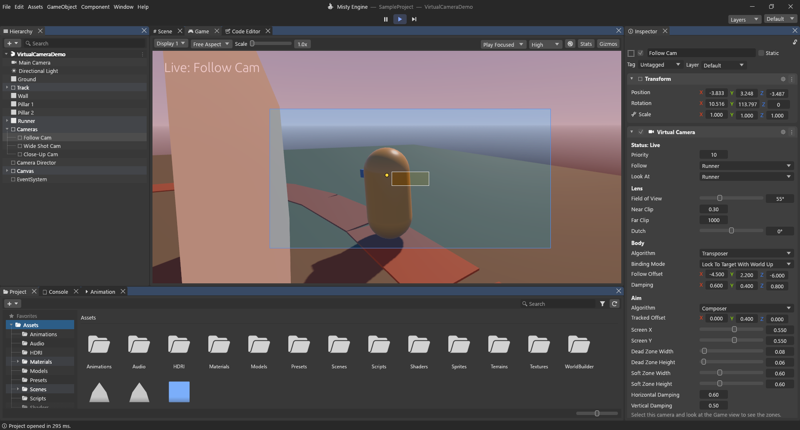 |
| 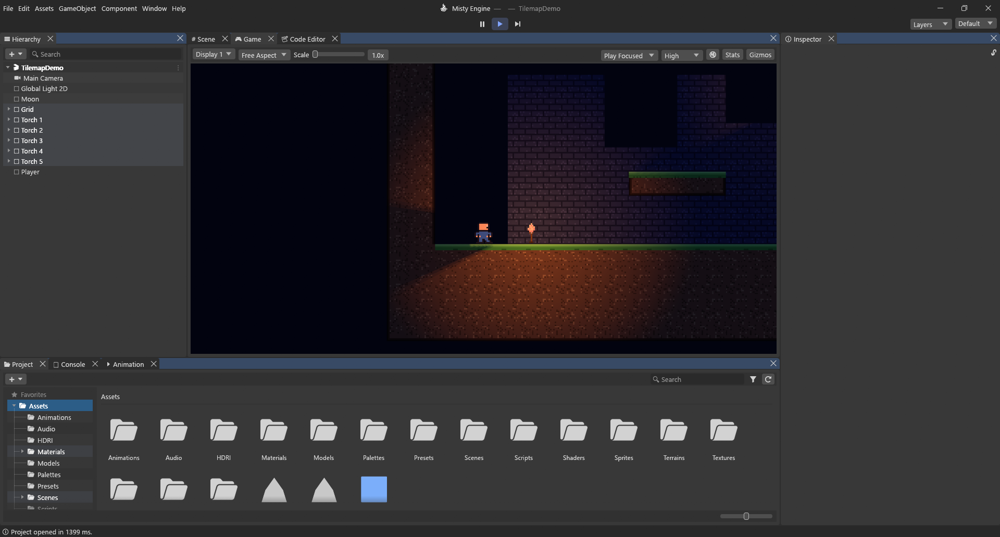 | 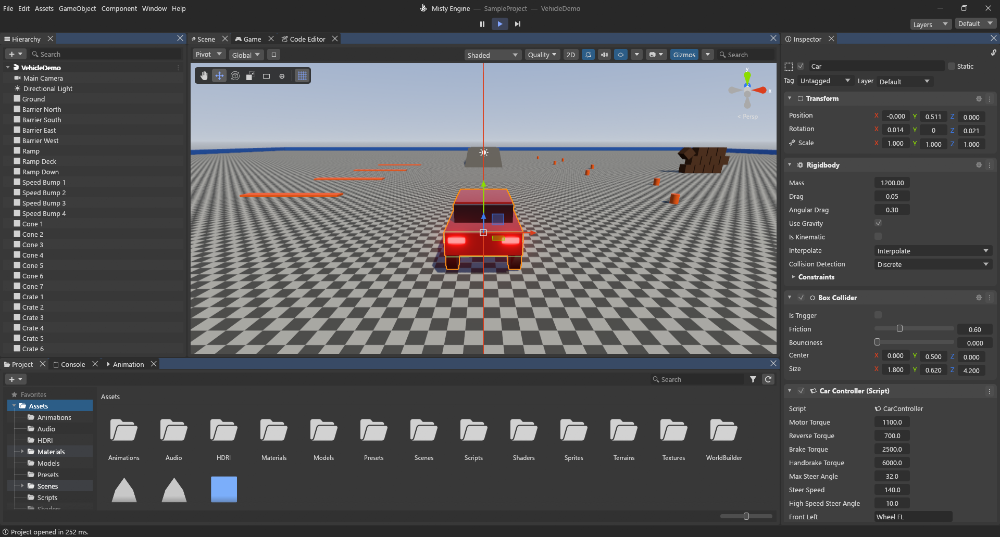 |
| 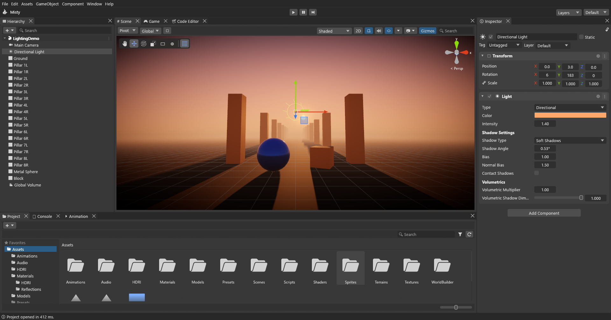 | 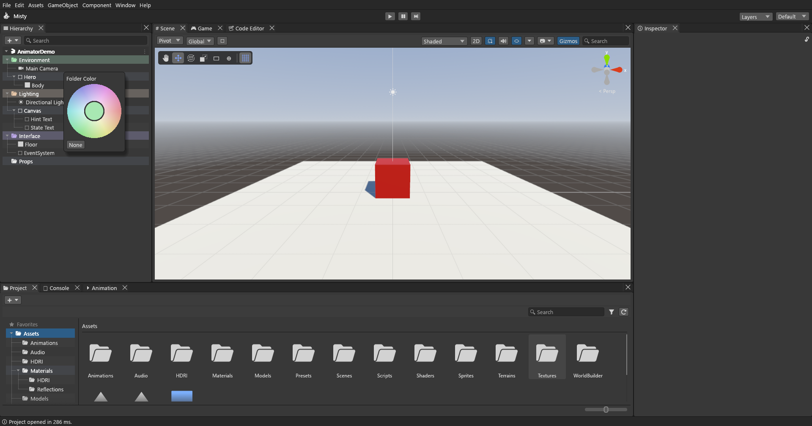 |
| 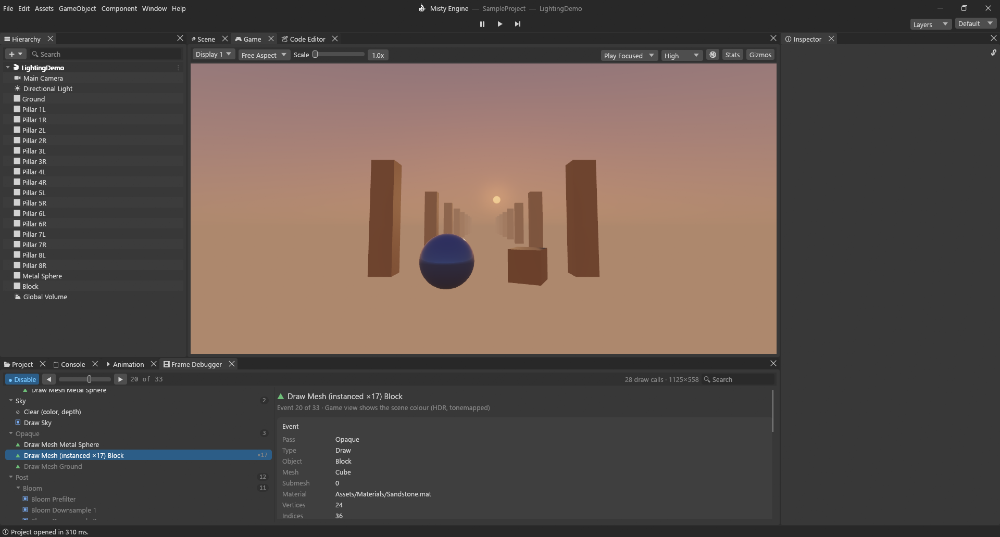 | 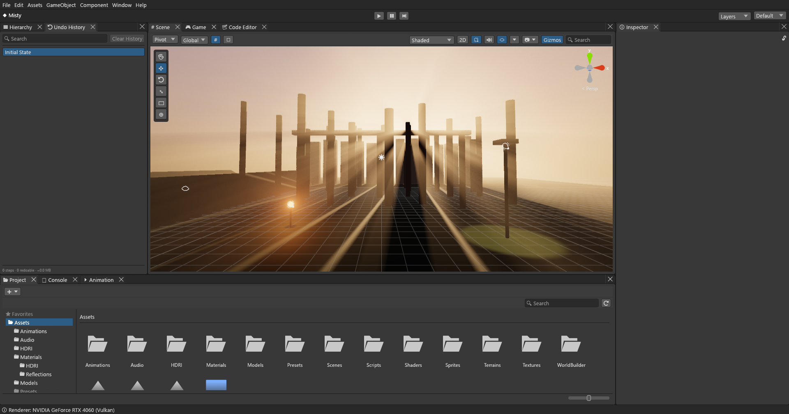 |

## Build from source

1. Install Rust (stable, 1.88 or newer) from <https://rustup.rs>. On Windows the Visual Studio C++
   build tools are needed (rustup offers to install them). The Windows SDK adds the exe icon; without
   it the build still works.
2. Get the code and build:

   ```bash
   git clone https://github.com/Aalzard/MistyEngine.git
   cd MistyEngine
   cargo build --release -p misty_editor -p misty_player
   ```

3. Start it:

   ```bash
   cargo run --release -p misty_editor                          # Misty Hub
   cargo run --release -p misty_editor -- SampleProject         # open a project directly
   cargo run --release -p misty_editor -- --new Racing MyGame    # new project from a template
   ```

`misty_player` must be built next to the editor for File ▸ Build to work. A project is any folder
with an `Assets/` folder; `SampleProject/` has demo scenes for most features.

For developers: `cargo test --workspace` and `cargo clippy --workspace --all-targets`.
`MISTY_SCREENSHOT=out.png` makes the editor (or `misty_player`) save a picture of its window and
exit. How a release is made: [docs/release.md](docs/release.md). Notes:
[progress](docs/progress.md) · [decisions](docs/decisions.md).

## License

Misty Engine is free software under the **GNU General Public License v3 or later** ([LICENSE](LICENSE)),
like Blender. **Games you make with it are yours:** the runtime exception
([RUNTIME-EXCEPTION.md](RUNTIME-EXCEPTION.md)) lets you share or sell your builds under any license,
including closed source. Only changes to Misty Engine itself must stay under the GPL.
