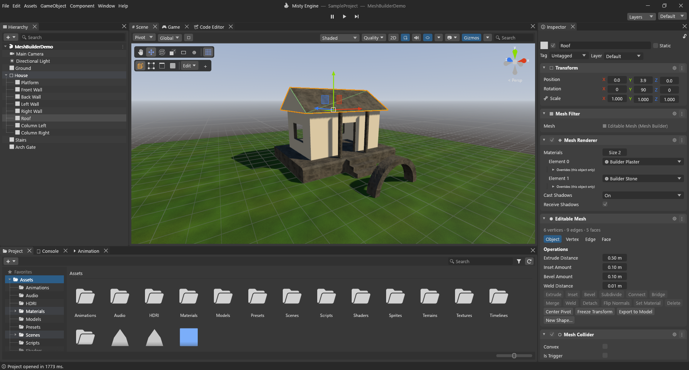
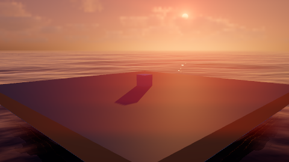

# Misty Engine

Misty Engine is a free, open source game engine and editor written in Rust. If you have used Unity, it
will feel familiar: a Hierarchy, a Scene view, an Inspector, a Project window, Play mode, prefabs and
scripts on your objects. The goal is to bring the best of several engines into one: the Unity
workflow, high-end visuals, open source, and lots of tools built in. It is built on wgpu, egui, hecs,
rapier and Lua.

> **Early test version (0.1.0).** Things will change and some things will break. Please try it, and
> tell us what you find.



## Download

Get the newest Windows version from the
**[Releases page](https://github.com/Aalzard/MistyEngine/releases)**:

- **`MistyEngine-Setup-vX.Y.Z-windows-x64.exe`** (recommended): installs Misty Engine for your user,
  with Start menu and desktop shortcuts and an uninstaller.
- or **`MistyEngine-vX.Y.Z-windows-x64.zip`**: unzip it anywhere and start `MistyEngine.exe`.

Misty Engine tells you when a new version is out and updates itself with one click (the green
**Update** button). Windows may say "Windows protected your PC" because the app is not signed yet:
click **More info ▸ Run anyway**.

**You need:** Windows 10 or 11 (64-bit) and a graphics card with Vulkan or DirectX 12. Linux and
macOS versions are coming.

## What you get

- **Misty Hub:** the start screen, with your recent projects (each showing the last view you were
  looking at) and tutorials. New projects come from two templates: Standard, and PP Ready (a sunset
  over the ocean with clouds, god rays and every effect on). You can also include all the sample
  scenes.
- **Editor:**
  - Frameless window with its own title bar, and dockable windows with saved layouts.
  - Inspector cards with clear titles; a Hierarchy with tree lines and colour-coded folders.
  - Undo history, Ctrl+K search for anything, multiple scenes open at once, prefabs and presets.
  - A built-in code editor, so you don't need Visual Studio.
- **Rendering:**
  - Physically based materials, soft shadows, area lights and reflection probes.
  - **Baked global illumination** (a lightmapper), **light probes** and **occlusion culling**.
  - Ambient occlusion, bloom and other post-processing, HDRI skies, light halos and lens flares.
  - Quality settings, FXAA and render scale right in the Scene view.
- **Atmosphere:** volumetric fog with sharp sun shafts, volumetric clouds, an ocean and lakes with
  waves, foam and fog.
- **Content tools:**
  - **Mesh Builder** for modelling in the editor (extrude, inset, bevel, loop cut and more).
  - **Splines** (roads, tubes, objects along a path), and **Tilemaps** with a Tile Palette and 2D
    lights.
  - **Shader Graph** and the **Effect Graph** (GPU particles, millions of them).
  - Terrain, and the World Builder (mountains, erosion, biomes, trees and rocks from a few settings).
- **Gameplay:**
  - Physics with joints, a character controller and **vehicles** (wheel colliders).
  - **Skinned characters** with blend shapes, **animation rigging and IK**, animator controllers.
  - The **Timeline** for cutscenes, and **virtual cameras** with blends, follow, orbit and shake.
  - Navigation meshes, particles, audio with mixers, UI, input actions.
- **Systems:**
  - Save system and localization, a video player, and rich text.
  - Asset groups loaded by address, and a package manager.
  - A **Test Runner** for Lua tests, plus a **Frame Debugger** and **Memory Profiler**.
- **Scripting:** Lua scripts with `Start`, `Update`, collisions and more
  ([scripting guide](docs/scripting.md)), and custom shaders in WGSL ([shaders guide](docs/shaders.md)).
- **Builds:** File ▸ Build makes a stand-alone game you can share ([building guide](docs/building.md)).

| | |
|---|---|
|  |  |
|  |  |
|  |  |
|  |  |
|  |  |
|  |  |

## Build from source

1. Install Rust (stable, 1.88 or newer) from <https://rustup.rs>. On Windows the Visual Studio C++
   build tools are needed (rustup offers to install them). The Windows SDK adds the exe icon; without
   it the build still works.
2. Get the code and build:

   ```bash
   git clone https://github.com/Aalzard/MistyEngine.git
   cd MistyEngine
   cargo build --release -p misty_editor -p misty_player
   ```

3. Start it:

   ```bash
   cargo run --release -p misty_editor                          # Misty Hub
   cargo run --release -p misty_editor -- SampleProject         # open a project directly
   cargo run --release -p misty_editor -- --new "PP Ready" MyGame  # new project from a template
   ```

`misty_player` must be built next to the editor for File ▸ Build to work. A project is any folder
with an `Assets/` folder; `SampleProject/` has demo scenes for most features.

For developers: `cargo test --workspace` and `cargo clippy --workspace --all-targets`.
`MISTY_SCREENSHOT=out.png` makes the editor (or `misty_player`) save a picture of its window and
exit. How a release is made: [docs/release.md](docs/release.md). Notes:
[progress](docs/progress.md) · [decisions](docs/decisions.md).

## License

Misty Engine is free software under the **GNU General Public License v3 or later** ([LICENSE](LICENSE)),
like Blender. **Games you make with it are yours:** the runtime exception
([RUNTIME-EXCEPTION.md](RUNTIME-EXCEPTION.md)) lets you share or sell your builds under any license,
including closed source. Only changes to Misty Engine itself must stay under the GPL.
