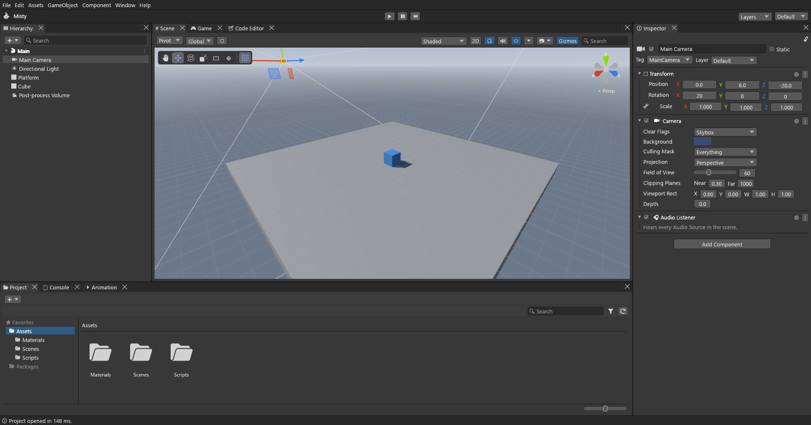
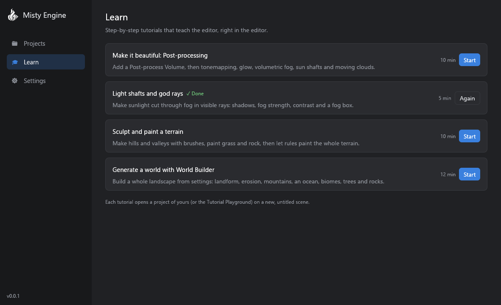
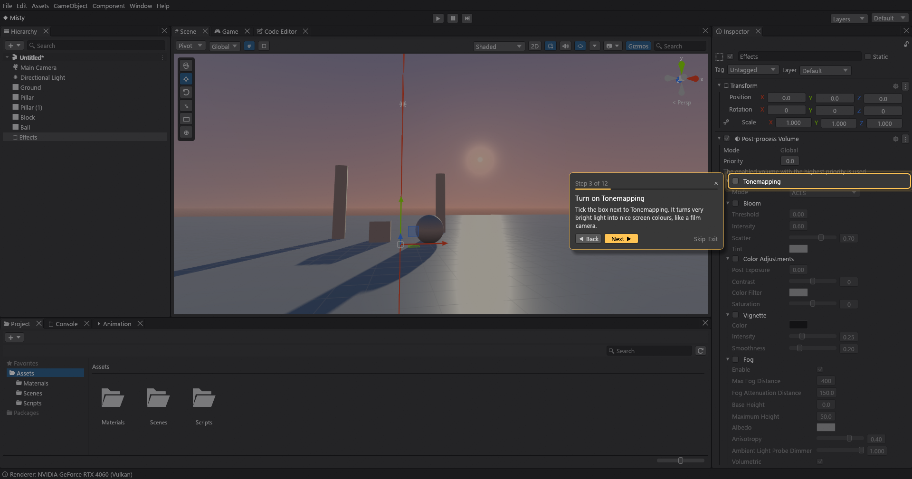
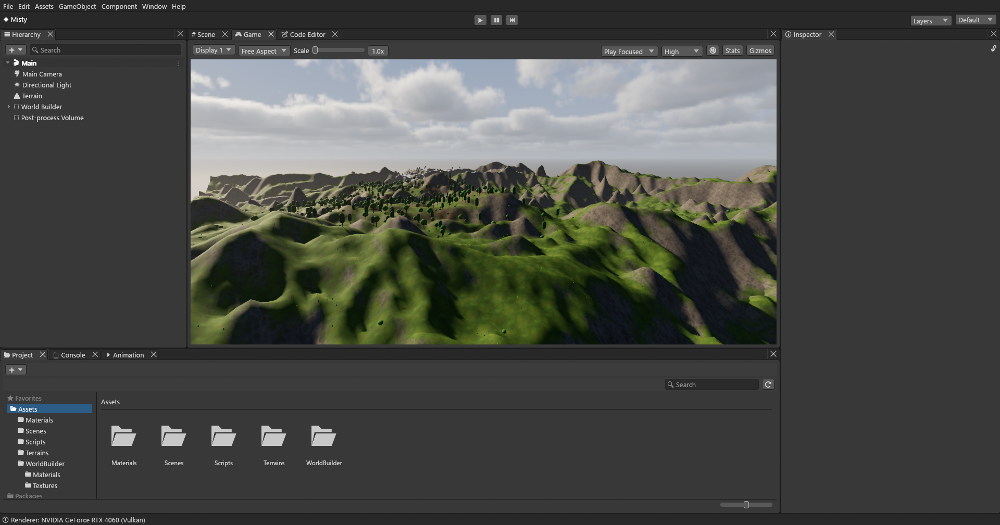

# Misty Engine

Misty Engine is a free game engine and editor written in Rust. If you have used Unity, it will feel
familiar: a Hierarchy, a Scene view, an Inspector, a Project window, Play mode, and Lua scripts on
your objects. It is built on wgpu, egui, hecs, rapier and Lua.

> **Early test version (0.0.1).** Things will change and some things will break. Please try it, and
> tell us what you find.



## Download

Get the newest Windows version from the
**[Releases page](https://github.com/Aalzard/MistyEngine/releases)**: download
`MistyEngine-vX.Y.Z-windows-x64.zip`, unzip it anywhere and start `MistyEngine.exe`.
Misty Engine tells you when a new version is out and can update itself with one click.

**You need:** Windows 10 or 11 (64-bit) and a graphics card with Vulkan or DirectX 12.

## What you get

- **Misty Hub** — the start screen: your recent projects, new projects from four templates (Empty,
  Standard, Ocean, Landscape) and tutorials.
- **Editor** — dockable windows, saved layouts, undo history, Ctrl+K search for anything, multiple
  scenes open at once, prefabs, presets.
- **Rendering** — physically based materials, shadows, area lights, reflection probes, ambient
  occlusion, bloom and other post-processing, HDRI skies, light halos and lens flares.
- **Atmosphere** — volumetric fog with sharp sun shafts, volumetric clouds, an ocean and lakes with
  waves, foam and fog.
- **Worlds** — terrain sculpting and painting, and the World Builder that makes a whole landscape
  (mountains, erosion, biomes, trees, rocks) from a few settings.
- **Gameplay** — physics (rapier), character controller, navigation meshes, animation and animator
  controllers, particles, audio with mixers, UI, input actions.
- **Scripting** — Lua scripts with `Start`, `Update`, collisions and more
  ([scripting guide](docs/scripting.md)); custom shaders in WGSL ([shaders guide](docs/shaders.md)).
- **Tutorials** — step-by-step lessons inside the editor that show you where to click.
- **Builds** — File ▸ Build makes a stand-alone game you can share ([building guide](docs/building.md)).

| | |
|---|---|
|  |  |
|  |  |

## Build from source

1. Install Rust (stable, 1.88 or newer) from <https://rustup.rs>. On Windows the Visual Studio C++
   build tools are needed (rustup offers to install them). The Windows SDK adds the exe icon; without
   it the build still works.
2. Get the code and build:

   ```bash
   git clone https://github.com/Aalzard/MistyEngine.git
   cd MistyEngine
   cargo build --release -p misty_editor -p misty_player
   ```

3. Start it:

   ```bash
   cargo run --release -p misty_editor                          # Misty Hub
   cargo run --release -p misty_editor -- SampleProject         # open a project directly
   cargo run --release -p misty_editor -- --new Landscape MyGame  # new project from a template
   ```

`misty_player` must be built next to the editor for File ▸ Build to work. A project is any folder
with an `Assets/` folder; `SampleProject/` has demo scenes for most features.

For developers: `cargo test --workspace` and `cargo clippy --workspace --all-targets`.
`MISTY_SCREENSHOT=out.png` makes the editor (or `misty_player`) save a picture of its window and
exit. How a release is made: [docs/release.md](docs/release.md). Notes:
[progress](docs/progress.md) · [decisions](docs/decisions.md).

## License

Misty Engine is free software under the **GNU General Public License v3 or later** ([LICENSE](LICENSE)),
like Blender. **Games you make with it are yours:** the runtime exception
([RUNTIME-EXCEPTION.md](RUNTIME-EXCEPTION.md)) lets you share or sell your builds under any license,
including closed source. Only changes to Misty Engine itself must stay under the GPL.
