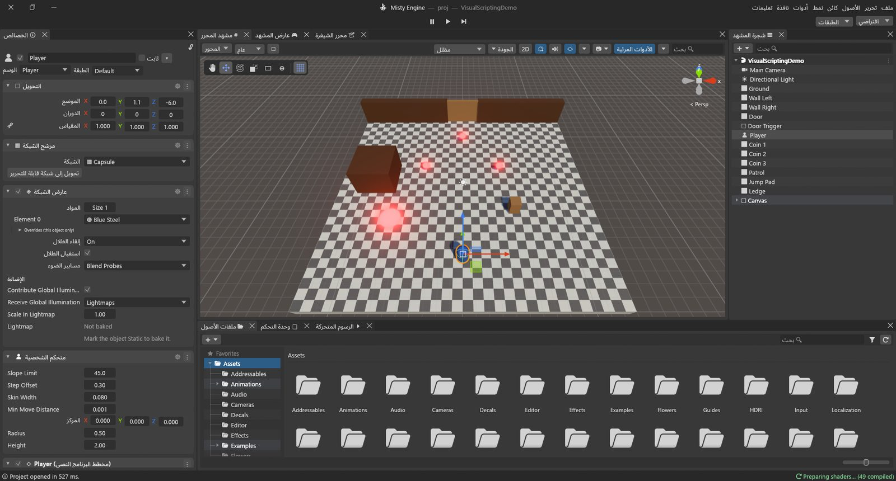

# واجهة المحرر

عندما تفتح مشروعًا، يملأ المحرر النافذة بعدد من اللوحات، لكل لوحة مهمة واحدة. وما إن تعرف وظيفة كل منها حتى يسهل عليك تعلّم بقية المحرك.

من الأعلى إلى الأسفل ترى:

- **شريط العنوان** وفيه القوائم (ملف، تحرير، الأصول…)؛
- **شريط الأدوات** وفي وسطه أزرار التشغيل والإيقاف المؤقت والخطوة؛
- **اللوحات**: شجرة المشهد، ومشهد المحرر، وعارض المشهد، والخصائص، وملفات الأصول، ووحدة التحكم…؛
- **شريط الحالة** على امتداد الحافة السفلية.

> [!TIP]
> تأخذك **تعليمات ▸ جولة في الواجهة** في جولة على هذه المناطق واحدةً تلو الأخرى، مع إبراز كل منها.

## شجرة المشهد

**ما هي:** قائمة بكل الكائنات في المشهد المفتوح. يمكن للكائن أن يحتوي كائنات أخرى، كالسيارة التي تحتوي عجلاتها الأربع. وتُظهر الشجرة ذلك: فالأبناء يقعون تحت آبائهم، وتُطوى بالسهم الصغير.

**لماذا تستخدمها:** لإيجاد الكائنات وتحديدها وإعادة تسميتها، ولتنظيم المشهد بوضع الكائنات تحت غيرها.

**كيف:**

- انقر كائنًا لتحديده. يضيف **Ctrl+نقر** كائنًا إلى التحديد أو يزيله، ويحدد **Shift+نقر** مجموعة متتالية.
- **انقر نقرًا مزدوجًا** على كائن لتأطيره في مشهد المحرر.
- **اسحب** كائنًا وأفلته فوق آخر ليصبح ابنًا له، واسحبه إلى مساحة فارغة ليعود إلى المستوى الأعلى.
- اضغط مطولًا على كائن (أو اضغط **F2**) لإعادة تسميته.
- **انقر بزر الفأرة الأيمن** على كائن لتظهر أوامر القص والنسخ واللصق والتكرار والحذف وتحديد الأبناء وأوامر الإنشاء (التي تنشئ ابنًا لذلك الكائن). وانقر بالزر الأيمن على مساحة فارغة لإنشاء كائن جديد.
- ينشئ زر **➕** في الأعلى كائنات جديدة، ويصفّي مربع البحث القائمة. ويمكنك كتابة مرشحات مثل `t:Light` و`t:Camera` و`tag:Player` و`layer:UI`.

## الخصائص

**ما هي:** كل ما يخص الكائن المحدد. في الأعلى: اسمه، ومربع اختيار لتشغيله أو إيقافه، و**ثابت**، و**الوسم**، و**الطبقة**. وتحتها بطاقة لكل نمط يملكه الكائن (التحويل، وعارض الشبكة، والضوء، ومتحكم الشخصية، ومخطط البرنامج النصي…).

**لماذا تستخدمها:** لتغيير شكل الكائن وسلوكه: تحريكه بكتابة الأرقام، أو تغيير لون ضوء، أو ضبط قيم برنامج نصي.

**كيف:**

- غيّر القيمة بالكتابة، أو بسحب حقل الرقم يمينًا ويسارًا، أو بالاختيار من قائمة.
- يضيف زر **إضافة نمط** في الأسفل قدرات جديدة إلى الكائن: مصادمًا، أو ضوءًا، أو صوتًا، أو برنامجًا نصيًا، أو مخطط برنامج نصي. اكتب في مربع البحث للوصول إلى ما تريد بسرعة.
- انقر بالزر الأيمن على عنوان البطاقة (أو زر **⋮**) لتظهر أوامر إعادة التعيين، وإزالة النمط، والتحريك للأعلى أو للأسفل، ونسخ النمط ولصقه.
- يثبّت زر **🔒** اللوحة على الكائن الحالي، فتحدد كائنات أخرى وتواصل تحرير هذا الكائن.
- إذا حددت أصلًا في ملفات الأصول، تعرض لوحة الخصائص إعدادات استيراده بدلًا من ذلك.

## ملفات الأصول

**ما هي:** ملفات مشروعك: المشاهد، والنماذج، والخامات، والمواد، والأصوات، وبرامج Lua النصية، ومخططات البرامج النصية. المجلدات على جانب، وملفات المجلد المختار على الجانب الآخر.

**كيف:**

- ينشئ زر **➕** أصولًا جديدة (مجلد، مادة، مخطط برنامج نصي، مشهد، وحدة تحكم أداة التحريك…)، وكذلك النقر بالزر الأيمن على مساحة فارغة.
- انقر نقرًا مزدوجًا على مشهد لفتحه، أو على مخطط برنامج نصي لتحريره، أو على برنامج Lua نصي لتحريره في محرر الشيفرة.
- اسحب الملفات من ملفات الأصول إلى مشهد المحرر أو شجرة المشهد لاستخدامها. واسحب الكائنات من شجرة المشهد إلى ملفات الأصول لتصنع منها قوالب جاهزة.
- أفلت ملفات من حاسوبك على اللوحة لاستيرادها.
- يغيّر المنزلق في الأسفل حجم الأيقونات، وإذا سحبته إلى أقصى الطرف حصلت على عرض القائمة.

## مشهد المحرر

**ما هو:** ورشة عملك: كاميرا حرة تطير بها في أرجاء المشهد لتبنيه. ما تراه هنا ليس ما يراه اللاعب؛ فذلك هو عارض المشهد.

**التنقل:**

- اضغط مطولًا على **زر الفأرة الأيمن** واستخدم **W A S D** (و**Q / E** للنزول والصعود) للطيران. اضغط **Shift** لتسرع، ومرّر عجلة الفأرة مع ضغط الزر الأيمن لتغيير السرعة.
- حدد كائنًا واضغط **F** لتأطيره.
- انقر أحد مخاريط مؤشر المحاور (في الزاوية العلوية) لتنظر على امتداد ذلك المحور، وانقر مركزه للتبديل بين المنظور والعرض المتساوي القياس.

**الأدوات** (في الزاوية العلوية، أو بالمفاتيح **Q W E R T Y**): العرض، والتحريك، والتدوير، والتحجيم، والمستطيل، والتحويل. يؤدي ضغط **Ctrl** أثناء السحب إلى الالتقاط بخطوات ثابتة (تضبطها من تحرير ▸ الشبكة والالتقاط).

**الشريط أعلى مشهد المحرر** يضم: مربع بحث، وخيارات الأدوات المرئية وزر **الأدوات المرئية**، وإعدادات الكاميرا (📷)، وزر التأثيرات (☁) وقائمته (السماء، والضباب، والسحب، والمعالجة اللاحقة…)، والصوت (🔊)، والإضاءة (💡)، و**2D**، وقائمة **الجودة**، ونمط الرسم (مظلل، وإطار سلكي، وعروض تشخيص كثيرة). نشرح قائمة الجودة في فصل [الجودة والتصيير](03-quality-and-rendering.md).

## عارض المشهد

**ما هو:** اللعبة كما تراها كاميرا المشهد، أي تمامًا كما سيراها اللاعب. وفيه تعمل اللعبة حين تضغط تشغيل.

**شريطه:**

- **Display 1** ونسبة العرض إلى الارتفاع (Free Aspect و16:9 و16:10 و4:3 و5:4)، ومنزلق **Scale** للتكبير.
- **الأدوات المرئية**، و**Stats** (أرقام التصيير، انظر [البحث عن مصدر البطء](02-performance.md))، و**VSync**، و**🔇** لكتم صوت اللعبة، ومستوى الجودة للمعاينة.
- **Play Focused / Play Maximized / Play Unfocused**: يجعل Play Maximized عارض المشهد يملأ النافذة حتى تتوقف.

## وحدة التحكم

**ما هي:** رسائل المحرر ورسائل لعبتك: معلومات، وتحذيرات (⚠)، وأخطاء (⛔). وتكتب فيها مخططات البرامج النصية وبرامج Lua بالأمر `Debug.Log`.

**كيف:**

- يفرغها زر **مسح**، وفي قائمته ⏷ خيار **المسح عند التشغيل**.
- يدمج زر **طي** الرسائل المتطابقة في صف واحد مع عدّاد.
- يوقف **إيقاف عند الخطأ** التشغيلَ مؤقتًا لحظة ظهور خطأ، لتتفحص ما حدث.
- تُظهر أزرار ⛔ و⚠ وℹ كل نوع أو تخفيه، ويصفّي مربع البحث الرسائل.
- انقر نقرًا مزدوجًا على رسالة صادرة عن برنامج نصي لتفتح السطر المعني.

ويعرض شريط الحالة أسفل النافذة آخر رسالة دائمًا؛ انقره لفتح وحدة التحكم.

## شريط الأدوات: التشغيل والإيقاف المؤقت والخطوة

تشغّل الأزرار الثلاثة في وسط شريط الأدوات لعبتك داخل المحرر:

| الزر | الاختصار | وظيفته |
|---|---|---|
| تشغيل | Ctrl+P | يبدأ اللعبة في عارض المشهد. اضغطه مرة أخرى للتوقف. |
| إيقاف مؤقت | Ctrl+Shift+P | يجمّد اللعبة. وإذا ضغطته قبل التشغيل، تبدأ اللعبة متوقفة. |
| خطوة | Ctrl+Alt+P | يشغّل إطارًا واحدًا بالضبط ثم يتوقف من جديد. مفيد جدًا لمراقبة ما يحدث بسرعة. |

أثناء التشغيل يتلوّن شريط اللوحات، كي لا تنسى أنك في وضع التشغيل.

> [!WARNING]
> التغييرات التي تجريها على الكائنات أثناء التشغيل تُلغى حين تتوقف، وهذا مقصود لتجرّب بحرية. دوّن القيم الجيدة، ثم توقف واضبطها فعليًا.

وعلى طرف شريط الأدوات: قائمة **التخطيط** (انظر أدناه) وقائمة **الطبقات**.

## القوائم

| القائمة | محتواها |
|---|---|
| ملف | إنشاء المشاهد وفتحها وحفظها، والمشاهد الأخيرة، وإنشاء مشروع أو فتحه، وMisty Hub، وملفات تعريف البناء، والبناء والتشغيل (Ctrl+B)، والخروج. |
| تحرير | التراجع والإعادة (Ctrl+Z / Ctrl+Y) وسجل التراجع (Ctrl+H)، والتحديد، والقص والنسخ واللصق والتكرار (Ctrl+D)، وإعادة التسمية (F2)، والحذف، وتأطير المحدد (F)، والشبكة والالتقاط، والتشغيل والإيقاف المؤقت والخطوة، وإعدادات المشروع، والتفضيلات. |
| الأصول | الإنشاء، والإظهار في المستكشف، وإعادة التسمية، والتكرار، والحذف، والتحديث (Ctrl+R). |
| كائن | إنشاء كائن فارغ (Ctrl+Shift+N)، والكائنات ثلاثية الأبعاد وثنائية الأبعاد، والتأثيرات، والأضواء، والصوت، وواجهة المستخدم، والكاميرات، ولاعب بمنظور الشخص الأول؛ وأوامر الأبوة، والنقل إلى العرض، والمحاذاة مع العرض، وتمكين Misty Mesh وتعطيله. |
| نمط | إضافة… (Ctrl+Shift+A) وكل الأنماط مصنّفة: الشبكة، والتأثيرات، والفيزياء، والتنقل، والصوت، والتصيير، والبرامج النصية، وواجهة المستخدم… |
| أدوات | التصيير: تحويل المشهد أو المشروع إلى Misty Mesh. |
| نافذة | التخطيطات، ثم كل اللوحات في مجموعات: عام (مشهد المحرر Ctrl+1، وعارض المشهد Ctrl+2، والخصائص Ctrl+3، وشجرة المشهد Ctrl+4، وملفات الأصول Ctrl+5، ووحدة التحكم Ctrl+Shift+C…)، والحركة، والتصيير (الإضاءة، واستبعاد المحجوب…)، ومخططات البرامج النصية، والتحليل (محلل الأداء Ctrl+7، ومصحح الإطارات، ومحلل الذاكرة)، وغيرها. |
| تعليمات | دليل المستخدم، وجولة في الواجهة، والدروس، وحول، والتحقق من التحديثات، ومرجع البرمجة. |

يفتح **Ctrl+K** بحثًا شاملًا في كل شيء: الكائنات، والأصول، وأوامر القوائم، وصفحات الإعدادات، وعناوين التوثيق.

## التخطيطات

التخطيط هو ترتيب اللوحات على الشاشة. تبدّل **نافذة ▸ التخطيطات** (أو قائمة **التخطيط** في شريط الأدوات) بين التخطيطات المدمجة: **2 by 3** و**4 Split** و**Default** و**Tall** و**Wide**.

- اسحب لسان اللوحة لنقلها: أفلته على حافة لوحة أخرى لتقسيمها، أو على شريط ألسنتها لتكديسها معها.
- يحفظ **حفظ التخطيط...** الترتيب الحالي باسم تختاره، فيظهر في القائمة. ويزيل **حذف التخطيط** أحدها، ويعيدك **إعادة تعيين كل التخطيطات** إلى التخطيطات المدمجة.
- يُحفظ ترتيبك مع المشروع تلقائيًا أثناء العمل.
- اللوحات التي تفتحها من قائمة نافذة تلتصق أول مرة بجوار لوحة مناسبة.

## التفضيلات

تجمع **تحرير ▸ التفضيلات** إعداداتك الشخصية (ترافقك أنت، لا المشروع):

- **عام:** **اللغة** (English وTürkçe والعربية) و**حجم الواجهة**.
- **الأدوات الخارجية:** المحرر الذي يفتح البرامج النصية: محرر الشيفرة المدمج أو المحرر الافتراضي في نظامك.
- **محرر الشيفرة:** التفاف الأسطر، والخريطة المصغرة، وأرقام الأسطر، والإغلاق التلقائي للأقواس، وحجم الخط ومسافة الجدولة.
- **أدوات الذكاء الاصطناعي:** السماح لمساعدي الذكاء الاصطناعي بالاتصال بهذا المحرر (معطّل افتراضيًا).

أما الإعدادات التي تخص المشروع كله (مستويات الجودة، والإدخال، والفيزياء، والوسوم والطبقات، والوقت…) فمكانها **تحرير ▸ إعدادات المشروع**.
