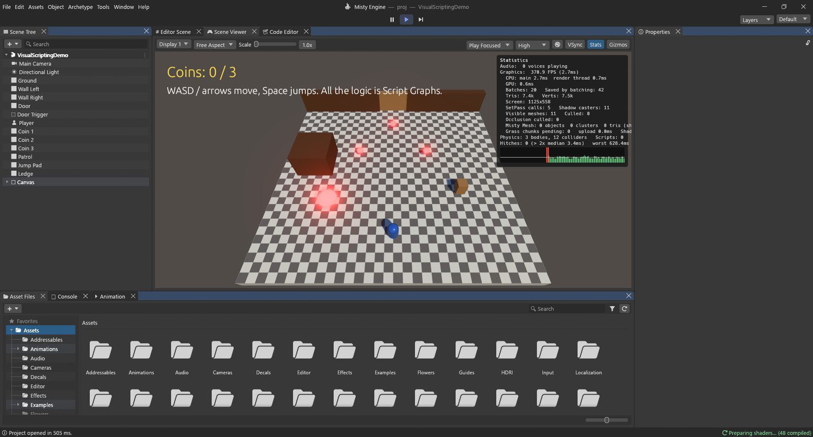
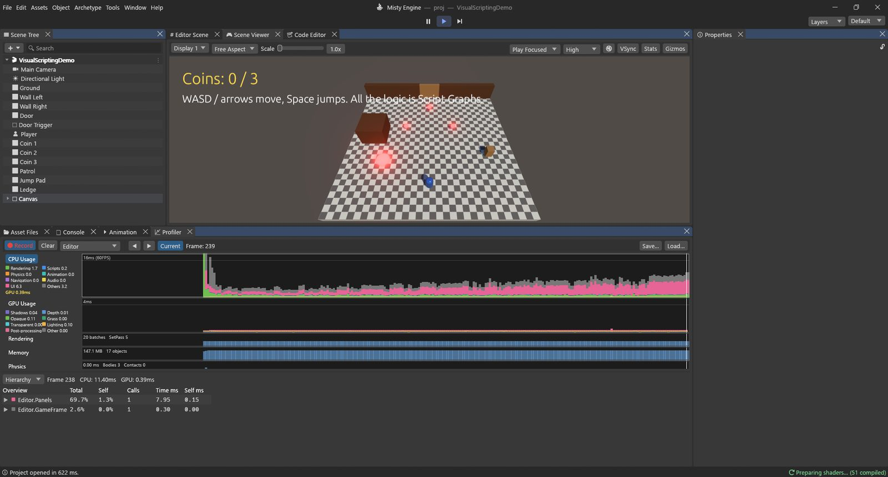
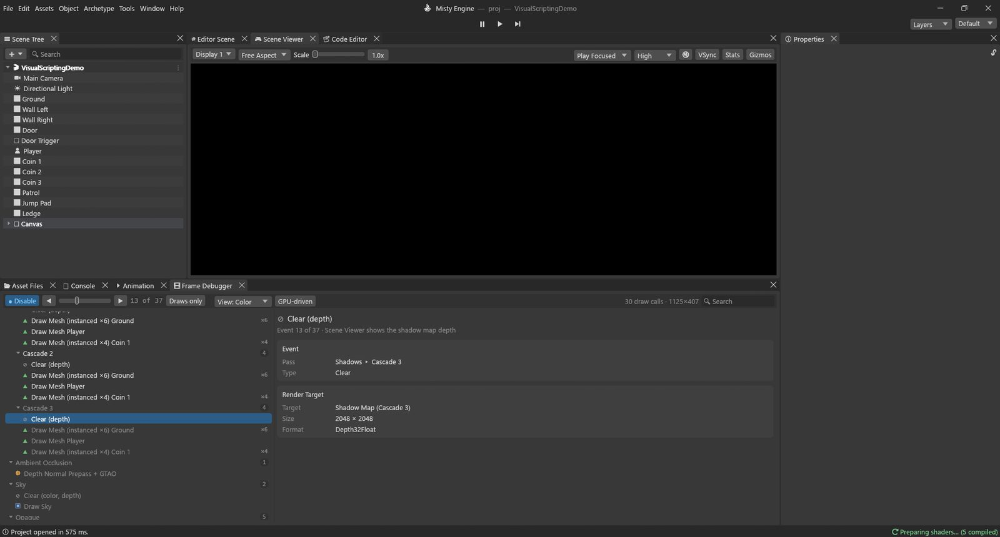

# البحث عن مصدر البطء

تبدو اللعبة سلسة حين يجهز كل إطار في وقته: نحو **16 ميلي ثانية** لستين إطارًا في الثانية، و**33** لثلاثين. وحين تتقطع اللعبة أو تتباطأ، يبقى السؤال واحدًا دائمًا: *ما الذي يستهلك الوقت؟* يقدّم Misty Engine أربع أدوات للإجابة:

| الأداة | مكانها | تجيب عن |
|---|---|---|
| مربع الإحصاءات | عارض المشهد ▸ **Stats** | ما سرعة اللعبة الآن؟ وكم يُرسم؟ |
| محلل الأداء | نافذة ▸ التحليل ▸ **محلل الأداء** (Ctrl+7) | أي جزء من الإطار يستهلك الوقت، المعالج أم بطاقة الرسوميات، وأي نظام؟ |
| مصحح الإطارات | نافذة ▸ التحليل ▸ **مصحح الإطارات** | ما الذي يُرسم بالضبط، وبأي ترتيب، وبأي مادة؟ |
| تقرير البناء | ملف ▸ ملفات تعريف البناء، بعد البناء | ما الذي يضخّم حجم اللعبة المبنية؟ |

ابدأ بمربع الإحصاءات، ثم انتقل إلى محلل الأداء لتجد المتسبب، واستعن بمصحح الإطارات حين يكون المتسبب هو الرسم.

## مربع الإحصاءات

انقر **Stats** في شريط عارض المشهد، فيظهر مربع في زاويته العلوية:

- **Graphics: FPS (ms)**: عدد الإطارات في الثانية وزمن الإطار الواحد.
- **CPU: main / render thread** و**GPU**: الزمن الذي استغرقه كل جانب. والأبطأ بين الثلاثة هو ما يحدد معدل إطاراتك.
- **Batches** (استدعاءات الرسم) و**Saved by batching** و**SetPass calls**: عدد المرات التي طُلب فيها من بطاقة الرسوميات أن ترسم، وعدد مرات تبديل المادة أو المظلل. كلما قلّ العدد زادت السرعة.
- **Tris / Verts**: عدد المثلثات والرؤوس المرسومة.
- **Shadow casters** و**Visible meshes / Culled** و**Occlusion culled**: كم رُسم في الظلال، وكم تُخطّي لأنه خارج الشاشة أو محجوب.
- **Misty Mesh**: الكائنات والعناقيد والمثلثات المرسومة عبر Misty Mesh.
- **Physics** (الأجسام والمصادمات) و**Scripts**.
- **Hitches**: الإطارات التي استغرقت أكثر من ضعف الزمن المعتاد، وأسوؤها. ويعرض الرسم الصغير تحته الإطارات الأخيرة، والتقطعات أعمدة حمراء.

> [!TIP]
> انظر إلى المعالج وبطاقة الرسوميات أولًا. إن كان زمن **GPU** هو الأكبر فأنت ترسم أكثر مما يجب (أو بكلفة عالية): راجع الظلال والجودة ودقة العرض. وإن كان زمن **CPU main** هو الأكبر فالسبب منطق اللعبة أو الفيزياء أو الحركة أو عدد الكائنات: افتح محلل الأداء.

## محلل الأداء

افتحه من **نافذة ▸ التحليل ▸ محلل الأداء** أو بالاختصار **Ctrl+7**. يبدأ التسجيل فور ظهوره، ويحتفظ بآخر 300 إطار. اضغط **تشغيل** لتحلل أداء لعبتك؛ فيقيس المحلل اللعبة أثناء عملها.

### أجزاؤه

- **شريط الأدوات:** **⏺ Record** (مفعّل افتراضيًا)، و**Clear**، والهدف (**Editor**، أو **Player** يعمل على جهاز آخر أو لعبة مبنية)، و**◀ ▶** للتنقل إطارًا إطارًا، و**Current** لمتابعة أحدث إطار، و**Load… / Save…** لحفظ التسجيل في ملف (`.mprof`) ومراجعته لاحقًا.
- **الوحدات**، لكل منها رسم بياني، وأحدث إطار على طرفه:
  - **CPU Usage**: زمن كل إطار مقسّمًا حسب النوع: Rendering وScripts وPhysics وAnimation وNavigation وAudio وUI وOthers، مع خط أصفر لبطاقة الرسوميات. وتدل الخطوط المرجعية على 16 ms (60 إطارًا) و33 ms (30) و66 ms (15). انقر لونًا في مفتاح الرسم لإخفائه.
  - **GPU Usage**: زمن بطاقة الرسوميات مقسّمًا حسب مجموعات المراحل: Shadows وDepth / Culling وOpaque وGrass & Trees وTransparent & Effects وLighting / GI / Volumes وPost-processing.
  - **Rendering** (الدفعات واستدعاءات SetPass)، و**Memory**، و**Physics**، و**Audio**، و**UI**: أرقامها الخاصة لكل إطار.
- **لوحة التفاصيل** في الأسفل تعرض الإطار المحدد للوحدة المحددة. **انقر أي رسم بياني أو اسحب عليه** لتختار إطارًا (يميّزه خط أبيض) وتلك الوحدة معًا.

### CPU Usage: عرض Hierarchy وعرض Timeline

حين تكون **CPU Usage** محددة، تتيح لوحة التفاصيل عرضين:

- **Hierarchy**: شجرة بكل ما فعله الإطار، مع **Total** و**Self** (نسبة من الإطار)، و**Calls**، و**Time ms**، و**Self ms**. يشمل *Total* ما استدعاه الصف، أما *Self* فهو الصف وحده. افتح الصفوف ذات الأرقام الأكبر لتصل إلى السبب.
- **Timeline**: شريط لكل خيط تنفيذ (الخيط الرئيسي، وعمل بطاقة الرسوميات لكل عملية تصيير، وخيوط الصوت والعمال)، والأعمال مرسومة أعمدةً على امتداد زمن الإطار. مرّر المؤشر فوق عمود لترى اسمه وزمنه. يبيّن هذا العرض *متى* تحدث الأشياء، وما الذي ينتظر ماذا.

صفوف ستصادفها كثيرًا: `Scripts.Update` و`ScriptGraphs.Update` (برامج Lua ومخططات البرامج النصية)، و`Physics.Step`، و`Animation.Update`، و`Navigation.Update`، و`UI.Events`. ويُقاس كل تابع من توابع Lua وحده باسم مثل `ScriptName.Update()`.

### GPU Usage

حين تكون **GPU Usage** محددة، تسرد التفاصيل كل عملية تصيير (عارض المشهد، ومشهد المحرر، وخرائط الظلال…) بمراحلها وزمن كل منها **GPU ms**، ثم المجموع لكل مجموعة. تصل أزمنة بطاقة الرسوميات متأخرة إطارًا أو اثنين، وبعض البطاقات لا تستطيع قياسها أصلًا، والمحلل يخبرك بذلك.

> [!PROGRAMMERS]
> تعلّم شيفرة المحرك أقسامها بالماكرو `profile_scope!("Name", Category::X)`، وكلفته قراءة ذرية واحدة حين لا يسجّل المحلل. للتسجيل من الإطار الأول: `MISTY_PROFILE=capture.jsonl`. وتتصل اللعبة المبنية بمحلل المحرر عبر `MISTY_PROFILER_CONNECT=127.0.0.1:54998` (أو `--profiler-connect`).

## مصحح الإطارات

يوقف مصحح الإطارات عارض المشهد على إطار واحد، ويتيح لك إعادة رسمه أمرًا أمرًا. افتحه من **نافذة ▸ التحليل ▸ مصحح الإطارات**.

1. اضغط **Enable**. يتوقف التشغيل مؤقتًا ويُلتقط الإطار. (يستأنف التشغيلُ عند الضغط على Disable أو إغلاق النافذة.)
2. تعرض القائمة كل أحداث الإطار مجمّعة حسب المرحلة: المسح (⊘)، والرسم (▲)، والرسم غير المباشر (◭)، ومراحل ملء الشاشة (▣)، والحوسبة (⚙)، والنسخ (⎘)، وواجهة المستخدم (▤).
3. انقر حدثًا، أو استخدم **◀ ▶** (أو مفاتيح الأسهم) والمنزلق: فيعرض عارض المشهد الإطار **مرسومًا حتى ذلك الحدث**، وتبهت الأحداث التي تليه.
4. يتخطى **Draws only** المسح والنسخ والحوسبة. ويعرض **View** بدلًا من الصورة: اللون، أو العمق، أو النواظم، أو الإضاءة العامة، أو الانبعاث.
5. يخبرك الجانب الآخر بكل شيء عن الحدث: مرحلته، وكائنه، وشبكته، ومادته، وعدد الرؤوس والفهارس، والنسخ، والمظلل، والارتباطات، وهدف التصيير، وحالة المزج والعمق والاستبعاد، والخامات، وخصائص المادة.

**لماذا تستخدمه:** لتعرف لماذا يُرسم شيء مرتين، أو لماذا يختفي كائن، أو أي الكائنات تلقي ظلالًا، أو لماذا عدد استدعاءات الرسم كبير إلى هذا الحد.

## محلل الذاكرة

تلتقط **نافذة ▸ التحليل ▸ محلل الذاكرة** لقطات لما يحتفظ به المحرر في الذاكرة: اضغط **⏺ Capture**. يعرض **Summary** ذاكرة بطاقة الرسوميات وذاكرة المعالج حسب الفئة (الخامات، والشبكات، وأهداف التصيير، والصوت، والبرامج النصية…)، ويسرد **Table** كل عنصر (رتّبه حسب Size)، ويرسمها **Tree Map** مربعات، ويبيّن **Compare** ما ازداد بين لقطتين.

## تقرير البناء

بعد البناء (**ملف ▸ ملفات تعريف البناء ▸ Build**) تعرض نافذة ملفات تعريف البناء **Build Report**: الحجم الكلي، وحجم البرنامج وحجم البيانات، ومدة البناء، ثم **By type** (الخامات، والشبكات، والصوت، والمشاهد…) و**Largest assets**. ويفتح زر **Open BuildReport.txt** التقرير الكامل المحفوظ بجوار اللعبة. استخدمه حين يكون حجم اللعبة أكبر من أن يُنزَّل بسهولة؛ فأكبر الأصول غالبًا خامات يمكنك تصغيرها من إعدادات استيرادها.

## مثال تطبيقي: مرحلة بطيئة

لنفترض أن مرحلتك تعمل بخمسة وعشرين إطارًا في الثانية وتبدو ثقيلة. إليك كيف تتعقب السبب.

**1. قِس.** اضغط تشغيل وفعّل **Stats**. يظهر مثلًا: *CPU main 12 ms، وGPU 38 ms*. الجانب البطيء هو بطاقة الرسوميات: اللعبة ترسم أكثر مما يجب.

**2. حدّد أي جزء من الرسم.** افتح **محلل الأداء** (Ctrl+7) وانقر رسم **GPU Usage**، ثم انقر إطارًا معتادًا. تعرض التفاصيل مراحل عارض المشهد، ومجموعة **Shadows** تأخذ مثلًا 20 ms من 38.

**3. اعرف السبب.** افتح **مصحح الإطارات**، واضغط **Enable**، وافتح مجموعة مرحلة الظلال. تتنقل بين أوامر الرسم فترى مئات الكائنات الصغيرة (حصى، وخصل عشب، وأغراض بعيدة) يُرسم كل منها في كل طبقة من طبقات الظلال. ويؤكد مربع الإحصاءات ذلك: *Shadow casters: 2,400*.

**4. أصلح.** عدة حلول، من الأبسط:

- في **إعدادات المشروع ▸ Quality** خفّض **Shadow Distance** (من 250 م إلى 120 م مثلًا)، أو قلّل **طبقات الظلال**. فالظلال البعيدة أعلى كلفة وأقل ظهورًا.
- أطفئ **Cast Shadows** في عارض الشبكة للأغراض الصغيرة؛ فلا أحد يلاحظ ظل حصاة.
- أعطِ الصخور والمباني الكثيفة الكبيرة **Misty Mesh**، والكائنات البعيدة **مجموعات مستويات التفاصيل** (انظر [الجودة والتصيير](03-quality-and-rendering.md)).

**5. تحقّق.** شغّل من جديد. صار زمن بطاقة الرسوميات مثلًا 19 ms واللعبة تعمل بخمسين إطارًا. قِس دائمًا بعد كل تغيير: فالإصلاح الذي لا تقيسه مجرد تخمين.

**وماذا لو كان المعالج هو البطيء؟** حدد **CPU Usage** في محلل الأداء وافتح **Hierarchy**. لنفترض أن `ScriptGraphs.Update` يستغرق 9 ms. افتحه: مخطط واحد موضوع على 500 قطعة نقدية يشغّل **GameObject: Find** في كل إطار ليبحث عن اللاعب. البحث عن كائن باسمه يمسح المشهد كله، وهنا 500 مرة في الإطار. الحل: ابحث عن اللاعب **مرة واحدة** في **On Start**، واحفظه في متغير، واستخدم المتغير في **On Update**. فينخفض الصف إلى أقل من ميلي ثانية.

> [!TIP]
> حلّل أداء اللعبة كما سيشغّلها اللاعبون: اللعبة المبنية (مع الهدف **Player** في محلل الأداء) تخلو أرقامها من عمل المحرر نفسه.
