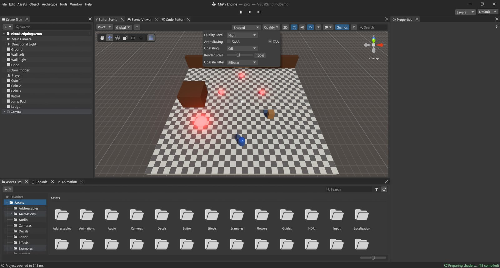
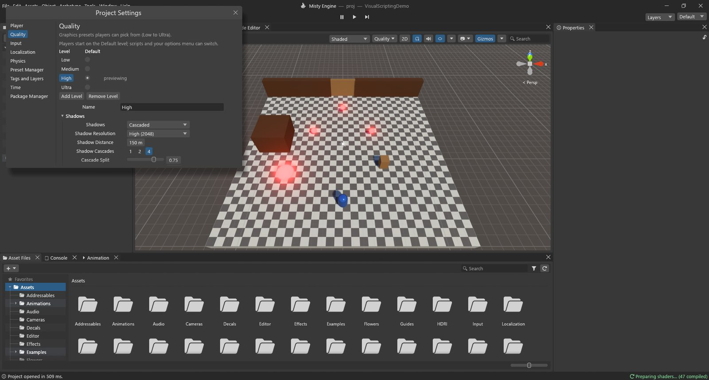

# الجودة والتصيير

كل لعبة مضطرة إلى الموازنة بين *جمال الصورة* و*السرعة*. ويضع Misty Engine هذه الخيارات في أماكن قليلة:

- **مستويات الجودة** (Low وMedium وHigh وUltra): لكل منها مجموعة إعدادات، في **تحرير ▸ إعدادات المشروع ▸ Quality**. يبدأ اللاعبون على المستوى الافتراضي، ويمكن لقائمة الخيارات في لعبتك أن تغيّره.
- قائمة **الجودة** في الشريط أعلى مشهد المحرر: طريقة سريعة لمعاينة مستوى وتغيير أبرز الإعدادات.
- أدوات لكل كائن: **مجموعات مستويات التفاصيل**، و**Misty Mesh**، و**استبعاد المحجوب**.
- الإضاءة: **Misty GI** (الضوء المرتد الحي)، وخرائط الإضاءة المجهزة مسبقًا، والمسابير.

## قائمة الجودة في مشهد المحرر

انقر **الجودة ⏷** في الشريط أعلى مشهد المحرر.

| الإعداد | وظيفته |
|---|---|
| Quality Level | يعاين مستوى في مشهد المحرر وعارض المشهد ووضع التشغيل، دون أن يغيّر المستوى الذي يبدأ عليه اللاعبون. |
| Anti-aliasing: FXAA | مرحلة رخيصة لتنعيم الحواف فوق أخذ العينات المتعدد 4x. |
| Anti-aliasing: TAA | تنعيم زمني: عشب وتفاصيل دقيقة ناعمة ومستقرة، بمزج عدة إطارات. |
| Upscaling | Off أو Quality (67%) أو Balanced (58%) أو Performance (50%) أو Custom: ارسم بكسلات أقل وأعد بناء صورة حادة من عدة إطارات. |
| Render Scale | ارسم الصورة ثلاثية الأبعاد بنسبة من 25% إلى 200% من حجم النافذة. ما دون 100% أسرع وأنعم. |
| Upscale Filter | طريقة تكبير الصورة الأصغر: Bilinear أو Nearest (بكسلات ظاهرة) أو Sharpen. |

> [!NOTE]
> باستثناء اختيار المستوى المعايَن، هذه هي **الإعدادات نفسها** الموجودة في صفحة Quality: ما تغيّره هنا يغيّر المستوى نفسه، لعارض المشهد وللعبة المبنية أيضًا. أما بقية أزرار ذلك الشريط (التأثيرات، والإضاءة، والأدوات المرئية، ونمط الرسم) فلا تغيّر إلا مشهد المحرر.

## إعدادات المشروع ▸ Quality

افتح **تحرير ▸ إعدادات المشروع** واختر **Quality**.

في الأعلى قائمة المستويات. انقر اسم مستوى لتحريره (ويُعايَن في الوقت نفسه)، ويحدد زر **Default** المستوى الذي يبدأ عليه اللاعبون الجدد (High في البداية). ينسخ **Add Level** المستوى الحالي، ويحذفه **Remove Level**، و**Name** هو ما تعرضه قائمة الخيارات في لعبتك.

الإعدادات موزعة على أربع مجموعات.

### Shadows (الظلال)

| الإعداد | وظيفته | متى تغيّره |
|---|---|---|
| Shadows | **Cascaded** (خرائط ظلال تغطي مساحة أكبر كلما ابتعدت) أو **Virtual** (خريطة ظلال افتراضية ضخمة لا يُرسم منها إلا الأجزاء المرئية). | تعطي Virtual ظلالًا حادة في كل مكان في العوالم الكبيرة، على حساب الذاكرة (**Shadow Page Pool**). |
| Shadow Resolution | من Low (512) إلى Very High (4096). | خفّضها أولًا على الأجهزة الضعيفة. |
| Shadow Distance | المسافة التي تُرسم حتى نهايتها الظلال (40 م في Low حتى 250 م في Ultra). | أكبر كلفة في الظلال. خفّضها حين يُظهر محلل الأداء أن Shadows مرتفعة. |
| Shadow Cascades | شريحة أو اثنتان أو أربع؛ ويشكّلها **Cascade Split** و**Cascade Blend**. | طبقات أكثر = ظلال قريبة أحدّ وأوامر رسم أكثر. |
| Soft Shadows | Off وLow وMedium وHigh. وينعّمها **Temporal Shadows** و**Shadow Denoise** عبر الإطارات. | أطفئها على الأجهزة المتواضعة. |

### Rendering (التصيير)

| الإعداد | وظيفته |
|---|---|
| Anti-Aliasing | أخذ العينات المتعدد (2x أو 4x). |
| FXAA وTemporal Anti-aliasing | كما في قائمة الجودة. ويضبط **TAA Blend** و**TAA Sharpness** التنعيم الزمني. |
| Upscaling وUpscaling Scale وUpscaler | ارسم بكسلات أقل وأعد بناء الصورة (بأداة Misty Temporal). |
| Render Scale وUpscale Filter | كما في قائمة الجودة. |
| LOD Bias | ما فوق 1 يُبقي مستويات التفاصيل الدقيقة لمسافة أبعد (أجمل وأبطأ)، وما دونه ينتقل إلى المستويات الأبسط أبكر. ويحرّك أيضًا مسافات مستويات تفاصيل الأشجار ولوحاتها. |
| Misty Mesh | يرسم نماذج Misty Mesh عناقيدَ (انظر أدناه). معطّل افتراضيًا. |
| Misty Mesh Error | عدد بكسلات الخطأ المسموح بها للعنقود قبل استخدام عنقود أدق. الأقل = تفاصيل أكثر. |

### Textures (الخامات)

| الإعداد | وظيفته |
|---|---|
| Texture Quality | دقة كاملة، أو النصف، أو الربع، أو الثُمن لكل الخامات. يوفّر ذاكرة الرسوميات. |
| Anisotropic Textures | خامات أوضح حين تُرى بزاوية مائلة (الأرضيات والطرق): Disabled أو Per Texture أو Forced On. |
| Max Texture Size | أكبر حجم خامة يُحمَّل (1024 في Low حتى 8192 في Ultra). |

### Effects (التأثيرات)

| الإعداد | وظيفته |
|---|---|
| Ambient Occlusion | ظلال تلامس ناعمة في الزوايا والثنيات (من Off إلى High). |
| Global Illumination | أعلى جودة يسمح بها هذا المستوى لـ Misty GI (وOff يعطّله). |
| Volumetric Fog | ضباب يلتقط الضوء والظل (من Off إلى High). |
| Sharp Sun Shafts | أشعة شمس حادة عبر الضباب. |
| Volumetric Clouds | جودة السحب. |
| Reflection Probes | دقة مسابير الانعكاس (Off يعني انعكاس السماء وحدها). |
| Lens Flares | توهجات العدسة حول الأضواء الساطعة. |
| Grass Shadows | المسافة التي يلقي العشب حتى نهايتها ظلالًا (Off و12 م و20 م و32 م). |
| Grass Ground Cover | طبقة إضافية من العشب القصير. |

### كيف تختار اللعبة مستواها

يبدأ اللاعبون الجدد على المستوى **الافتراضي**. ويمكن لملف تعريف البناء أن يختار مستوى بداية آخر (**Quality Level** في ملف ▸ ملفات تعريف البناء). وتغيّره قائمة الخيارات في لعبتك أثناء اللعب، ويُحفظ الاختيار للمرة التالية.

> [!PROGRAMMERS]
> في Lua: `QualitySettings.GetQualityLevel()` (يبدأ العد من الصفر)، و`QualitySettings.SetQualityLevel(i)`، و`QualitySettings.names`. ويُخزَّن الاختيار في مفتاح PlayerPrefs المسمى `Misty.QualityLevel`.

## مستويات التفاصيل (LOD)

**ما هي:** الكائن البعيد لا يغطي إلا بضع بكسلات، فرسم كل مثلثاته هدر. تستبدل **مجموعة مستويات التفاصيل** بالكائن نسخًا أبسط كلما صغر على الشاشة، وتخفيه حين يصير ضئيلًا.

**كيف:**

1. حدد الكائن ثم **إضافة نمط ▸ التصيير ▸ مجموعة مستويات التفاصيل**.
2. يعرض الشريط الملوّن المستويات: من *LOD 0* (التفاصيل الكاملة) حتى *Culled*. اسحب الفواصل لتحدد متى يبدأ كل مستوى، نسبةً من ارتفاع الشاشة (60% و30% و10% افتراضيًا). ويبيّن مؤشر **📷** حجم الكائن الآن من كاميرا مشهد المحرر.
3. ضع الشبكات الأبسط في المستويات: يستخدم **Fill from Children** الابن 0 للمستوى LOD 0، والابن 1 للمستوى LOD 1، وهكذا؛ أو استخدم **Add Renderer…** لكل مستوى.
4. يمزج **Fade Mode ▸ Cross Fade** بين المستويات بدل القفز المفاجئ (ويحدد **Fade Width** مدة المزج).

**مستويات تلقائية:** حدد نموذجًا في ملفات الأصول وفعّل **Generate LODs** في إعدادات استيراده. يصنع المحرك نسخًا أبسط (50% و20% من المثلثات افتراضيًا) ويضيف لك مجموعة مستويات التفاصيل.

**متى تستخدمها:** لكل ما يتكرر كثيرًا أو يظهر بعيدًا: الأشجار، والصخور، والأغراض، والمباني. ويحرّك **LOD Bias** في مستوى الجودة كل نقاط الانتقال دفعة واحدة.

## استبعاد المحجوب (Occlusion Culling)

**ما هو:** الكائنات المختبئة خلف جدار تستهلك الوقت إن رُسمت. يحسب استبعاد المحجوب مسبقًا ما يمكن رؤيته من كل مكان، ويتخطى الباقي.

**كيف** (**نافذة ▸ التصيير ▸ استبعاد المحجوب**):

1. لسان **Object**: حدد الأشياء الكبيرة التي تحجب غيرها (الجدران، والمباني، والتضاريس) وفعّل **Occluder Static**؛ وحدد الأشياء التي يمكن أن تُحجب وفعّل **Occludee Static**. والخياران موجودان أيضًا في قائمة **ثابت** في لوحة الخصائص.
2. لسان **Bake**: **أصغر حاجب** (5 م افتراضيًا) هو حجم الخلايا التي تتحرك الكاميرا خلالها، و**أصغر ثقب** (0.25 م) هو أضيق فتحة يمكن الرؤية من خلالها. احفظ المشهد، ثم اضغط **Bake**.
3. لسان **Visualization**: يعرض خلية الكاميرا، ويخفي في مشهد المحرر الكائنات المستبعدة من موضع الكاميرا.

يجب أن يكون إعداد **استبعاد المحجوب** في الكاميرا مفعّلًا (وهو كذلك افتراضيًا). ويخفي **Dynamic Occlusion** أيضًا الكائنات المتحركة خلف الجدران المجهزة، على بطاقة الرسوميات.

**متى تستخدمه:** المراحل الداخلية، والمدن، وكل ما فيه جدران كثيرة. أما في حقل مفتوح فقلّما يفيد: لا شيء يحجب شيئًا.

## Misty Mesh

**ما هو:** يقطّع Misty Mesh النموذج الكثيف إلى عناقيد صغيرة من المثلثات بعدة مستويات من التفاصيل. وفي كل إطار يختار، عنقودًا عنقودًا، أخشن نسخة تبدو صحيحة على الشاشة. فتحصل على صخور ومبانٍ كثيفة التفاصيل دون صنع مستويات التفاصيل يدويًا.

**كيف:**

- حدد الكائنات واختر **كائن ▸ تمكين Misty Mesh** (موجود أيضًا في قائمة النقر بالزر الأيمن في شجرة المشهد وفي بطاقة Mesh Filter)، أو
- **أدوات ▸ التصيير ▸ Convert Scene to Misty Mesh...** لكل شبكة كثيفة في المشهد (بدءًا من **Min. triangles**، وهو 5000 افتراضيًا). يسرد ما تخطاه وسبب ذلك، ويمكنه تفعيل **Quality ▸ Misty Mesh** للمستويين High وUltra.
- ثم تأكد أن **Misty Mesh** مفعّل في مستوى الجودة. فإن كان معطّلًا، رُسمت تلك النماذج شبكاتٍ عادية.

**متى تستخدمه:** الأجسام الكثيفة الصلبة الساكنة: الصخور، والمنحدرات، والتماثيل، والمباني. لا للشخصيات (المكسوّة بهيكل عظمي)، ولا للأشياء الشفافة أو المقصوصة بقناع ألفا كأوراق الشجر.

**تحقّق منه:** في قائمة نمط الرسم في مشهد المحرر عروض **Misty Mesh Clusters** و**Levels** و**Overdraw** و**Materials**، ويعدّ مربع الإحصاءات عناقيده ومثلثاته.

## Misty GI

**ما هو:** الضوء يرتد. يصيب ضوء الشمس جدارًا أحمر فتحمرّ الأرض بجانبه قليلًا، وتُضاء غرفة ذات نافذة صغيرة بنعومة في كل أرجائها. يحسب **Misty GI** هذا الضوء المرتد وحجب السماء والانعكاسات الناعمة حيًّا، فيتبع الأضواء والكائنات المتحركة دون أي تجهيز مسبق.

**كيف:**

- **نافذة ▸ التصيير ▸ الإضاءة ▸** لسان **المشهد ▸ Realtime Lighting**: فعّل **Realtime Global Illumination** للمشهد.
- في **وحدة المعالجة اللاحقة** قسم **Misty Global Illumination** لضبطه في منطقة معينة: **Intensity** و**Quality**.
- يحدد **Global Illumination** في مستوى الجودة أعلى جودة مسموحة (وOff يعطّله على الأجهزة الضعيفة).

**متى تستخدمه:** المشاهد التي تتغير إضاءتها: دورة ليل ونهار، أو أبواب تُفتح، أو أضواء تتحرك. كلفته بضع ميلي ثوانٍ من زمن بطاقة الرسوميات. أما الإضاءة التي لا تتغير أبدًا، فإن **خرائط الإضاءة المجهزة مسبقًا** (نافذة الإضاءة ▸ **Generate Lighting**) لا تكلّف شيئًا يُذكر أثناء اللعب، و**مسابير الضوء** تنقل الضوء المجهز إلى الكائنات المتحركة.

> [!TIP]
> لا تعرف أي الإعدادات أعلى كلفة؟ غيّر إعدادًا واحدًا ثم انظر إلى **GPU Usage** في محلل الأداء: تبيّن المجموعات (Shadows وLighting / GI / Volumes وPost-processing…) أين ذهب الوقت.
