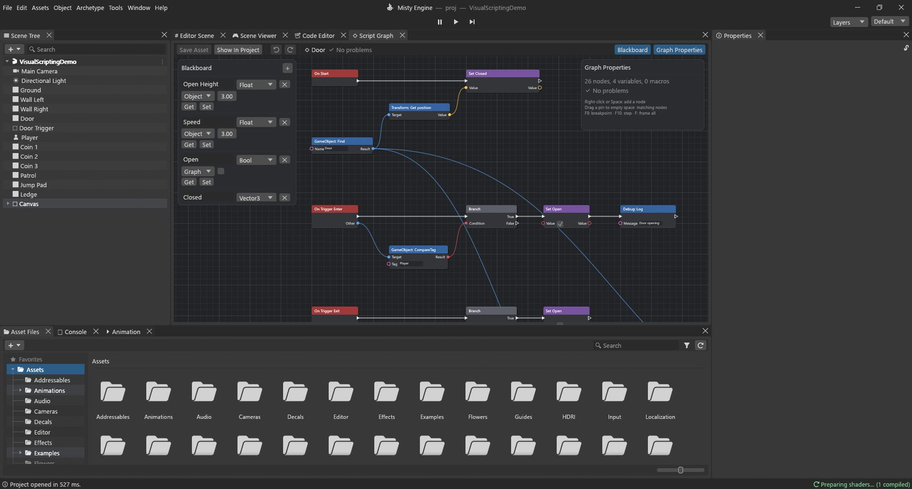

# مخططات البرامج النصية: الأساسيات

**مخطط البرنامج النصي** (Script Graph) منطقٌ للعبة تبنيه بوصل صناديق بدل كتابة الشيفرة. كل صندوق **عقدة** تؤدي مهمة صغيرة واحدة: «عندما تبدأ اللعبة»، «اقرأ المفتاح W»، «اجمع عددين»، «حرّك هذا الكائن». تصل العقد بأسلاك، والأسلاك تحدد ما يحدث وبأي ترتيب.

إن سبق لك أن اتبعت وصفة طبخ فأنت تعرف الفكرة: *عندما* يسخن الفرن (حدث)، *خذ* 200 غرام من الدقيق (قيمة)، *اخلطها* مع البيض (فعل)، *وإذا* كانت العجينة لزجة *فأضف* دقيقًا (قرار).



## أنشئ مخططًا وضعه على كائن

1. في **ملفات الأصول** انقر **➕ ▸ مخطط برنامج نصي** (أو انقر بالزر الأيمن على مساحة فارغة ▸ إنشاء). يبدأ المخطط الجديد بحدثين: **On Start** و**On Update**.
2. انقر عليه نقرًا مزدوجًا ليُفتح في نافذة **مخطط البرنامج النصي**.
3. ضعه على كائن: حدد الكائن، ثم **إضافة نمط ▸ البرامج النصية** واختر المخطط، أو اسحب المخطط من ملفات الأصول وأفلته على الكائن في شجرة المشهد.
4. تعرض لوحة الخصائص الآن بطاقة باسم *اسم المخطط (Script Graph)*. حقولها هي **متغيرات الكائن** في المخطط (نشرحها أدناه)، فيكون لكل كائن قيمه الخاصة.
5. يحفظ **Ctrl+S** (أو **Save Asset**) المخطط. وللنافذة تراجع وإعادة خاصّان بها (**Ctrl+Z / Ctrl+Y**).

## النافذة

- **لوحة الرسم** في الوسط تضم العقد. مرّر العجلة للتكبير، واسحب بزر الفأرة الأوسط (أو **Alt+سحب**) للتنقل، واضغط **F** لرؤية كل شيء.
- **السبورة** (Blackboard) على جانب تسرد **متغيرات** المخطط: الاسم، والنوع، والنطاق، والقيمة الابتدائية، مع زرّي **Get** و**Set** اللذين يضيفان العقدة المناسبة.
- **مفتش المخطط** (Graph Inspector) على الجانب الآخر يعرض إعدادات العقدة المحددة (أي متغير تستخدم، واسم الحدث، وعدد مخارج Sequence…) ويسرد كل مشكلة في المخطط.

**إضافة العقد:** انقر بالزر الأيمن على لوحة الرسم أو اضغط **Space**. يسرد البحث العقد حسب الفئة (Events وFlow وVariables وMath وLogic وComparison وConstants وString وRandom وList وEngine وLua وSubgraphs). اكتب لتصفية النتائج، واستخدم الأسهم و**Enter** للاختيار.

> [!TIP]
> اسحب سلكًا من منفذ وأفلته على مساحة فارغة: يُفتح البحث مقتصرًا على العقد التي تناسب ذلك المنفذ، وتأتي العقدة الجديدة موصولة. هذه أسرع طريقة للبناء.

## الأسلاك: التدفق والبيانات

هناك نوعان من الأسلاك، والتمييز بينهما مفتاح قراءة أي مخطط.

- **الأسلاك البيضاء تحمل التدفق**، أي «افعل هذا، ثم ذاك». تبدأ من **حدث** وتسير من عقدة إلى أخرى عبر العقد التي *تفعل* شيئًا. والعقدة ذات المنافذ البيضاء لا تعمل إلا حين يصلها التدفق.
- **الأسلاك الملونة تحمل البيانات**: عددًا، أو موضعًا، أو صحيحًا أو خطأ، أو كائنًا. لكل منفذ بيانات **نوع**، ولا تتصل إلا الأنواع المتوافقة.

| النوع | يحمل | مثال |
|---|---|---|
| Float | عددًا بفاصلة عشرية | 5.0 (سرعة)، 0.016 (زمن إطار) |
| Int | عددًا صحيحًا | 3 (أرواح)، 120 (نقاط) |
| Bool | صحيحًا أو خطأ | «هل الباب مفتوح؟» |
| String | نصًا | "Player"، "Score: 10" |
| Vector3 | ثلاثة أعداد X وY وZ | موضع، أو اتجاه، أو دوران بالدرجات |
| Quaternion | دورانًا | ناتج Look Rotation |
| GameObject | كائنًا من المشهد | اللاعب، الباب |
| List | عدة قيم | Make List |
| Any | أي قيمة تصله | Select، وDebug: Log |

بعض الأنواع تتحول من تلقاء نفسها: يدخل Int في منفذ Float، ويدخل أي شيء في منفذ String (فيصير نصًا)، ويناسب Any كل الأنواع. وإن رُفض سلك، يخبرك أسفل لوحة الرسم بالسبب.

**المداخل غير الموصولة** فيها حقل صغير تكتب فيه القيمة. والمدخل **Target** غير الموصول (الكائن الذي تعمل عليه عقدة المحرك) يعني *الكائن الذي يحمل هذا المخطط*.

**الوصل:** اسحب من منفذ إلى آخر. وانقر بالزر الأيمن (أو **Alt+نقر**) على منفذ لإزالة أسلاكه.

## ثلاثة أنواع من العقد

- **الأحداث** تبدأ التدفق. لها مخرج أبيض وليس لها مدخل أبيض: **On Start** (مرة واحدة حين يبدأ الكائن)، و**On Update** (في كل إطار، ومخرجه **Delta Time** هو الزمن منذ الإطار السابق)، و**On Fixed Update** (في كل خطوة فيزياء)، و**On Trigger Enter / Exit** و**On Collision Enter / Exit** (مع الكائن **Other**)، و**On Input Action**، و**On Timer**، و**Custom Event**، و**On Enable / On Disable**، و**On Destroy**.
- **عقد الأفعال** لها منافذ بيضاء و*تفعل* شيئًا: **Set** لمتغير، و**Transform: Rotate**، و**Debug: Log**، و**CharacterController: Move**.
- **عقد القيم** بلا منافذ بيضاء، وتكتفي بالحساب: **Add**، و**Multiply**، و**Make Vector3**، و**Input: GetKey**، و**Get** لمتغير. وتعمل حين تعمل عقدة فعلٍ تحتاج ناتجها، وحينها فقط.

## المتغيرات

المتغير صندوق له اسم يحتفظ بقيمة بين الإطارات: النقاط، أو السرعة، أو «هل الباب مفتوح». أنشئه في السبورة بالزر **+**، وأعطه اسمًا ونوعًا وقيمة ابتدائية.

- متغيرات **Graph** خاصة بهذا المخطط على هذا الكائن، لا يراها غيره.
- متغيرات **Object** تعيش على الكائن نفسه. تظهر حقولًا في **الخصائص**، فيمكن لبابين أن يستخدما المخطط نفسه بقيم مختلفة. وتستطيع مخططات الكائن الأخرى وبرامج Lua النصية قراءتها أيضًا، وتصل إليها الكائنات الأخرى بعقدتي **Get / Set Object Variable**.

استخدم **Get *الاسم*** لقراءة المتغير و**Set *الاسم*** لتغييره. ولعقدة Set منفذ أبيض لأن تغيير شيء ما فعلٌ.

## عقد التدفق: اتخاذ القرارات والتكرار

| العقدة | وظيفتها |
|---|---|
| Branch | يخرج التدفق من **True** أو **False** بحسب **Condition**. هي «إذا» في المخططات. |
| Sequence | يشغّل **Then 0** ثم **Then 1** ثم **Then 2**… بالترتيب. تُبقي المخططات الكبيرة مرتبة. |
| For Loop | يشغّل **Loop Body** مرة لكل **Index** من **First** إلى **Last**، ثم **Completed**. |
| For Each | يشغّل **Loop Body** لكل **Item** في قائمة. |
| While | يكرر **Loop Body** ما دام **Condition** صحيحًا (ويتوقف بعد **Max Iterations**). |
| Do Once | يسمح بمرور التدفق في المرة الأولى فقط (حتى **Reset**). |
| Gate | باب للتدفق: لا يمر **Enter** إلا وهو مفتوح (**Open** و**Close** و**Toggle**). |
| Flip Flop | يخرج من **A**، ثم **B**، ثم **A**… في كل مرة يعمل فيها. |
| Delay | ينتظر **Duration** ثانية، ثم يكمل من **Completed**. |

## عقد المحرك

معظم المحرك متاح عقدًا، تُسمّى *المالك: العضو*: **Transform: Get position**، و**Transform: Set position**، و**Input: GetKey**، و**Physics: Raycast**، و**Animator: SetFloat**، و**PlayerPrefs: Save**، و**Time: Get deltaTime**… تجدها في فئة **Engine** في البحث، وكتابة اسم العضو توصلك إليها بسرعة. ولعقد أجزاء الكائن (Transform وRigidbody وAnimator وCharacter Controller…) مدخل **Target**.

## مخططك الأول: مكعب يدور

لنجعل مكعبًا يدور، فنرى كل ما سبق عمليًا.

1. أنشئ مكعبًا (**كائن ▸ 3D Object ▸ Cube**) ومخطط برنامج نصي باسم *Spin*، وضع المخطط على المكعب.
2. افتح المخطط. أبقِ **On Update** واحذف **On Start** (حدده ثم **Delete**).
3. أضف **Transform: Rotate** (ابحث عن «Rotate»). صِل المخرج الأبيض **Out** من **On Update** بمدخله **In**.
4. نريد 90 درجة في الثانية حول المحور العمودي. أضف **Make Vector3** وصِل مخرجه **Vector** بالمدخل **Euler Degrees**.
5. أضف **Multiply** (Math ▸ Float). اكتب **90** في **A**، وصِل **Delta Time** من **On Update** بالمدخل **B**. ثم صِل **Result** بالمدخل **Y** في Make Vector3.
6. احفظ واضغط تشغيل. المكعب يدور.

لماذا نضرب في Delta Time؟ لأن On Update يعمل في كل إطار، والإطارات لا تستغرق كلها الزمن نفسه. فالدوران بمقدار *90 × زمن الإطار* في كل إطار يبلغ مجموعه 90 درجة بالضبط كل ثانية، على جهاز سريع أو بطيء. سترى هذا النمط في كل دليل تطبيقي.

> [!PROGRAMMERS]
> المخطط السابق يعادل شيفرة Lua هذه:
> ```lua
> function Update()
>     transform:Rotate(Vector3.new(0, 90 * Time.deltaTime, 0))
> end
> ```
> لكن المخططات لا تُحوَّل إلى Lua. فحين يبدأ التشغيل، يُفحص كل مخطط من حيث الأنواع ويُترجم إلى شيفرة بايت مدمجة: قائمة مسطّحة من العمليات على ملف سجلات لكل نسخة. وعقد القيم كسولة: تُسطَّح داخل عمليات الفعل الذي يقرؤها، وتُحسب مرة واحدة في كل تشغيل له. وتعمل العمليات الحسابية الشائعة عمليات أعداد عشرية مباشرة؛ فمخطط من 100 عقدة على 1000 كائن يكلّف نحو 1 ms في الإطار. والمنافذ محددة الأنواع (يتسع Int إلى Float، وكل شيء إلى String، وAny يناسب الجميع)، وتُرفض أسلاك البيانات التي تشكّل حلقة. وتُضمَّن المخططات الفرعية والماكروهات وقت الترجمة، فلا تكلّف شيئًا أثناء اللعب.

## التواصل مع الكائنات الأخرى ومع Lua

- يشغّل **Send Custom Event** عقد **Custom Event** التي تحمل الاسم نفسه في مخططات الكائن **Target** (ويستدعي دالة Lua بالاسم نفسه في برامجه النصية)، مع وسائط. ويفعل **Broadcast Custom Event** ذلك لكل الكائنات.
- يستدعي **Call Lua Function** دالة من برنامج Lua نصي على الكائن Target ويعطيك **Result**. ويقرأ **Get Lua Field** حقلًا من قيمة Lua.
- ومن Lua: يصل `gameObject:SendCustomEvent(name, ...)` إلى المخططات، ويقرأ `gameObject:GetVariable(name)` و`SetVariable(name, value)` متغيرات الكائن ويكتبانها.

## إبقاء المخططات مرتبة

- يجمع **Ctrl+G** العقد المحددة في إطار له عنوان، وانقر بالزر الأيمن على لوحة الرسم لإضافة **ملاحظات لاصقة**.
- حدد بعض العقد ثم انقر بالزر الأيمن ▸ **Collapse To Macro** لتحويلها إلى عقدة واحدة. وانقر عليها نقرًا مزدوجًا لتحرير ما بداخلها.
- **المخطط الفرعي** (Subgraph) مخطط يُستخدم عقدةً داخل مخططات أخرى: أعطه عقدة **Graph Input** وعقدة **Graph Output**.

## العثور على الأخطاء

- تحمل العقدة التي فيها مشكلة شارة حمراء **!** مع رسالة (متغير مفقود، أو سلك لا تتوافق أنواعه…). ويعرض شريط الأدوات أول مشكلة، ويسرد مفتش المخطط جميعها.
- أثناء التشغيل **تتوهج** الأسلاك التي حملت التدفق للتو، ويعرض تمرير المؤشر فوق منفذ آخر قيمة مرت به. وتعرض السبورة القيم الحية للمتغيرات.
- يضع **F9** **نقطة توقف** على عقدة: يتوقف التشغيل مؤقتًا قبل أن تعمل مباشرة. ويشغّل **F10** (**Step**) تلك العقدة ويتوقف عند التالية، ويكمل **Continue** التنفيذ.
- تذهب الأخطاء أثناء التشغيل إلى وحدة التحكم، مع أسماء الكائن والمخطط والعقدة.

## الاختصارات

| المفاتيح | الوظيفة |
|---|---|
| النقر بالزر الأيمن، Space | البحث عن العقد |
| Delete، Ctrl+D | الحذف، التكرار |
| Ctrl+C / X / V | النسخ، القص، اللصق (حتى بين المخططات) |
| Ctrl+G | التجميع |
| F | تأطير الكل |
| Ctrl+Z / Ctrl+Y | التراجع / الإعادة |
| Ctrl+S | الحفظ |
| F9، F10 | نقطة توقف، خطوة |

هل أنت مستعد؟ تبني الفصول الأربعة التالية ميزات حقيقية في الألعاب، عقدةً عقدة.
