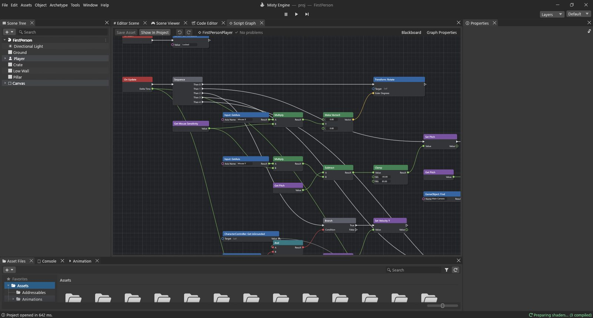

# دليل تطبيقي: لاعب بمنظور الشخص الأول

تبني في هذا الدليل أدوات التحكم المعتادة في ألعاب منظور الشخص الأول: **W A S D** للمشي، و**الفأرة** للنظر حولك، و**Space** للقفز، مع كاميرا بمستوى العين. كل ذلك مخطط برنامج نصي واحد من نحو خمسين عقدة، نبنيه في سبع خطوات صغيرة.

**المثال:** المشهد `Assets/Guides/FirstPerson/FirstPerson.scene` ومخططه `FirstPersonPlayer.vgraph`. افتحه واضغط تشغيل وتجوّل.



## التجهيز

اللاعب كائن واحد له كاميرا ابنة:

- **Player**: وسمه *Player*، وعليه نمط **متحكم الشخصية** (الارتفاع 1.8، ونصف القطر 0.35، والمركز Y = 0.9: أي أن الكبسولة تقف على أصل الكائن)، ومخطط البرنامج النصي، وشبكة كبسولة تمثل جسمه.
- **Main Camera**: ابن للكائن Player على ارتفاع **Y = 1.6** (مستوى العين)، وعليه نمط **الكاميرا**.

لماذا متحكم الشخصية؟ لأنه يحرّك كبسولة في العالم، فتنزلق على امتداد الجدران وتصعد الدرجات الصغيرة، ويخبرك هل تقف على الأرض. أنت تعطيه الحركة التي تريدها، وهو يتولى التصادم.

ولماذا الكاميرا ابن؟ لأن الأبناء يتبعون آباءهم. فحين يستدير الجسم يسارًا، تستدير الكاميرا معه. ولا يخص الكاميرا وحدها إلا النظر إلى الأعلى والأسفل.

## المتغيرات

في السبورة:

| الاسم | النوع | النطاق | البداية | الاستخدام |
|---|---|---|---|---|
| Walk Speed | Float | Object | 5 | متر في الثانية |
| Jump Speed | Float | Object | 5 | السرعة إلى الأعلى عند القفز |
| Mouse Sensitivity | Float | Object | 2 | سرعة استجابة الدوران للفأرة |
| Gravity | Float | Graph | -15 | مدى تسارع السقوط |
| Velocity Y | Float | Graph | 0 | السرعة الحالية صعودًا أو هبوطًا |
| Pitch | Float | Graph | 0 | مقدار نظر الكاميرا إلى الأعلى أو الأسفل، بالدرجات |

المتغيرات الثلاثة الأولى من نوع **Object**، فيمكنك ضبطها في لوحة الخصائص لكل لاعب على حدة.

## الخطوة 1: قفل مؤشر الفأرة

**On Start ▸ Cursor: Set lockState** مع **Value** = `Locked`.

- يعمل **On Start** مرة واحدة حين تبدأ اللعبة.
- يخفي **Cursor: Set lockState** مؤشر الفأرة ويبقيه داخل النافذة، فتحريك الفأرة يدير المنظر بدل أن يغادر النافذة. والقيمة `None` تحرره من جديد، و`Confined` تبقيه داخل النافذة ظاهرًا.

*ومفيد أيضًا في:* تحرير المؤشر حين تُفتح قائمة الإيقاف المؤقت (`None`) وقفله من جديد عند إغلاقها.

## الخطوة 2: حدث واحد وخمس مهام بالترتيب

**On Update ▸ Sequence** (اضبط عدد مخارجها على **5** في مفتش المخطط).

- يعمل **On Update** في كل إطار. ومخرجه **Delta Time** هو الزمن منذ الإطار السابق بالثواني (نحو 0.016 عند ستين إطارًا في الثانية).
- يشغّل **Sequence** المخارج **Then 0** و**Then 1** … **Then 4** واحدًا تلو الآخر. نخصص مخرجًا لكل مهمة: الاستدارة، والإمالة، والقفز، والجاذبية، والحركة. لا تفعل العقدة شيئًا بنفسها، لكنها تُبقي المخطط مقروءًا.

*ومفيد أيضًا في:* أي حدث عليه أداء عدة أمور لا علاقة بينها.

## الخطوة 3: النظر يمينًا ويسارًا (استدارة الجسم)

```
Input: GetAxis ("Mouse X") ─► Multiply ◄─ Get Mouse Sensitivity
                                │
                     Make Vector3 (Y) ─► Transform: Rotate ◄── Then 0
```

- يعطي **Input: GetAxis** مع **Axis Name** = `Mouse X` مقدار حركة الفأرة أفقيًا في هذا الإطار (نحو 0.1 لكل بكسل، واليمين موجب). والمحاور مضبوطة في إعدادات المشروع ▸ Input: `Horizontal` و`Vertical` (A/D وW/S، أو عصا التحكم) و`Mouse X` و`Mouse Y`.
- يضرب **Multiply** (Math ▸ Float) المدخل **A** في **B**: حركة الفأرة في الحساسية.
- يبني **Make Vector3** قيمة من X وY وZ. لا نملأ إلا **Y**: الدوران حول المحور العمودي.
- يدير **Transform: Rotate** الكائن **Target** بمقدار **Euler Degrees**. ولأن Target غير موصول، فإنه يدير الكائن Player نفسه.

*ومفيد أيضًا في:* Rotate هي طريقتك لتدوير القطع النقدية والمراوح والأبراج. وMake Vector3 هي طريقتك لبناء أي موضع أو اتجاه أو دوران من أعداد منفصلة.

## الخطوة 4: النظر إلى الأعلى والأسفل (إمالة الكاميرا)

```
Get Pitch ─► Subtract ◄─ Multiply ◄─ Input: GetAxis ("Mouse Y"), Get Mouse Sensitivity
               │
            Clamp (-85, 85) ─► Set Pitch ◄── Then 1
                                   │
GameObject: Find ("Main Camera") ─► Transform: Set localEulerAngles ◄─ Make Vector3 (X ◄ Get Pitch)
```

- يعطي **Input: GetAxis** مع `Mouse Y` مقدار حركة الفأرة إلى الأعلى (موجب) أو الأسفل.
- يعطي **Subtract** الناتج **A − B**: قيمة Pitch الحالية ناقص حركة الفأرة. ففي الدوران، تعني القيمة *السالبة* للمحور X النظر إلى الأعلى، لذا يجب أن يُنقص تحريكُ الفأرة إلى الأعلى قيمةَ Pitch.
- يُبقي **Clamp** القيمة **Value** بين **Min** (-85) و**Max** (85). ولولاه لأمكنك النظر إلى الأعلى حتى ينقلب المنظر.
- يخزّن **Set Pitch** الناتج. نحتفظ بالزاوية في متغير بدل قراءتها من الكاميرا، لأن الزوايا المقروءة من دوران قد تعود بأعداد مختلفة وإن كانت مكافئة.
- يعيد **GameObject: Find** الكائن الذي يحمل الاسم **Name** (`Main Camera`).
- يضبط **Transform: Set localEulerAngles** دوران الكاميرا *بالنسبة إلى أبيها*: X = Pitch، وY وZ صفر. ولأن الجسم استدار يمينًا ويسارًا من قبل، فلا تضيف الكاميرا إلا الإمالة.

*ومفيد أيضًا في:* يحصر Clamp الصحة بين 0 و100، أو يُبقي الكاميرا داخل صندوق. وSet localEulerAngles هي طريقتك لتدوير جزء من كائن (باب على مفصله، أو سبطانة برج) دون تدوير الكائن كله.

> [!TIP]
> البحث عن كائن باسمه يمسح المشهد كله. لا بأس بذلك هنا (لاعب واحد)، أما على مئات الكائنات فابحث مرة واحدة في **On Start**، واحفظ النتيجة في متغير من نوع GameObject واستخدمه.

## الخطوة 5: القفز

```
CharacterController: Get isGrounded ─┐
Input: GetKeyDown ("space") ─────────┴► And ─► Branch ◄── Then 2
                                                 └ True ─► Set Velocity Y ◄─ Get Jump Speed
```

- تكون قيمة **CharacterController: Get isGrounded** صحيحة حين لامست الكبسولة الأرض في آخر حركة لها.
- تكون قيمة **Input: GetKeyDown** مع **Key** = `space` صحيحة في الإطار الذي يُضغط فيه المفتاح فقط. (أما **Input: GetKey** فصحيحة *ما دام* المفتاح مضغوطًا، و**GetKeyUp** في إطار تحريره.)
- تكون **And** صحيحة فقط حين يكون **A** و**B** صحيحين معًا: على الأرض *و*Space مضغوط. فلا قفز في الهواء.
- يرسل **Branch** التدفق من **True** أو **False** بحسب **Condition**.
- **Set Velocity Y** = Jump Speed: صرنا نصعد الآن بسرعة 5 أمتار في الثانية.

*ومفيد أيضًا في:* GetKeyDown مع Branch هو نمط كل «اضغط مفتاحًا لتفعل شيئًا» (فتح باب، أو إطلاق نار، أو تفاعل). وتجمع And وOr وNot بين الشروط.

## الخطوة 6: الجاذبية

```
Get Velocity Y ─► Add ◄─ Multiply ◄─ Get Gravity, On Update.Delta Time
                   │
                   ├─► Max (B = -1) ─► Select.True
                   └─────────────────► Select.False      Select.Condition ◄─ Get isGrounded
                                          │
                              Set Velocity Y ◄── Then 3
```

في كل إطار تغيّر الجاذبية السرعة العمودية قليلًا: *السرعة = السرعة + الجاذبية × زمن الإطار*.

- يضرب **Multiply** الجاذبية في Delta Time: مقدار السرعة الذي تضيفه الجاذبية في هذا الإطار (-15 × 0.016 ≈ -0.25).
- يعطي **Add** الناتج **A + B**: سرعة السقوط الجديدة.
- يعطي **Max** الأكبر بين **A** و**B**. فعلى الأرض لا نريد لسرعة السقوط أن تواصل الازدياد، لذا لا ندعها تنزل عن -1 (دفعة صغيرة إلى الأسفل تُبقي الكبسولة ملامسة للأرض، فتبقى isGrounded صحيحة).
- يختار **Select** القيمة **True** أو **False** بحسب **Condition**، كأنه Branch للقيم: على الأرض نستخدم السرعة المحدودة، وفي الهواء السرعة المتزايدة.
- يخزّنها **Set Velocity Y**.

*ومفيد أيضًا في:* Select مثالية لكل «هذه القيمة أو تلك» (سرعة المشي أو الركض، ولون التشغيل أو الإيقاف). وتمنع Max وMin القيم من تجاوز حدٍّ ما.

## الخطوة 7: الحركة

```
Transform: Get right ─► Scale ◄─ Input: GetAxis ("Horizontal")
Transform: Get forward ─► Scale ◄─ Input: GetAxis ("Vertical")
        both ─► Add ─► Scale (× Get Walk Speed) ─► Add ◄─ Make Vector3 (Y ◄ Get Velocity Y)
                                                 │
                                 Scale (× Delta Time) ─► CharacterController: Move.motion ◄── Then 4
```

- يعطي **Input: GetAxis** مع `Horizontal` القيمة -1 (A) أو 0 أو 1 (D)، ومع `Vertical` من -1 (S) إلى 1 (W). مع المفاتيح تتدرج القيمة صعودًا وهبوطًا خلال لحظة، ومع عصا التحكم تتبع العصا.
- **Transform: Get right** و**Get forward** هما الاتجاهان اللذان يواجههما Player، قيمتان من نوع Vector3 طول كل منهما 1. ولأن الخطوة 3 أدارت الجسم، فإن «الأمام» هو حيث تنظر.
- يضرب **Scale** (Math ▸ Vector3) المتجه **Vector** في عدد (**Scale**): اليمين × مقدار A/D، والأمام × مقدار W/S.
- يجمع **Add** (Math ▸ Vector3) متجهين: فيعطي اتجاه المشي. ثم يعطي **Scale** في Walk Speed سرعةً بالمتر في الثانية.
- يضيف **Make Vector3**، بعد ملء **Y** فقط بالقيمة Velocity Y وجمعه مع ما سبق، القفزَ والسقوط.
- يحوّل **Scale** في **Delta Time** «المتر في الثانية» إلى «المتر في هذا الإطار».
- يحرّك **CharacterController: Move** الكبسولة بمقدار **motion**، مع الانزلاق على امتداد الجدران. ولا يضيف جاذبية من عنده، ولهذا كتبنا الخطوة 6.

*ومفيد أيضًا في:* سلسلة «الاتجاه × السرعة × Delta Time» هذه تحرّك أي شيء بسرعة ثابتة: الأعداء، والمنصات، والمقذوفات.

## جرّبه

اضغط تشغيل: WASD للمشي، والفأرة للنظر، وSpace للقفز. ثم جرّب:

- حدد Player وغيّر **Walk Speed** أو **Jump Speed** أو **Mouse Sensitivity** في بطاقة مخطط البرنامج النصي في لوحة الخصائص، حتى أثناء التشغيل.
- اضبط **Gravity** على -5 لقفزات كأنك على القمر.
- المشي القطري أسرع قليلًا من المشي المستقيم، لأن الاتجاهين يُجمعان. ضع **Normalize** بعد أول **Add** إن أردت السرعة نفسها في كل الاتجاهات.

> [!PROGRAMMERS]
> المتحكم نفسه بلغة Lua للمقارنة:
> ```lua
> -- pitch, vy and gravity are fields of the script.
> function Update()
>     local dt = Time.deltaTime
>     local sens = self.mouseSensitivity
>     transform:Rotate(Vector3.new(0, Input.GetAxis("Mouse X") * sens, 0))
>     pitch = Mathf.Clamp(pitch - Input.GetAxis("Mouse Y") * sens, -85, 85)
>     camera.transform.localEulerAngles = Vector3.new(pitch, 0, 0)
>     local cc = gameObject:GetComponent("CharacterController")
>     if cc.isGrounded and Input.GetKeyDown("space") then vy = self.jumpSpeed end
>     vy = cc.isGrounded and math.max(vy + gravity * dt, -1) or vy + gravity * dt
>     local move = (transform.right * Input.GetAxis("Horizontal")
>         + transform.forward * Input.GetAxis("Vertical")) * self.walkSpeed
>     cc:Move((move + Vector3.new(0, vy, 0)) * dt)
> end
> ```
> في المخطط، تغذي قيمة `isGrounded` خطوتي القفز والجاذبية معًا، وكل فعلٍ يقرؤها يحصل عليها محسوبةً لحظة تشغيله.
