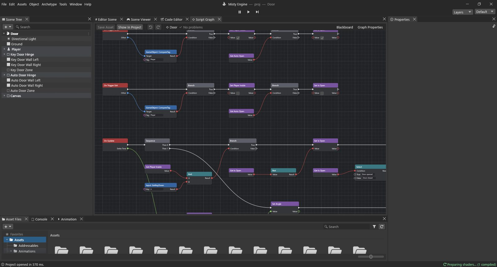

# دليل تطبيقي: باب يُفتح ويُغلق

الباب مشروع ثانٍ مثالي: يحتاج إلى **منطقة** تلاحظ اللاعب، و**ضغطة مفتاح**، و**حالة مفتوح أو مغلق** يتذكرها، و**دوران سلس** على مفصله. ويعمل المخطط نفسه بطريقتين: اضغط **E** لتفتح الباب وتغلقه، أو (مع تفعيل **Auto Open**) يُفتح وحده حين تقترب ويُغلق حين تبتعد.

**المثال:** المشهد `Assets/Guides/Door/Door.scene` والمخطط `Door.vgraph`. في المشهد بابان يستخدمان المخطط نفسه: الأيسر ينتظر **E**، والأيمن مفعّل فيه **Auto Open**. ويعيد المشهد استخدام لاعب منظور الشخص الأول من الدليل السابق.



## التجهيز

يتكون كل باب من ثلاثة كائنات:

- **Key Door Hinge**: كائن فارغ يقف في موضع المفصل. تدويره يدير الباب حول حافته، لا حول منتصفه.
- **Key Door**: ابن للمفصل مُزاح مترًا إلى الجانب، وهو لوح الباب (صندوق عليه مصادم صندوقي وجسم صلب حركي، فيصطدم به اللاعب دون أن يدفعه).
- **Key Door Zone**: كائن فارغ أمام المدخل عليه **مصادم صندوقي** فُعّل فيه **مُشغِّل** (Is Trigger) بأبعاد 3 × 2 × 3 م. المُشغِّل لا يعترض شيئًا، بل يبلّغ فقط عمّن يدخله ويخرج منه. ومخطط البرنامج النصي موضوع على هذا الكائن.

يجب أن يحمل اللاعب الوسم **Player** (ولاعب منظور الشخص الأول يحمله).

> [!TIP]
> حيلة المفصل تصلح لكل ما يدور حول حافة: الأغطية، والرافعات، والجسور المتحركة. ضع كائنًا فارغًا عند نقطة الارتكاز، واجعل الجزء المتحرك ابنًا له.

## المتغيرات

| الاسم | النوع | النطاق | البداية | الاستخدام |
|---|---|---|---|---|
| Door Name | String | Object | Door Hinge | اسم المفصل المراد تدويره |
| Open Angle | Float | Object | 90 | مقدار الفتح بالدرجات |
| Turn Speed | Float | Object | 180 | درجة في الثانية |
| Auto Open | Bool | Object | false | الفتح بالدخول إلى المنطقة بدل المفتاح E |
| Is Open | Bool | Graph | false | هل يجب أن يكون الباب مفتوحًا؟ |
| Player Inside | Bool | Graph | false | هل اللاعب داخل المنطقة؟ |
| Angle | Float | Graph | 0 | موضع الباب الآن |

ولأن المتغيرات الأربعة الأولى من نوع Object، فإن كل منطقة تضبط قيمها في لوحة الخصائص: المنطقة اليسرى فيها *Door Name* = `Key Door Hinge`، واليمنى `Auto Door Hinge` مع تفعيل *Auto Open*.

لاحظ الفرق بين **Is Open** (ما *نريده*) و**Angle** (حيث *يقف* الباب فعلًا). تغيّر ضغطة E الرغبة فورًا، ثم يدور الباب نحوها خلال لحظة. وفصل «الحالة» عن «الحركة» هو ما يجعل الدوران سلسًا.

## الخطوة 1: اللاعب يدخل

```
On Trigger Enter ─► Branch ◄─ GameObject: CompareTag (Target ◄ Other, Tag "Player")
                      └ True ─► Set Player Inside (true) ─► Branch ◄─ Get Auto Open
                                                              └ True ─► Set Is Open (true)
```

- يعمل **On Trigger Enter** حين يدخل شيء إلى مُشغِّل هذا الكائن. و**Other** هو ما دخل.
- تكون **GameObject: CompareTag** صحيحة حين يحمل الكائن **Target** الوسم **Tag** (`Player`). وتُتجاهل الأشياء الأخرى (كرة تتدحرج، أو عدو).
- يكمل **Branch** من **True** للاعب وحده.
- يتذكر **Set Player Inside** = true ذلك من أجل الخطوة 3.
- وفرع **Branch** ثانٍ على **Get Auto Open**: إن كانت المنطقة تفتح الباب وحدها، فإن **Set Is Open** = true.

*ومفيد أيضًا في:* On Trigger Enter مع CompareTag هي طريقتك لصنع الأغراض القابلة للالتقاط، ونقاط الحفظ، ومناطق الضرر، ومشغّلات المشاهد السينمائية، وأعلام الفوز.

## الخطوة 2: اللاعب يخرج

الصورة المعكوسة: **On Trigger Exit ▸ Branch (CompareTag Player) ▸ Set Player Inside (false) ▸ Branch (Auto Open) ▸ Set Is Open (false)**.

- يعمل **On Trigger Exit** حين يغادر شيء المُشغِّل.
- مع Auto Open يُغلق الباب خلفك، ودونه يبقى الباب على الحال التي تركته عليها.

## الخطوة 3: اضغط E للتبديل

```
On Update ─► Sequence ─ Then 0 ─► Branch ◄─ And ◄─ Get Player Inside, Input: GetKeyDown ("e")
                                    └ True ─► Set Is Open ◄─ Not ◄─ Get Is Open
                                                  └─► Debug: Log ◄─ Select (Is Open: "Door opened" / "Door closed")
```

- **On Update ▸ Sequence** بمخرجين: Then 0 يتولى المفتاح، وThen 1 يتولى الدوران.
- تكون **Input: GetKeyDown** مع `e` صحيحة في الإطار الذي يُضغط فيه E.
- **And** مع **Get Player Inside**: لا يعمل E إلا قرب الباب.
- تقلب **Not** الصحيح خطأً والخطأ صحيحًا. وضبط Is Open على *ليس Is Open* يعكسه: المفتوح يصير مغلقًا، والمغلق مفتوحًا. هذا هو التبديل.
- يختار **Select** النص بحسب الحالة الجديدة، ويكتبه **Debug: Log** في وحدة التحكم. والكتابة في السجل أسهل طريقة للتأكد من أن منطقك يفعل ما تظن.

*ومفيد أيضًا في:* «اضبط X على Not X» يبدّل أي شيء: مصباحًا يدويًا، أو قائمة، أو مفتاح إضاءة. وتفعل عقدة **Flip Flop** الشيء نفسه للتدفق (A ثم B ثم A…).

## الخطوة 4: الدوران بسلاسة

```
Get Is Open ─► Select (True ◄ Get Open Angle, False 0) ─► Move Towards.Target
Get Angle ───────────────────────────────────────────► Move Towards.Current
Get Turn Speed × On Update.Delta Time (Multiply) ─────► Move Towards.Max Delta
                                                            │
                                       Set Angle ◄── Then 1 ┘
                                           └─► Transform: Set localEulerAngles
                                                 Target ◄ GameObject: Find ◄ Get Door Name
                                                 Value  ◄ Make Vector3 (Y ◄ Get Angle)
```

- يعطي **Select** الزاوية المستهدفة: Open Angle (90) حين يجب أن يكون الباب مفتوحًا، و0 حين لا.
- يحرّك **Move Towards** القيمة **Current** نحو **Target** بمقدار لا يتجاوز **Max Delta**، ولا يتخطاها أبدًا. ومع Max Delta = Turn Speed × Delta Time، يدور الباب بسرعة 180 درجة في الثانية ويتوقف عند 90 أو 0 بالضبط.
- يخزّن **Set Angle** الزاوية الجديدة.
- يجد **GameObject: Find**، مع المتغير **Door Name**، مفصل هذه المنطقة.
- يضبط **Transform: Set localEulerAngles** دوران المفصل: Y = Angle.

*ومفيد أيضًا في:* Move Towards أبسط طريقة لتحريك عدد بسرعة ثابتة: شريط صحة يتناقص، أو ضوء يخفت، أو منصة تنزلق (ونسختها من نوع Vector3 تحرّك المواضع). ولبداية ونهاية ألطف، استخدم **Lerp** مع قيمة T صغيرة في كل إطار.

## جرّبه

اضغط تشغيل. اقترب من الباب الأيسر واضغط **E**: ينفتح، وتكتب وحدة التحكم *Door opened*. اضغط E مرة أخرى لإغلاقه. ثم توجّه إلى الباب الأيمن: ينفتح عند وصولك ويُغلق حين تبتعد.

أفكار:

- خفّض **Turn Speed** لبوابة قلعة ثقيلة، وارفع **Open Angle** إلى 120.
- اصنع بابًا منزلقًا: استبدل بالدوران **Transform: Set localPosition**، وبعقدة **Move Towards** نسختَها من نوع Vector3.
- اقفل الباب حتى يحصل اللاعب على مفتاح: أضف إلى اللاعب متغير كائن *Has Key* من نوع Bool، واقرأه بعقدة **Get Object Variable** (مع Target = Other)، وأدخله عبر **And** في الخطوة 3.

> [!PROGRAMMERS]
> ترتيب الأحداث في كل إطار: يُبلَّغ عن المُشغِّلات بعد كل خطوة فيزياء وقبل On Update، فترى الخطوة 3 دائمًا قيمة Player Inside محدّثة. ونسخة مخطط المنطقة خاصة بكل كائن: البابان يتشاركان الأصل، لا متغيرات Graph.
