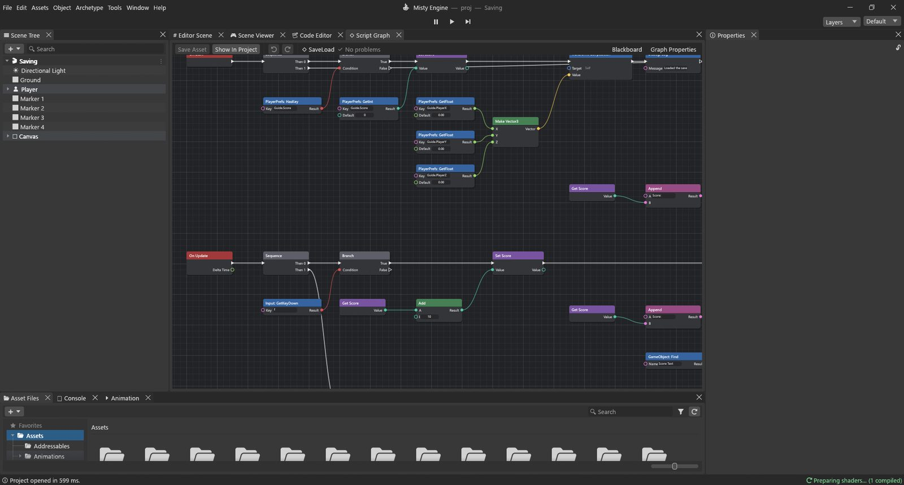

# دليل تطبيقي: الحفظ والتحميل

الألعاب تتذكر: أعلى نتيجة، ومستوى الصوت، والمكان الذي وصلت إليه. في هذا الدليل يجمع اللاعب النقاط بالمفتاح **F**، ويحفظ بالمفتاح **F5**، وفي المرة التالية التي تبدأ فيها اللعبة تعود النقاط ويعود اللاعب إلى موضعه.

**المثال:** المشهد `Assets/Guides/Saving/Saving.scene` والمخطط `SaveLoad.vgraph`. يحمل اللاعب مخططين: أدوات تحكم منظور الشخص الأول من الدليل 5، وهذا المخطط. يمكن للكائن أن يحمل ما تشاء من المخططات، ويؤدي كل منها مهمته.



## PlayerPrefs في دقيقة

**PlayerPrefs** دفتر صغير تحتفظ به اللعبة على حاسوب اللاعب. لكل سطر فيه **مفتاح** (اسم تختاره، مثل `Guide.Score`) وقيمة: عدد صحيح (Int)، أو عدد بفاصلة عشرية (Float)، أو نص (String).

| العقدة | وظيفتها |
|---|---|
| PlayerPrefs: SetInt / SetFloat / SetString | تكتب **Value** تحت **Key**. |
| PlayerPrefs: GetInt / GetFloat / GetString | تقرأ قيمة **Key**، وتعطي **Default** إن لم توجد. |
| PlayerPrefs: HasKey | صحيحة حين يكون شيء ما محفوظًا تحت **Key**. |
| PlayerPrefs: DeleteKey | تنسى **Key**. |
| PlayerPrefs: Save | تكتب الدفتر على القرص الآن. |

> [!WARNING]
> تغيّر عقد Set الدفتر في الذاكرة، أما **PlayerPrefs: Save** فتكتبه في الملف. وإن تعطلت اللعبة قبل الحفظ ضاعت التغييرات. واللعبة المبنية تحفظ أيضًا حين تُغلق بالطريقة المعتادة.

أين الملف؟ في المحرر هو `Library/PlayerPrefs.json` داخل مشروعك (فلا ينتهي به المطاف في لعبتك). وفي اللعبة المبنية هو مجلد إعدادات اللاعب (في Windows: `%APPDATA%\<Company>\<Product>\prefs.json`).

> [!TIP]
> ابدأ مفاتيحك باسم اللعبة أو النظام (`Guide.Score` و`Options.Volume`) كي لا تتعارض مع غيرها أبدًا. ويحتفظ المحرك بمفاتيحه الخاصة تحت البادئة `Misty.` (مستوى الجودة، وحجم النافذة).

## المتغير

متغير واحد من نوع Graph: **Score** (من نوع Int، ويبدأ من 0).

## الخطوة 1: التحميل عند البدء

```
On Start ─► Sequence ─ Then 0 ─► Branch ◄─ PlayerPrefs: HasKey ("Guide.Score")
                                   └ True ─► Set Score ◄─ PlayerPrefs: GetInt ("Guide.Score")
                                               └─► Transform: Set position ◄─ Make Vector3
                                                     X ◄ PlayerPrefs: GetFloat ("Guide.PlayerX")
                                                     Y ◄ PlayerPrefs: GetFloat ("Guide.PlayerY")
                                                     Z ◄ PlayerPrefs: GetFloat ("Guide.PlayerZ")
                                                   └─► Debug: Log ("Loaded the saved game")
                    └ Then 1 ─► Text: Set text ◄─ Append ("Score: " + Get Score)
                                  Target ◄ GameObject: Find ("Score Text")
```

- يحمّل **Sequence** أولًا (Then 0)، ثم يعرض النقاط (Then 1)، سواء أوجد حفظ أم لا.
- يتحقق **PlayerPrefs: HasKey** من وجود حفظ. في أول مرة تلعب لا يوجد شيء، فيتخطى **Branch** التحميل، ويبدأ اللاعب حيث يضعه المشهد.
- يقرأ **PlayerPrefs: GetInt** النقاط ويمررها إلى **Set Score**.
- تقرأ ثلاث عقد **PlayerPrefs: GetFloat** القيم X وY وZ، ويجمعها **Make Vector3**، ثم ينقل **Transform: Set position** اللاعب إلى هناك. (لا يستطيع PlayerPrefs تخزين Vector3، لذا نخزّن أعداده الثلاثة.)
- يصل **Append** نصّين: `Score: ` والنقاط (ويتحول Int إلى نص تلقائيًا).
- يغيّر **Text: Set text** كلمات نص في واجهة المستخدم. والهدف Target هو الكائن **Score Text**، نجده باسمه.

*ومفيد أيضًا في:* HasKey مع Branch هي طريقتك لإظهار زر «متابعة» فقط حين يوجد حفظ، أو لعرض درس تعليمي في المرة الأولى فقط.

## الخطوة 2: جمع النقاط

```
On Update ─► Sequence ─ Then 0 ─► Branch ◄─ Input: GetKeyDown ("f")
                                    └ True ─► Set Score ◄─ Add (Get Score + 10)
                                                └─► Text: Set text ◄─ Append ("Score: " + Get Score)
```

- يجمع **Add** (Math ▸ Int) عددين صحيحين: Score + 10.
- ويُحدَّث النص فورًا، بالطريقة نفسها كما عند البدء.

في لعبة حقيقية تأتي النقاط من القطع النقدية أو الأعداء، فيرسل الكائن **Custom Event** يبدأ هذا التدفق بدل المفتاح.

## الخطوة 3: الحفظ بالمفتاح F5

```
          Then 1 ─► Branch ◄─ Input: GetKeyDown ("f5")
                      └ True ─► PlayerPrefs: SetInt ("Guide.Score", Get Score)
                                 └─► PlayerPrefs: SetFloat ("Guide.PlayerX", X)
                                      └─► PlayerPrefs: SetFloat ("Guide.PlayerY", Y)
                                           └─► PlayerPrefs: SetFloat ("Guide.PlayerZ", Z)
                                                └─► PlayerPrefs: Save ─► Debug: Log ("Game saved")
Transform: Get position ─► Break Vector3 ─► X, Y, Z
```

- يعطي **Transform: Get position** موضع وقوف اللاعب، ويقسمه **Break Vector3** إلى **X** و**Y** و**Z** لعقد SetFloat الثلاث. (يبني Make Vector3 متجهًا، ويفككه Break Vector3.)
- تكتب عقد Set القيم، وتكتب **PlayerPrefs: Save** الملف.

*ومفيد أيضًا في:* الحفظ عند نقطة حفظ (On Trigger Enter)، أو كل دقيقة (**On Timer**)، أو عند نهاية المرحلة. واستخدم المفاتيح نفسها في الخطوتين 1 و3: فخطأ إملائي في مفتاح يعني أن القيمة لن توجد أبدًا.

## جرّبه

1. اضغط تشغيل. اضغط **F** عدة مرات: ترتفع النقاط.
2. امشِ إلى مكان آخر واضغط **F5**. تكتب وحدة التحكم *Game saved*.
3. توقف ثم اضغط تشغيل من جديد. تكتب وحدة التحكم *Loaded the saved game*، وتعود النقاط، وتقف حيث حفظت.

لتبدأ من جديد، احذف `Library/PlayerPrefs.json` والتشغيل متوقف، أو أضف مفتاحًا (F8 مثلًا) يشغّل **PlayerPrefs: DeleteKey** للمفاتيح الأربعة ثم **PlayerPrefs: Save**.

## حفظ أكبر

PlayerPrefs مخصص لقيم قليلة: الإعدادات، وأعلى نتيجة، وآخر مرحلة. أما حالة اللعبة كاملة (كل عدو، وكل صندوق فُتح، وعدة خانات حفظ بصور مصغرة) فاستخدم لها **نظام الحفظ**: أعطِ الكائنات نمط **Saveable** واستدعِ `SaveSystem.Save(slot)` و`SaveSystem.Load(slot)` (وهما متاحتان أيضًا عقدتين في المحرك: *SaveSystem: Save* و*SaveSystem: Load*). وتعرض **نافذة ▸ عام ▸ Save Data** محتوى الخانات.

> [!PROGRAMMERS]
> عقد PlayerPrefs أصلية بمنافذ محددة الأنواع (`Key: String` و`Value: Int/Float/String` و`Default`)، وتستخدم المخزن نفسه الذي تستخدمه دوال Lua `PlayerPrefs.SetInt(k, v)` و`GetInt(k, d)`. القيم محفوظة في جدول واحد على مستوى العملية، ولا يكتب `Save` ملف JSON إلا إذا تغير شيء.
