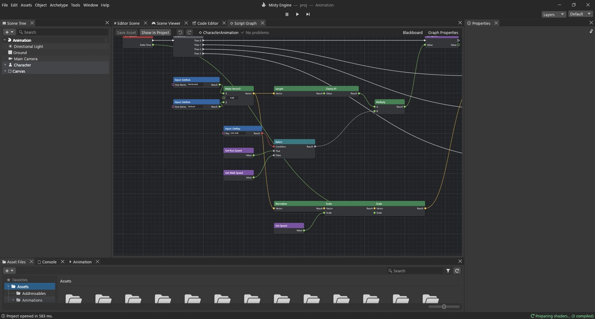
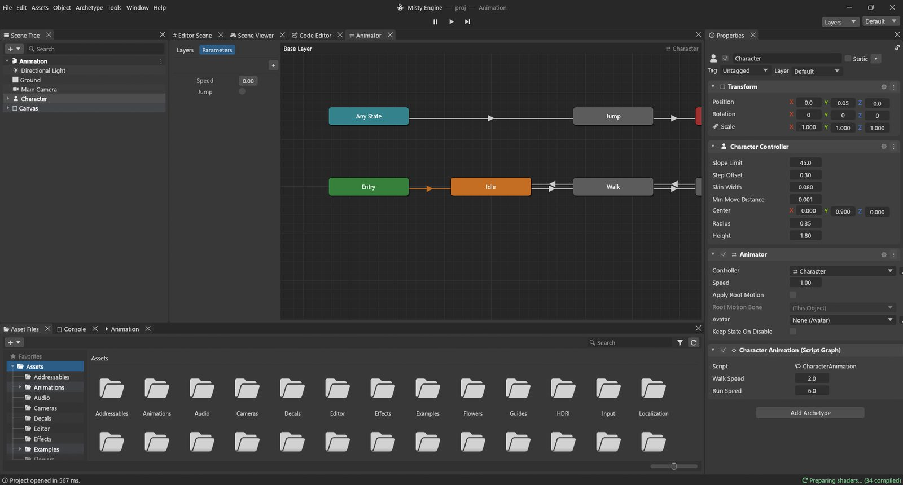

# دليل تطبيقي: الانتقال بين الحركات

يجب أن تقف الشخصية ساكنة حين لا تلمس شيئًا، وتمشي حين تدفعها إلى الأمام، وتركض حين تضغط Shift، وتقفز حين تضغط Space. يتعاون على ذلك أمران:

- **وحدة تحكم أداة التحريك** (Animator Controller): خريطة للحركات (*الحالات*) وقواعد الانتقال من واحدة إلى أخرى (*الانتقالات*)؛
- **مخطط برنامج نصي** يقيس سرعة حركة الشخصية ويخبر بها أداة التحريك.

المخطط لا يختار الحركات بنفسه. إنه يبلّغ عن *حقائق* فقط («السرعة 2.3»، «اقفز الآن»)، وقواعد أداة التحريك تقرر ما يُعرض. وهذا الفصل يُبقي الطرفين بسيطين.

**المثال:** المشهد `Assets/Guides/Animation/Animation.scene`، ومخططه `CharacterAnimation.vgraph`، ووحدة التحكم `Character.controller`، مع أربعة مقاطع صغيرة (`Idle` و`Walk` و`Run` و`Jump`) تحرّك **Body**، وهو جسم الشخصية الصندوقية.



## وحدة تحكم أداة التحريك

انقر نقرًا مزدوجًا على `Character.controller` لفتحها في نافذة **أداة التحريك**.



**المعاملات** هي القيم التي يضبطها المخطط:

| المعامل | النوع | المعنى |
|---|---|---|
| Speed | Float | سرعة حركة الشخصية بالمتر في الثانية |
| Jump | Trigger | إشارة لمرة واحدة: «اقفز الآن» |

**المُطلِق** (Trigger) يشبه Bool ينطفئ وحده فور أن يستخدمه انتقال، فتُحدث الضغطة الواحدة قفزة واحدة.

**الحالات**: **Idle** (حالة البداية)، و**Walk**، و**Run**، و**Jump**، وكل منها يعرض مقطعه.

**الانتقالات** (الأسهم)، ولكل منها شرط:

| من | إلى | متى |
|---|---|---|
| Idle | Walk | Speed أكبر من 0.5 |
| Walk | Idle | Speed أصغر من 0.5 |
| Walk | Run | Speed أكبر من 4 |
| Run | Walk | Speed أصغر من 4 |
| Any State | Jump | Jump (مُطلِق) |
| Jump | Exit | عند 90% من المقطع (وقت الخروج) |

تعني **Any State** «من أي حالة كنا فيها»، فيمكنك القفز واقفًا أو ماشيًا أو راكضًا. ويعيد **Exit** إلى حالة البداية Idle، ومنها تعود قواعد Speed إلى العمل. ويمزج كل انتقال خلال 0.15 ثانية (و0.1 ثانية للقفز) كي لا يكون التغيير مفاجئًا.

يحمل الكائن **Character** نمط **متحكم الشخصية** (للحركة) ونمط **أداة التحريك** مع وحدة التحكم هذه. والمقاطع تحرّك الابن **Body**.

## المتغيرات

| الاسم | النوع | النطاق | البداية | الاستخدام |
|---|---|---|---|---|
| Walk Speed | Float | Object | 2 | متر في الثانية عند المشي |
| Run Speed | Float | Object | 6 | متر في الثانية عند الركض |
| Speed | Float | Graph | 0 | سرعة هذا الإطار |

## الخطوة 1: ما السرعة؟

```
Input: GetAxis ("Horizontal") ─► Make Vector3.X
Input: GetAxis ("Vertical") ───► Make Vector3.Z ─► Length ─► Clamp 01 ─► Multiply.A
Input: GetKey ("left shift") ─► Select.Condition (True ◄ Get Run Speed, False ◄ Get Walk Speed) ─► Multiply.B
                                                                          │
                                         On Update ─► Sequence ─ Then 0 ─► Set Speed
```

- يجمع **Make Vector3** المحورين في اتجاه واحد (X جانبيًا، وZ إلى الأمام).
- **Length** (Math ▸ Vector3) طول ذلك المتجه: 0 حين لا يُضغط شيء، و1 حين يُضغط W، وأكثر بقليل من 1 قطريًا، وأي قيمة بينهما مع عصا التحكم.
- يُبقي **Clamp 01** القيمة بين 0 و1: أي «مقدار» الإدخال.
- تكون **Input: GetKey** مع `left shift` صحيحة ما دام Shift مضغوطًا.
- يختار **Select** بين Run Speed وWalk Speed.
- يعطي **Multiply** السرعة: 0 واقفًا، و2 ماشيًا، و6 راكضًا.

*ومفيد أيضًا في:* يقيس Length أي مسافة أو سرعة (بُعد العدو، أو سرعة السيارة). ويحوّل Clamp 01 أي مقدار إلى قيمة آمنة بين 0 و1، جاهزة لعقدة **Lerp**.

## الخطوة 2: الحركة

```
Make Vector3 ─► Normalize ─► Scale (× Get Speed) ─► Scale (× Delta Time) ─► CharacterController: Move ◄── Then 1
```

- يجعل **Normalize** طول الاتجاه 1 بالضبط (ويترك «لا شيء مضغوط» صفرًا)، فلا تكون الحركة القطرية أسرع.
- **Scale** في Speed، ثم في **Delta Time**: المسافة المقطوعة في هذا الإطار.
- يحرّك **CharacterController: Move** الشخصية.

## الخطوة 3: إخبار أداة التحريك

```
Then 2 ─► Animator: SetFloat (Name "Speed", Value ◄ Get Speed, Damp Time 0.1)
```

- يضبط **Animator: SetFloat** معاملًا من نوع Float في أداة التحريك على الكائن **Target** (غير الموصول: هذا الكائن). ويجب أن يطابق **Name** اسم المعامل تمامًا.
- يجعل **Damp Time** المعامل يقترب من القيمة الجديدة خلال نحو 0.1 ثانية بدل القفز إليها. فحين تُفلت W تنزلق Speed من 2 إلى 0، مارّةً بالقيمة 0.5 في طريقها: فينتهي المشي في اللحظة التي تتوقف فيها الشخصية. اضبطه على 0 للقفز مباشرة إلى القيمة.

العقد القريبة منها: **Animator: SetBool** و**SetInteger** و**SetTrigger** و**ResetTrigger** لضبط المعاملات، و**Animator: GetFloat / GetBool / GetInteger** لقراءتها.

## الخطوة 4: القفز

```
Then 3 ─► Branch ◄─ Input: GetKeyDown ("space")
            └ True ─► Animator: SetTrigger (Name "Jump")
```

- يُطلق **Animator: SetTrigger** المُطلِق *Jump*. فيستخدمه الانتقال *Any State → Jump*، ويُعرض مقطع القفز مرة واحدة، ثم يعيد الانتقال *Jump → Exit* الشخصية.

*ومفيد أيضًا في:* تناسب المُطلِقات كل فعل لمرة واحدة: الهجوم، وفتح صندوق، والتلويح، وتلقي ضربة. واستخدم **Bool** لما يدوم (الانحناء، والتصويب، والسباحة)، و**Float** لما يتغير (السرعة، والاستدارة).

## جرّبه

اضغط تشغيل وافتح **نافذة ▸ الحركة ▸ أداة التحريك** بجوار عارض المشهد. تُبرَز الحالة الحالية، وتعرض المعاملات قيمها الحية.

- قف ساكنًا: **Idle**. اضغط مطولًا على **W**: **Walk**. أضف **Shift**: **Run**. أفلت: تعود عبر Walk إلى Idle. اضغط **Space**: **Jump**.
- غيّر العتبات في أداة التحريك (انقر انتقالًا) وراقب نقاط التبديل تتحرك.
- غيّر **Walk Speed** إلى 4.5 في لوحة الخصائص: صار المشي سريعًا بما يكفي ليُعدّ ركضًا.

> [!PROGRAMMERS]
> ما يعادل الخطوتين 3 و4 بلغة Lua:
> ```lua
> local anim = gameObject:GetComponent("Animator")
> anim:SetFloat("Speed", speed, 0.1, Time.deltaTime)
> if Input.GetKeyDown("space") then anim:SetTrigger("Jump") end
> ```
> عقد Animator في المخطط أصلية: تخاطب مشغّل أداة التحريك نفسه الذي تخاطبه Lua، والهدف الذي لا يحمل أداة تحريك يبلّغ عن خطأ يسمّي الكائن. وتُفحص المعاملات بالاسم والنوع؛ فالاسم الخاطئ يكتب تحذيرًا بدل أن يفشل بصمت.
