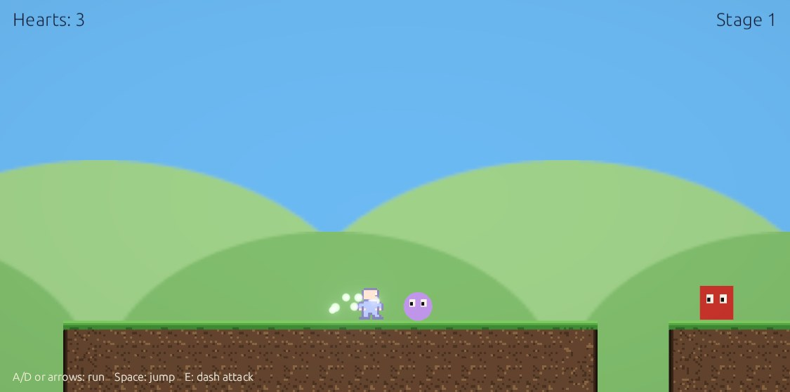

# لعبة مصنوعة بالعُقد فقط

هل يمكن صنع لعبة كاملة دون كتابة أي شيفرة؟ نعم. **Lumo's Leap** لعبة منصات ثنائية الأبعاد قصيرة في المشروع النموذجي: قائمة رئيسية، وثلاث مراحل، ونوعان من الأعداء، وهجوم اندفاع، وشاشة فوز. كل ما تفعله اللعبة مخططات برامج نصية (Script Graphs)، وليس فيها سطر واحد من Lua.

**المثال:** المجلد `Assets/NodeGame` في المشروع النموذجي. افتح المشهد `Scenes/NodeGameMenu.scene` واضغط **Play**. المخططات في المجلد `Graphs/`: انقر أحدها نقرًا مزدوجًا لتقرأه في نافذة مخطط البرنامج النصي.



## العب

- **A / D** أو مفاتيح الأسهم: الجري. **Space** (أو W أو السهم العلوي): القفز. أبقِه مضغوطًا لقفزة عالية، أو انقره نقرة سريعة لقفزة صغيرة.
- **E**: هجوم الاندفاع. يتوهج لومو باللون الأبيض ويطير إلى الأمام، وكل عدو في طريقه يتلقى ضربة.
- العدو **Puff** (دائري بنفسجي) تكفيه ضربة واحدة: يُدفع بعيدًا ثم يبهت ويختفي. والعدو **Brute** (مربع أحمر) يحتاج إلى ضربتين: كل ضربة تجعله يومض بالأبيض وتدفعه إلى الخلف.
- لمس عدو دون اندفاع، أو السقوط في حفرة، يكلّفك قلبًا. وإذا لم يبقَ أي قلب تبدأ المرحلة من جديد.
- صِل إلى العلم لتنتقل إلى المرحلة التالية. وبعد المرحلة الثالثة تظهر شاشة الفوز.

## مخططات صغيرة تتحدث فيما بينها

مخطط واحد كبير للعبة كاملة يستحيل أن يُقرأ. لذلك تستخدم اللعبة ثلاثة عشر مخططًا صغيرًا، لكل واحد منها مهمة واحدة:

| المخطط | موضوع على | المهمة |
|---|---|---|
| Player Input | اللاعب | يحوّل المفاتيح إلى متغيرين وحدثين |
| Player | اللاعب | الجري والقفز والاندفاع والقلوب |
| Patrol | كل عدو | يمشي، ويستدير عند حافة أو جدار |
| Enemy Touch | كل عدو | يميّز ضربة الاندفاع من الأذى |
| Brute | الأعداء Brute | ضربتان، وميض، دفع إلى الخلف |
| Puff | الأعداء Puff | ضربة واحدة، يُدفع بعيدًا ثم يبهت |
| Goal | العلم | يعلن أن المرحلة انتهت |
| Stage | كائن واحد في كل مرحلة | القلوب على الشاشة، وتحميل المشهد التالي |
| Camera Follow | الكاميرا الرئيسية | تتبع اللاعب |
| Menu و Win | الشاشتان | اللعب، والخروج، والعودة إلى القائمة |
| Vanish | القالب Burst | يزيل الجسيمات بعد انتهائها |
| Autopilot | لا شيء | يلعب المرحلة وحده (جرّبه مكان Player Input) |

تتحدث المخططات بطريقتين، وقد عرفتهما في الفصول السابقة:

- **متغيرات الكائن** (Object variables) مشتركة بين كل المخططات الموضوعة على الكائن نفسه. يكتب Player Input المتغيرين *Move* و *Jump Held* ويقرؤهما Player. وتتشارك Patrol و Brute و Puff المتغيرين *Dead* و *Knock*. وتقرؤها الكائنات الأخرى بالعقدة **Get Object Variable**: العدو يسأل اللاعب «هل أنت في حالة *Dashing*؟».
- **الأحداث المخصصة** (Custom events) رسائل. يرسل Player Input الحدثين *JumpPressed* و *DashPressed*، ويرسل Enemy Touch الحدث *DashHit* إلى عدوّه والحدث *Hurt* إلى اللاعب، ويبث العلم الحدث *StageCleared* إلى الجميع بالعقدة **Broadcast Custom Event**.

> [!TIP]
> لفصل لوحة المفاتيح في مخطط خاص بها فائدة جانبية لطيفة: ضع Autopilot مكان Player Input على اللاعب فتلعب اللعبة وحدها، لأن Autopilot يكتب المتغيرات نفسها ويرسل الأحداث نفسها.

## الجري والقفز

يحرّك مخطط Player جسمًا من نوع **Rigidbody 2D** بضبط سرعته في الحدث **On Fixed Update**.

```
On Fixed Update ─► Branch (Get Dead) ─ False ─► Sequence
  Then 0 ─► Branch (Hit of Physics2D: Raycast ×3, down from the feet) ─► Set Grounded At ◄─ Time: Get time
  Then 3 ─► Branch (Get Dashing)
              └ False ─► Branch (jump pressed lately And on the ground lately)
                           ├ True ─► Set VY ◄─ Get Jump Speed
                           └ False ─► Branch (Rising And moving up And Not Jump Held)
                                        ├ True ─► Set VY ◄─ velocity Y × Get Jump Cut
                                        └ False ─► Set VY ◄─ velocity Y
              all three ─► Rigidbody2D: Set velocity ◄─ Make Vector3 (Get Move × Get Speed, Get VY)
```

- العقدة **Physics2D: Raycast** تبحث عن أرض تحت القدمين مباشرة. اللعبة لا تخزّن «هل هو على الأرض»، بل تخزّن *متى* كان عليها آخر مرة (**Set Grounded At**). وكذلك مفتاح القفز: الحدث *JumpPressed* يخزّن قيمة **Time: Get time** في المتغير *Jump Pressed At*.
- تحدث القفزة حين تكون اللحظتان قريبتين. هذا الاختبار الواحد يعطي شيئين تتميز بهما ألعاب المنصات الجيدة: **زمن الذئب** (coyote time، أي أنك تستطيع القفز لحظة بعد تجاوز الحافة) و**تخزين القفزة** (ضغطة قبل الهبوط بقليل تُحتسب).
- **ارتفاع قفزة متغير**: ترك المفتاح أثناء الصعود يضرب السرعة الصاعدة في *Jump Cut* (0.5)، فتصير النقرة قفزة صغيرة.
- العقدة **Rigidbody2D: Set velocity** تطبّق النتيجة، والجاذبية متروكة للفيزياء.

## هجوم الاندفاع

```
Custom Event: DashPressed ─► Branch (cooldown over) ─► Set Dashing (true) ─► Set Dash Until
    ─► SpriteRenderer: Set color ◄─ Color: new (4, 4, 4) ─► ParticleSystem: Play
```

- ما دام *Dashing* صحيحًا يضبط الفرع Then 3 أعلاه السرعة على *Facing* × *Dash Speed* ولا شيء غير ذلك: يطير لومو في خط مستقيم، حتى فوق الحفر.
- العقدة **SpriteRenderer: Set color** بلون أسطع من الأبيض بأربع مرات تجعل الصورة تتوهج (في المشهد حجم معالجة لاحقة فيه Bloom)، والعقدة **ParticleSystem: Play** تبدأ الأثر الأبيض. وبعد مرور *Dash Until* يعود اللون ويتوقف الأثر.
- الاندفاع نفسه لا يمسّ الأعداء أبدًا. هو يضبط *Dashing* فقط، والأعداء هم من ينظرون إليه.

## الأعداء

على كل عدو مصادم صندوقي ثنائي الأبعاد فُعّل فيه **Is Trigger**، وثلاثة مخططات.

- **Patrol** يطلق شعاعين في كل خطوة فيزيائية: واحدًا إلى الأسفل أمام قدميه (حافة؟) وواحدًا إلى الأمام (جدار؟). إن قال أحدهما «توقف» عكس *Direction*، وإلا حرّكته العقدة **Transform: Translate**.
- **Enemy Touch** يستخدم **On Trigger Enter 2D** و **On Trigger Exit 2D** مع **GameObject: CompareTag** ليعرف متى يكون اللاعب في الداخل. ثم في كل **On Update**: هل اللاعب في حالة *Dashing*؟ نعم: يرسل *DashHit* إلى نفسه. لا: يرسل *Hurt* إلى اللاعب.
- **Brute** يجيب عن *DashHit*: ينقص *Health* واحدًا، ويضبط *Knock* (فيزلقه Patrol إلى الخلف)، ويومض بالأبيض، وبعد **Delay** يعود لونه. وعند الصفر يستدعي **Instantiate** بالقالب Burst ثم **Destroy**.
- **Puff** يجيب عن *DashHit* بضبط *Dead*. ومن بعدها يدفعه حدثه **On Update** بعيدًا، ويخفض *Fade* بالعقدة **Move Towards**، ويكتبه في شفافية الصورة ويكبّرها قليلًا. وحين يبلغ *Fade* الصفر: **Destroy**.

> [!NOTE]
> المخطط Patrol لا يعرف شيئًا عن الضربات، و Brute لا يعرف شيئًا عن المشي. يتشاركان المتغيرين *Knock* و *Dead* فقط. ولهذا يستطيع Puff أن يعيد استخدام Patrol و Enemy Touch دون أي تغيير.

## المراحل والقلوب والمشهد التالي

- **Goal** مُشغِّل على العلم: **On Trigger Enter 2D ▸ Branch (CompareTag Player) ▸ Do Once ▸ Broadcast Custom Event** بالحدث *StageCleared*.
- **Stage** يسمعه، فيعرض «Stage clear!» بالعقدة **Text: Set text**، وينتظر بعقدة **Delay**، ثم يستدعي **SceneManager: LoadScene** بمتغيره *Next Scene*. كل مرحلة تضبط *This Scene* و *Next Scene* في لوحة الخصائص، فيخدم مخطط واحد المراحل الثلاث كلها.
- مخطط Player يعدّ *Hearts*. كل تغيير يُبث بالحدث *HeartsChanged* فيكتبه Stage على الشاشة. وعند الصفر يبث اللاعب *PlayerDied* فيحمّل Stage المشهد *This Scene* من جديد. وكل اندفاعة تبث *DashUsed* مع وقت جاهزية الاندفاعة التالية، فيكتب Stage تحت القلوب "Dash: ready" أو "Dash: ...".

> [!WARNING]
> العقدة **SceneManager: LoadScene** لا تجد إلا المشاهد المدرجة في **File ▸ Build Settings**. ومشاهد اللعبة الخمسة مدرجة هناك.

## القائمة وشاشة الفوز

- للزرين **Play** و **Quit** مدخل **On Click** يسمّي الكائن Menu والحدث المطلوب إرساله: *Play* أو *Quit*. ويجيب مخطط Menu بعقد **Custom Event**: الحدث *Play* يحمّل المرحلة الأولى، والحدث *Quit* يستدعي **Application: Quit**. يبدأ الزر Play محددًا فيضغطه المفتاح Enter، والمفتاح Escape يرسل *Quit*.
- **Win** ينتظر بعقدة **Delay** ثم يحمّل القائمة، وأي مفتاح من Enter أو Space أو Escape يفعل ذلك فورًا.

## جرّب

أفكار لتغيير اللعبة دون مغادرة المحرر:

- حدّد اللاعب وغيّر *Jump Speed* أو *Dash Speed* أو *Hearts* في لوحة الخصائص.
- أعطِ عدوًّا من نوع Brute القيمة 3 في *Health*، أو زِد *Speed* لعدو من نوع Puff.
- ارسم أرضًا أكثر بلوحة البلاطات، وكرّر عدوًّا، وانقل العلم.
- أضف مرحلة رابعة: كرّر مشهد مرحلة، وأضفه إلى Build Settings، واضبط *Next Scene* على الكائن Game في المرحلة الثالثة.

> [!PROGRAMMERS]
> تستخدم الأشعة واستعلامات التداخل وسرعة Rigidbody 2D عقدًا أصلية محددة النوع (يعطي الشعاع Hit و Point و Normal و Distance و Collider)، ولا يوجد في اللعبة أي برنامج Lua. اختبار المشروع `sample_node_game.rs` يلعب المرحلة الأولى دون نافذة بمفاتيح محاكاة، والمجلد `tools/node_game` يعيد توليد الملفات.
