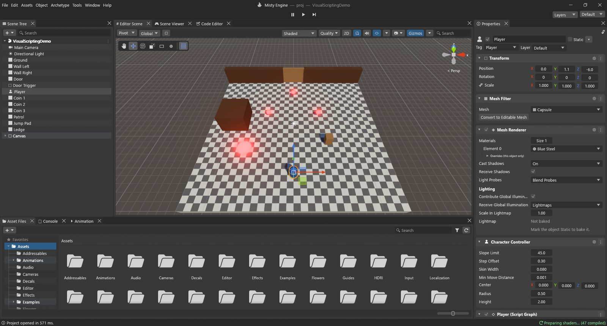

# The editor layout

When you open a project, the editor fills the window with a few panels. Each panel has one
job. Once you know what each one is for, the rest of the engine is much easier to learn.

From top to bottom you see:

- the **title bar** with the menus (File, Edit, Assets…);
- the **toolbar** with Play, Pause and Step in the middle;
- the **panels**: Scene Tree, Editor Scene, Scene Viewer, Properties, Asset Files, Console…;
- the **status bar** along the bottom.

> [!TIP]
> **Help ▸ Layout Tour** walks you through these areas one by one, with a highlight on each.

## Scene Tree

**What it is:** the list of every object in the open scene. Objects can hold other objects:
a car can hold its four wheels. The tree shows that: children sit under their parent and fold
away with the small arrow.

**Why you'd use it:** to find and select objects, to rename them, and to organise a scene by
putting objects under others.

**How:**

- Click an object to select it. **Ctrl+click** adds or removes one, **Shift+click** selects a
  range.
- **Double-click** an object to frame it in the Editor Scene.
- **Drag** an object onto another to make it a child; drag it to empty space to bring it back
  to the top.
- Press and hold an object (or press **F2**) to rename it.
- **Right-click** an object for Cut, Copy, Paste, Duplicate, Delete, Select Children and the
  create entries (they make a child of that object). Right-click empty space to create a new
  object.
- The **➕** button at the top creates objects; the search box filters the list. You can type
  filters such as `t:Light`, `t:Camera`, `tag:Player` or `layer:UI`.

## Properties

**What it is:** everything about the selected object. At the top: its name, a tick box to turn
it on or off, **Static**, **Tag** and **Layer**. Below: one card for each archetype it has
(Transform, Mesh Renderer, Light, Character Controller, Script Graph…).

**Why you'd use it:** to change how an object looks and behaves: move it by typing numbers,
change a light's colour, set a script's values.

**How:**

- Change a value by typing, by dragging a number field left or right, or by picking from a
  list.
- **Add Archetype** at the bottom adds new abilities to the object: a collider, a light, a
  sound, a script or a Script Graph. Type in its search box to find one quickly.
- Right-click a card's title (or its **⋮** button) for Reset, Remove Archetype, Move Up / Down
  and Copy / Paste Archetype.
- The **🔒** button locks the panel to the current object, so you can select others and still
  edit this one.
- Select an asset in Asset Files and Properties shows its import settings instead.

## Asset Files

**What it is:** the files of your project: scenes, models, textures, materials, sounds, Lua
scripts and Script Graphs. Folders on the left, the files of the chosen folder on the right.

**How:**

- **➕** creates new assets (Folder, Material, Script Graph, Scene, Animator Controller…), and
  so does right-clicking empty space.
- Double-click a scene to open it, a Script Graph to edit it, a Lua script to edit it in the
  Code Editor.
- Drag files from Asset Files into the Editor Scene or the Scene Tree to use them. Drag
  objects from the Scene Tree into Asset Files to make prefabs.
- Drag a texture onto an object (in the Editor Scene or on its Scene Tree row) and the editor
  makes a material for it in `Assets/Materials` and puts it on the object. A normal map
  (a name ending in `_Normal` or `_N`, or Texture Type: Normal Map) goes into the Normal Map
  slot of the material the object already has.
- Drop files from your computer onto the panel to import them.
- The slider at the bottom changes the icon size; all the way left gives a list.

## Editor Scene

**What it is:** your workshop: a free camera you fly around the scene to build it. What you see
here is not what the player sees; that is the Scene Viewer.

**How to move around:**

- Hold the **right mouse button** and use **W A S D** (and **Q / E** for down and up) to fly.
  Hold **Shift** to go faster; scroll while holding the right button to change the speed.
- Select an object and press **F** to frame it.
- Click the cones of the axis gizmo (top right) to look along an axis; click its centre to
  switch between perspective and isometric.

**Tools** (top left, or the keys **Q W E R T Y**): View, Move, Rotate, Scale, Rect and
Transform. **Ctrl** while dragging snaps by steps (Edit ▸ Grid and Snap sets them).

**The bar at the top of the Editor Scene**, from right to left: a search box, gizmo options and
the **Gizmos** toggle, the camera settings (📷), the effects toggle (☁) and its menu (sky, fog,
clouds, post-processing…), audio (🔊), lighting (💡), **2D**, the **Quality** menu, and the draw
mode (Shaded, Wireframe and many debug views). The Quality menu is described in
[Quality and rendering](03-quality-and-rendering.md).

## Scene Viewer

**What it is:** the game, seen through the scene's camera, exactly as a player will see it. It
plays the game when you press Play.

**Its bar:**

- **Display 1** and the aspect ratio (Free Aspect, 16:9, 16:10, 4:3, 5:4), and a **Scale**
  slider to zoom in.
- **Gizmos**, **Stats** (rendering numbers, see [Finding what is slow](02-performance.md)),
  **VSync**, **🔇** to mute the game's sound, and the quality level to preview.
- **Play Focused / Play Maximized / Play Unfocused**: Play Maximized makes the Scene Viewer
  fill the window until you stop.

## Console

**What it is:** the editor's messages, and your game's: information, warnings (⚠) and errors
(⛔). Script Graphs and Lua write here with `Debug.Log`.

**How:**

- **Clear** empties it; its ⏷ menu has **Clear on Play**.
- **Collapse** merges identical messages into one row with a count.
- **Error Pause** pauses Play the moment an error appears, so you can look around.
- The ⛔ / ⚠ / ℹ buttons on the right show or hide each kind; the search box filters.
- Double-click a message from a script to open that line.

The status bar at the bottom of the window always shows the latest message; click it to open
the Console.

## The toolbar and Play / Pause / Step

The three buttons in the middle of the toolbar run your game inside the editor:

| Button | Shortcut | What it does |
|---|---|---|
| Play | Ctrl+P | Starts the game in the Scene Viewer. Press again to stop. |
| Pause | Ctrl+Shift+P | Freezes the game. Pressed before Play, the game starts paused. |
| Step | Ctrl+Alt+P | Runs exactly one frame, then pauses again. Great for watching something fast. |

While playing, the tab bar is tinted so you don't forget you are in Play mode.

> [!WARNING]
> Changes you make to objects while playing are undone when you stop. That is on purpose: you
> can experiment freely. Write down good values, stop, then set them for real.

On the right of the toolbar: the **Layout** menu (see below) and a **Layers** list.

## The menus

| Menu | What's in it |
|---|---|
| File | New / Open / Save scenes, recent scenes, New / Open Project, Misty Hub, Build Profiles and Build And Run (Ctrl+B), Exit. |
| Edit | Undo / Redo (Ctrl+Z / Ctrl+Y) and Undo History (Ctrl+H), selection, Cut / Copy / Paste / Duplicate (Ctrl+D), Rename (F2), Delete, Frame Selected (F), Grid and Snap, Play / Pause / Step, Project Settings, Preferences. |
| Assets | Create, Show in Explorer, Rename, Duplicate, Delete, Refresh (Ctrl+R). |
| Object | Create Empty (Ctrl+Shift+N), 3D and 2D objects, effects, lights, audio, UI, cameras, a first-person player; parenting, Move To View, Align With View, Enable / Disable Misty Mesh. |
| Archetype | Add… (Ctrl+Shift+A) and every archetype by category: Mesh, Effects, Physics, Navigation, Audio, Rendering, Scripts, UI… |
| Tools | Rendering: convert the scene or the project to Misty Mesh. |
| Window | Layouts, then every panel by group: General (Editor Scene Ctrl+1, Scene Viewer Ctrl+2, Properties Ctrl+3, Scene Tree Ctrl+4, Asset Files Ctrl+5, Console Ctrl+Shift+C…), Animation, Rendering (Lighting, Occlusion Culling…), Script Graphs, Analysis (Profiler Ctrl+7, Frame Debugger, Memory Profiler) and more. |
| Help | User Guide, Layout Tour, Tutorials, About, Check for Updates, Scripting Reference. |

**Ctrl+K** opens a search over everything: objects, assets, menu commands, settings pages and
documentation headings.

## Layouts

A layout is the arrangement of the panels. **Window ▸ Layouts** (or the **Layout** menu on the
toolbar) switches between the built-in ones: **2 by 3**, **4 Split**, **Default**, **Tall** and
**Wide**.

- Drag a panel's tab to move it: drop it on the edge of another panel to split, or on its tab
  bar to stack.
- **Save Layout...** keeps the current arrangement under a name; it then appears in the list.
  **Delete Layout** removes one, **Reset All Layouts** goes back to the built-ins.
- Your arrangement is saved with the project as you go.
- Panels opened from the Window menu dock next to a sensible neighbour the first time.

## Preferences

**Edit ▸ Preferences** holds your personal settings (they follow you, not the project):

- **General:** the **Language** (English, Türkçe, العربية) and the **UI Scale**.
- **External Tools:** which editor opens scripts: the built-in Code Editor or your system's
  default.
- **Code Editor:** word wrap, minimap, line numbers, auto-closing brackets, font and tab size.
- **AI Tools:** let AI assistants connect to this editor (off by default).

Project-wide settings (quality levels, input, physics, tags and layers, time…) live in
**Edit ▸ Project Settings** instead.
