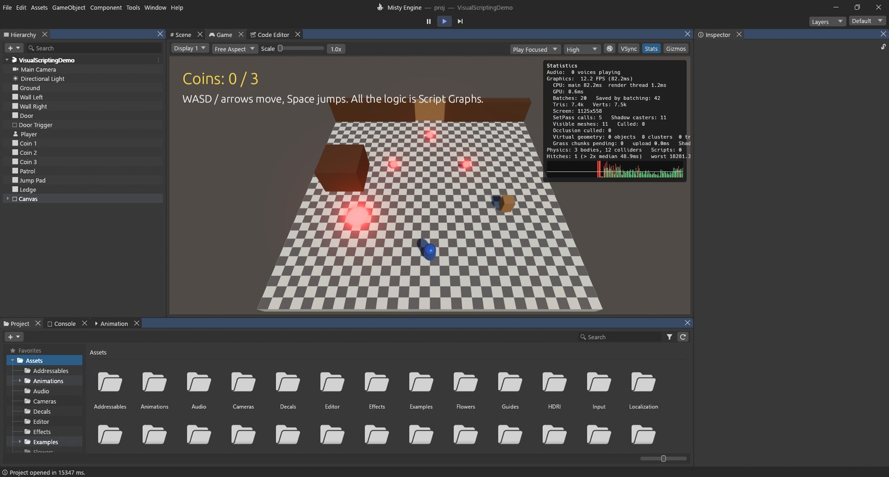
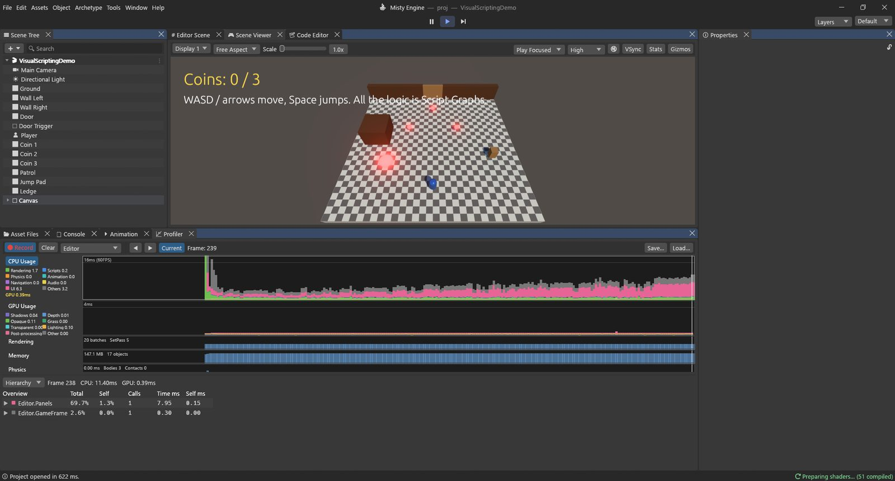
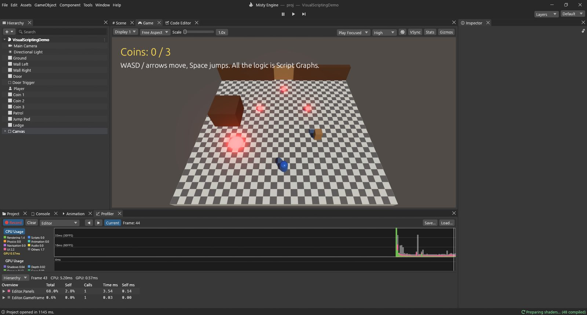

# Finding what is slow

A game feels smooth when every frame is ready in time: about **16 ms** for 60 frames per
second, **33 ms** for 30. When a game stutters or crawls, the question is always the same:
*what is taking the time?* Misty Engine has four tools to answer it:

| Tool | Where | Answers |
|---|---|---|
| Stats box | Scene Viewer ▸ **Stats** | How fast is it right now? How much is being drawn? |
| Profiler | Window ▸ Analysis ▸ **Profiler** (Ctrl+7) | Which part of the frame takes the time, CPU or GPU, and which system? |
| Frame Debugger | Window ▸ Analysis ▸ **Frame Debugger** | What exactly is drawn, in what order, with which material? |
| Build report | File ▸ Build Profiles, after a build | What makes the built game big? |

Start with the Stats box, go to the Profiler to find the culprit, and use the Frame Debugger
when the culprit is drawing.

## The Stats box

Click **Stats** on the Scene Viewer's bar. A box appears in its top-right corner:

- **Graphics: FPS (ms)**: frames per second and the time of one frame.
- **CPU: main / render thread** and **GPU**: how long each side took. The slowest of the
  three sets your frame rate.
- **Batches** (draw calls) and **Saved by batching**, **SetPass calls**: how many times the
  GPU was asked to draw, and how often it had to switch material or shader. Fewer is faster.
- **Tris / Verts**: how many triangles and vertices were drawn.
- **Shadow casters**, **Visible meshes / Culled**, **Occlusion culled**: how much was drawn
  into shadows, and how much was skipped because it was off screen or hidden.
- **Misty Mesh**: objects, clusters and triangles drawn through Misty Mesh.
- **Physics** (bodies, colliders) and **Scripts**.
- **Hitches**: frames that took more than twice the usual time, and the worst one. The small
  graph below shows recent frames; hitches are red bars.

> [!TIP]
> Look at CPU and GPU first. If the **GPU** time is the big one, you are drawing too much (or
> too expensively): see shadows, quality and resolution. If the **CPU main** time is the big
> one, it is game logic, physics, animation or the number of objects: open the Profiler.

## The Profiler

Open it with **Window ▸ Analysis ▸ Profiler** or **Ctrl+7**. It starts recording as soon as it
is shown and keeps the last 300 frames. Press **Play** to profile your game: the Profiler then
measures the game while it runs.

### Its parts

- **The toolbar:** **⏺ Record** (on by default), **Clear**, the target (**Editor**, or a
  **Player** started on another machine or as a built game), **◀ ▶** to step frame by frame,
  **Current** to follow the newest frame, and **Load… / Save…** to keep a capture as a file
  (`.mprof`) and look at it later.
- **The modules**, one chart each, newest frame on the right:
  - **CPU Usage**: each frame's time stacked by kind: Rendering, Scripts, Physics, Animation,
    Navigation, Audio, UI and Others, with a yellow line for the GPU. Guide lines show 16 ms
    (60 FPS), 33 ms (30 FPS) and 66 ms (15 FPS). Click a colour in the legend to hide it.
  - **GPU Usage**: the GPU's time stacked by group of passes: Shadows, Depth / Culling,
    Opaque, Grass & Trees, Transparent & Effects, Lighting / GI / Volumes, Post-processing.
  - **Rendering** (batches, SetPass calls), **Memory**, **Physics**, **Audio** and **UI**:
    their own numbers per frame.
- **The details pane** below shows the selected frame for the selected module. **Click or
  drag on any chart** to choose a frame (a white line marks it) and that module.

### CPU Usage: Hierarchy and Timeline

With **CPU Usage** selected, the details pane has two views:

- **Hierarchy**: a tree of everything the frame did, with **Total** and **Self** (as a share
  of the frame), **Calls**, **Time ms** and **Self ms**. *Total* includes what a row called;
  *Self* is only the row itself. Open the rows with the biggest numbers to find the cause.
- **Timeline**: one band per thread (the Main Thread, the GPU work of each render, audio and
  worker threads), with the work drawn as bars along the frame's time. Hover a bar for its
  name and time. It shows *when* things happen, and what waits for what.

Rows you will meet often: `Scripts.Update` and `ScriptGraphs.Update` (your Lua scripts and
Script Graphs), `Physics.Step`, `Animation.Update`, `Navigation.Update`, `UI.Events`. Each
Lua method is timed on its own, as `ScriptName.Update()`.

### GPU Usage

With **GPU Usage** selected, the details list each render (the Scene Viewer, the Editor Scene,
shadow maps…) with its passes and their **GPU ms**, then a total per group. GPU timings arrive
a frame or two late, and some graphics cards cannot measure them at all; the Profiler says
so.

> [!PROGRAMMERS]
> Engine code marks its own sections with `profile_scope!("Name", Category::X)`; it costs one
> atomic load when the Profiler is not recording. Recording from the very first frame:
> `MISTY_PROFILE=capture.jsonl`. A built player connects to the editor's Profiler with
> `MISTY_PROFILER_CONNECT=127.0.0.1:54998` (or `--profiler-connect`).

## The Frame Debugger

The Frame Debugger stops the Scene Viewer on one frame and lets you replay it one draw at a
time. Open it with **Window ▸ Analysis ▸ Frame Debugger**.

1. Press **Enable**. Play pauses and the frame is captured. (Disable, or closing the window,
   resumes Play.)
2. The list on the left shows every event of the frame, grouped by pass: clears (⊘), draws
   (▲), indirect draws (◭), fullscreen passes (▣), compute (⚙), copies (⎘) and UI (▤).
3. Click an event, or use **◀ ▶** (or the arrow keys) and the slider: the Scene Viewer shows
   the frame **drawn up to that event**. Events after it are dimmed.
4. **Draws only** skips clears, copies and compute. **View** shows the target's Color,
   Depth, Normals, GI or Emission instead.
5. The right side tells you everything about the event: its pass, object, mesh, material,
   vertex and index counts, instances, shader, bindings, render target, blend / depth / cull
   state, textures and material properties.

**Why you'd use it:** to see why something is drawn twice, why an object is missing, which
objects cast shadows, or why the draw count is so high.

## Memory Profiler

**Window ▸ Analysis ▸ Memory Profiler** takes snapshots of what the editor holds in memory:
press **⏺ Capture**. **Summary** shows GPU and CPU memory by category (textures, meshes,
render targets, audio, scripts…), **Table** lists every item (sort by Size), **Tree Map** draws
them as boxes, and **Compare** shows what grew between two snapshots.

## The build report

After a build (**File ▸ Build Profiles ▸ Build**), the Build Profiles window shows a
**Build Report**: the total size, the size of the program and of the data, how long the build
took, then **By type** (textures, meshes, audio, scenes…) and the **Largest assets**. **Open
BuildReport.txt** opens the full report written next to the game. Use it when the game is too
big to download: the largest assets are usually textures you can shrink in their import
settings.

## A worked example: a slow level

Say your level runs at 25 FPS and feels heavy. Here is how you'd track it down.

**1. Measure.** Press Play, turn on **Stats**. It says, for example, *CPU main 12 ms, GPU
38 ms*. The GPU is the slow side: the game is drawing too much.

**2. Find which part of the drawing.** Open the **Profiler** (Ctrl+7) and click the
**GPU Usage** chart. Click a typical frame. The details show the Scene Viewer's passes, and the
**Shadows** group takes, say, 20 ms of the 38.

**3. See why.** Open the **Frame Debugger**, press **Enable**, open the shadow pass group. You
step through the draws and see hundreds of small objects (pebbles, grass tufts, props far
away) each drawn into every shadow cascade. The Stats box agrees: *Shadow casters: 2,400*.

**4. Fix it.** Several fixes, from the simplest:

- In **Project Settings ▸ Quality**, lower **Shadow Distance** (for example from 250 m to
  120 m) or use fewer **Shadow Cascades**. Far shadows are the most expensive and the least
  visible.
- Turn off **Cast Shadows** on the small props' Mesh Renderers: nobody sees a pebble's shadow.
- Give big, dense rocks and buildings **Misty Mesh**, and far objects **LOD Groups** (see
  [Quality and rendering](03-quality-and-rendering.md)).

**5. Check.** Play again. The GPU time is now, say, 19 ms and the game runs at 50 FPS.
Always measure after a change: a fix you can't measure is a guess.

**And when the CPU is the slow side?** Select **CPU Usage** in the Profiler and open the
**Hierarchy**. Suppose `ScriptGraphs.Update` takes 9 ms. Open it: one graph, on 500 coins,
runs **GameObject: Find** every frame to look for the player. Finding an object by name
searches the whole scene, 500 times a frame. The fix: find the player **once**, in
**On Start**, keep it in a variable, and use the variable in **On Update**. The row drops to
under a millisecond.

> [!TIP]
> Profile the game as players will run it: a built game (with the Profiler's **Player**
> target) has none of the editor's own work in its numbers.
