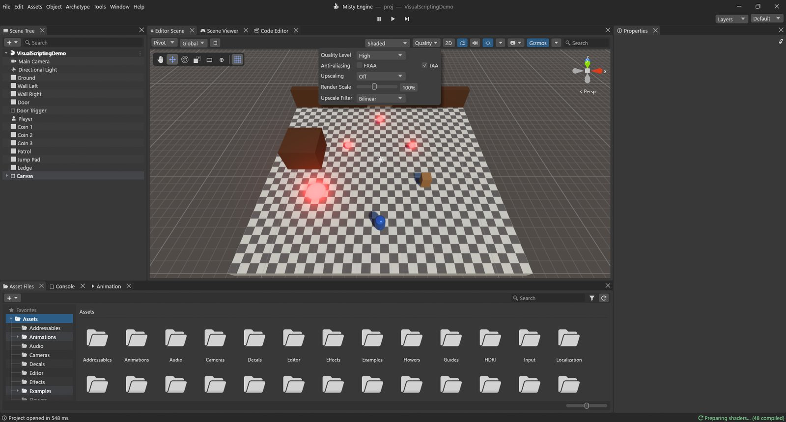
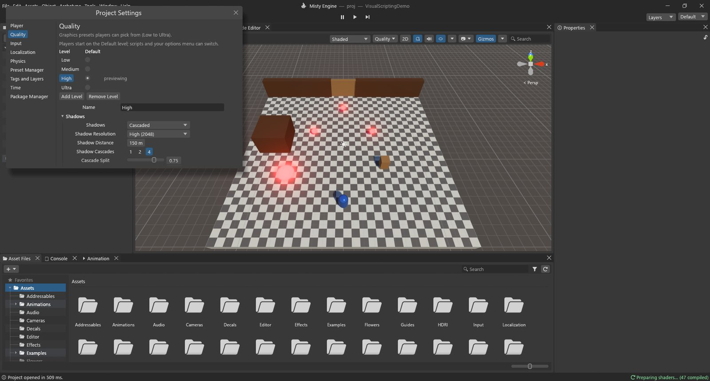

# Quality and rendering

Every game has to choose between *looks* and *speed*. Misty Engine puts these choices in a few
places:

- **Quality levels** (Low, Medium, High, Ultra): one set of settings each, in
  **Edit ▸ Project Settings ▸ Quality**. Players start on the Default level and your options
  menu can switch.
- The **Quality** menu in the bar at the top of the Editor Scene: a quick way to preview a
  level and change the most visible settings.
- Per-object tools: **LOD Groups**, **Misty Mesh**, **occlusion culling**.
- Lighting: **Misty GI** (live bounce light), baked lightmaps and probes.

## The Quality menu in the Editor Scene

Click **Quality ⏷** in the bar at the top of the Editor Scene.

| Setting | What it does |
|---|---|
| Quality Level | Previews a level in the Editor Scene, the Scene Viewer and Play. It does not change which level players start on. |
| Anti-aliasing: FXAA | A cheap edge-smoothing pass on top of the 4x multisampling. |
| Anti-aliasing: TAA | Temporal anti-aliasing: smooth, stable grass and thin details, by blending frames. |
| Upscaling | Off, Quality (67%), Balanced (58%), Performance (50%) or Custom: draw fewer pixels and rebuild a sharp image from several frames. |
| Render Scale | Draw the 3D image at 25% to 200% of the window size. Below 100% is faster and softer. |
| Upscale Filter | How a smaller image is stretched: Bilinear, Nearest (pixelated) or Sharpen. |

> [!NOTE]
> Apart from choosing the level to preview, these are the **same settings** as on the
> Quality page: what you change here changes the level, for the Scene Viewer and the built game
> too. The other toggles of that bar (effects, lighting, gizmos, draw mode) only change the
> Editor Scene.

## Project Settings ▸ Quality

Open **Edit ▸ Project Settings** and choose **Quality**.

At the top is the list of levels. Click a level's name to edit it (it is previewed at the same
time); the **Default** button marks the level new players start on (High, at first). **Add
Level** copies the current one, **Remove Level** deletes it, and **Name** is what your options
menu shows.

The settings are in four groups.

### Shadows

| Setting | What it does | When to change it |
|---|---|---|
| Shadows | **Cascaded** (shadow maps that cover more area as they get further) or **Virtual** (one huge virtual shadow map, only the visible pages drawn). | Virtual gives sharp shadows everywhere in big worlds, at the cost of memory (**Shadow Page Pool**). |
| Shadow Resolution | Low (512) to Very High (4096). | Lower it first on weak machines. |
| Shadow Distance | How far shadows are drawn (40 m on Low to 250 m on Ultra). | The biggest shadow cost. Lower it when the Profiler shows Shadows high. |
| Shadow Cascades | 1, 2 or 4 slices; **Cascade Split** and **Cascade Blend** shape them. | More cascades = sharper near shadows, more draws. |
| Soft Shadows | Off, Low, Medium, High. **Temporal Shadows** and **Shadow Denoise** smooth them over frames. | Off on Low-end machines. |

### Rendering

| Setting | What it does |
|---|---|
| Anti-Aliasing | Multisampling (2x or 4x). |
| FXAA, Temporal Anti-aliasing | As in the Quality menu. **TAA Blend** and **TAA Sharpness** tune TAA. |
| Upscaling, Upscaling Scale, Upscaler | Draw fewer pixels and reconstruct the image (the Misty Temporal upscaler). |
| Render Scale, Upscale Filter | As in the Quality menu. |
| LOD Bias | Above 1 keeps detailed LOD levels further away (prettier, slower); below 1 switches to simpler ones sooner. It also moves tree LOD and billboard distances. |
| Misty Mesh | Draws Misty Mesh models as clusters (see below). Off by default. |
| Misty Mesh Error | How many pixels of error a cluster may show before a finer one is used. Lower = more detail. |

### Textures

| Setting | What it does |
|---|---|
| Texture Quality | Full, Half, Quarter or Eighth resolution for every texture. Saves video memory. |
| Anisotropic Textures | Sharper textures seen at a slant (floors, roads): Disabled, Per Texture or Forced On. |
| Max Texture Size | Largest texture size loaded (1024 on Low to 8192 on Ultra). |

### Effects

| Setting | What it does |
|---|---|
| Ambient Occlusion | Soft contact shadows in corners and creases (Off to High). |
| Global Illumination | The highest Misty GI quality this level allows (Off turns it off). |
| Volumetric Fog | Fog that catches light and shadow (Off to High). |
| Sharp Sun Shafts | Crisp rays of sunlight through fog. |
| Volumetric Clouds | Cloud quality. |
| Reflection Probes | Probe resolution (Off means only the sky is reflected). |
| Lens Flares | Flares around bright lights. |
| Grass Shadows | How far grass casts shadows (Off, 12 m, 20 m, 32 m). |
| Grass Ground Cover | An extra layer of short grass. |

### How the game picks a level

New players start on the **Default** level. A Build Profile can choose another starting level
(**Quality Level** in File ▸ Build Profiles). Your options menu changes it while playing; the
choice is saved for the next run.

> [!PROGRAMMERS]
> Lua: `QualitySettings.GetQualityLevel()` (0-based), `QualitySettings.SetQualityLevel(i)`
> and `QualitySettings.names`. The choice is stored in the PlayerPrefs key
> `Misty.QualityLevel`.

## LODs (levels of detail)

**What it is:** a far-away object covers only a few pixels, so drawing all its triangles is a
waste. A **LOD Group** swaps an object for simpler versions as it gets smaller on screen, and
hides it when it is tiny.

**How:**

1. Select the object and **Add Archetype ▸ Rendering ▸ LOD Group**.
2. The coloured bar shows the levels: *LOD 0* (full detail) down to *Culled*. Drag the
   dividers to choose when each level starts, as a share of the screen height (60%, 30%, 10% by
   default). The **📷** marker shows how big the object is from the Editor Scene's camera
   right now.
3. Put the simpler meshes in the levels: **Fill from Children** uses child 0 for LOD 0, child
   1 for LOD 1, and so on; or **Add Renderer…** per level.
4. **Fade Mode ▸ Cross Fade** blends between levels instead of popping (**Fade Width** sets
   how long).

**Automatic LODs:** select a model in Asset Files and tick **Generate LODs** in its import
settings. The engine makes simpler copies (by default 50% and 20% of the triangles) and adds a
LOD Group for you.

**When to use it:** for anything that appears many times or far away: trees, rocks, props,
buildings. The quality level's **LOD Bias** moves all the switch points at once.

## Occlusion culling

**What it is:** objects hidden behind a wall still cost time if they are drawn. Occlusion
culling works out in advance what can be seen from where, and skips the rest.

**How** (**Window ▸ Rendering ▸ Occlusion Culling**):

1. **Object** tab: select the big things that hide others (walls, buildings, terrain) and tick
   **Occluder Static**; select the things that can be hidden and tick **Occludee Static**. Both
   are also in the **Static** menu of Properties.
2. **Bake** tab: **Smallest Occluder** (default 5 m) is the size of the cells the camera moves
   through; **Smallest Hole** (0.25 m) is the smallest gap you can see through. Save the scene,
   then press **Bake**.
3. **Visualization** tab: shows the camera's cell and, in the Editor Scene, hides the objects
   culled from where the camera is.

The camera's **Occlusion Culling** setting (on by default) must be on. **Dynamic Occlusion**
also hides moving objects behind the baked walls, on the GPU.

**When to use it:** indoor levels, cities, anything with lots of walls. In an open field it
does little: nothing hides anything.

## Misty Mesh

**What it is:** Misty Mesh cuts a dense model into small clusters of triangles at several
levels of detail. Each frame it picks, cluster by cluster, the coarsest one that still looks
right on screen. You get very dense rocks and buildings without making LODs by hand.

**How:**

- Select objects and choose **Object ▸ Enable Misty Mesh** (also on the Scene Tree's
  right-click menu and the Mesh Filter card), or
- **Tools ▸ Rendering ▸ Convert Scene to Misty Mesh...** for every dense mesh in the scene
  (from **Min. triangles**, 5,000 by default). It lists what it skipped and why, and can turn
  on **Quality ▸ Misty Mesh** for High and Ultra.
- Then make sure **Misty Mesh** is on in the quality level. When it is off, those models are
  drawn as ordinary meshes.

**When to use it:** dense, solid, still objects: rocks, cliffs, statues, buildings. Not for
characters (skinned), see-through or alpha-tested things like leaves.

**Check it:** the Editor Scene's draw mode menu has **Misty Mesh Clusters**, **Levels**,
**Overdraw** and **Materials** views; the Stats box counts its clusters and triangles.

## Misty GI

**What it is:** light bounces. Sunlight hits a red wall and the floor next to it turns a bit
red; a room with a small window is lit softly all over. **Misty GI** computes that bounce
light, sky shadowing and soft reflections live, so it follows moving lights and objects with
no baking.

**How:**

- **Window ▸ Rendering ▸ Lighting ▸ Scene** tab ▸ **Realtime Lighting**: tick **Realtime
  Global Illumination** for the scene.
- A **Post-process Volume** has a **Misty Global Illumination** section to adjust it in an
  area: **Intensity** and **Quality**.
- The quality level's **Global Illumination** sets the best quality allowed (and Off turns it
  off on weak machines).

**When to use it:** scenes whose lighting changes: a day-night cycle, doors opening, moving
lights. It costs a few milliseconds of GPU time. For lighting that never changes, **baked
lightmaps** (Lighting window ▸ **Generate Lighting**) cost almost nothing while playing, and
**Light Probes** carry baked light onto moving objects.

> [!TIP]
> Not sure which settings cost the most? Change one, then look at the Profiler's
> **GPU Usage**: the groups (Shadows, Lighting / GI / Volumes, Post-processing…) show where the
> time went.
