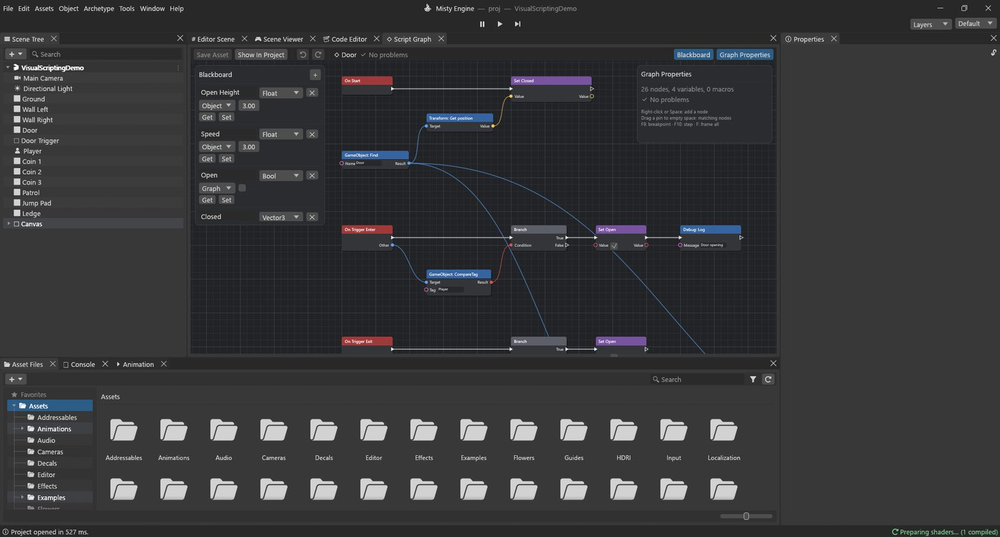

# Script Graphs: the basics

A **Script Graph** is game logic you build by connecting boxes instead of typing code. Each box
is a **node** that does one small thing: "when the game starts", "read the W key", "add two
numbers", "move this object". You wire nodes together, and the wires decide what happens and in
what order.

If you have ever followed a recipe, you already know the idea: *when* the oven is hot (an
event), *take* 200 g of flour (a value), *mix* it with the eggs (an action), *if* the dough is
sticky *then* add flour (a decision).



## Make a graph and put it on an object

1. In **Asset Files**, click **➕ ▸ Script Graph** (or right-click empty space ▸ Create). A new
   graph starts with two events, **On Start** and **On Update**.
2. Double-click it to open it in the **Script Graph** window.
3. Put it on an object: select the object, then **Add Archetype ▸ Scripts** and pick the
   graph, or drag the graph from Asset Files onto the object in the Scene Tree.
4. Properties now shows a card called *GraphName (Script Graph)*. Its fields are the graph's
   **Object variables** (more on those below), so each object can have its own values.
5. **Ctrl+S** (or **Save Asset**) saves the graph. The window has its own undo and redo
   (**Ctrl+Z / Ctrl+Y**).

## The window

- **The canvas** in the middle holds the nodes. Scroll to zoom, drag with the middle mouse
  button (or **Alt+drag**) to move around, **F** to see everything.
- **The Blackboard** on the left lists the graph's **variables**: name, type, scope and
  starting value, with **Get** and **Set** buttons that add the matching node.
- **The Graph Inspector** on the right shows the settings of the selected node (which variable
  it uses, an event's name, how many outputs a Sequence has…) and lists every problem in the
  graph.

**Adding nodes:** right-click the canvas or press **Space**. The search lists nodes by
category (Events, Flow, Variables, Math, Logic, Comparison, Constants, String, Random, List,
Engine, Lua, Subgraphs). Type to filter, use the arrows and **Enter** to pick.

> [!TIP]
> Drag a wire from a pin and drop it on empty canvas: the search opens showing only nodes that
> fit that pin, and the new node comes already wired. This is the fastest way to build.

## Wires: flow and data

There are two kinds of wire, and telling them apart is the key to reading any graph.

- **White wires carry the flow**, the "do this, then that". They start at an **event** and go
  from left to right through the nodes that *do* something. A node with white pins runs only
  when the flow reaches it.
- **Coloured wires carry data**: a number, a position, true or false, an object. Each data pin
  has a **type**, and only matching types connect.

| Type | Holds | Example |
|---|---|---|
| Float | a number with decimals | 5.0 (a speed), 0.016 (a frame's time) |
| Int | a whole number | 3 (lives), 120 (score) |
| Bool | true or false | "is the door open?" |
| String | text | "Player", "Score: 10" |
| Vector3 | three numbers X, Y, Z | a position, a direction, a rotation in degrees |
| Quaternion | a rotation | the result of Look Rotation |
| GameObject | an object of the scene | the player, the door |
| List | several values | a Make List |
| Any | whatever comes in | Select, Debug: Log |

Some types convert by themselves: an Int fits a Float pin, anything fits a String pin (it
becomes text), and Any fits everything. When a wire is refused, the bottom of the canvas says
why.

**Unconnected inputs** have a small field where you type the value. An unconnected
**Target** (the object an engine node works on) means *the object this graph is on*.

**Wiring:** drag from a pin to another pin. Right-click (or **Alt+click**) a pin to remove its
wires.

## Three kinds of node

- **Events** start a flow. They have a white output but no white input: **On Start** (once,
  when the object starts), **On Update** (every frame; its **Delta Time** output is the time
  since the last frame), **On Fixed Update** (every physics step), **On Trigger Enter / Exit**
  and **On Collision Enter / Exit** (with the **Other** object), **On Input Action**, **On
  Timer**, **Custom Event**, **On Enable / On Disable**, **On Destroy**.
- **Action nodes** have white pins and *do* something: **Set** a variable, **Transform: Rotate**,
  **Debug: Log**, **CharacterController: Move**.
- **Value nodes** have no white pins. They only compute: **Add**, **Multiply**, **Make
  Vector3**, **Input: GetKey**, **Get** a variable. They run when an action node that needs
  their result runs, and only then.

## Variables

A variable is a named box that keeps a value between frames: a score, a speed, "is the door
open". Create them on the Blackboard with **+**, give them a name, a type and a starting value.

- **Graph** variables belong to this graph on this object. Nobody else sees them.
- **Object** variables live on the object. They show up as fields in **Properties**, so two
  doors can use the same graph with different values. The object's other graphs and its Lua
  scripts can read them too, and other objects reach them with **Get / Set Object Variable**.

Use **Get *Name*** to read a variable and **Set *Name*** to change it. Set has a white pin
because changing something is an action.

## Flow nodes: making decisions and repeating

| Node | What it does |
|---|---|
| Branch | Goes out of **True** or **False** depending on its **Condition**. The "if" of graphs. |
| Sequence | Runs **Then 0**, then **Then 1**, then **Then 2**… in order. Keeps big graphs tidy. |
| For Loop | Runs **Loop Body** once for each **Index** from **First** to **Last**, then **Completed**. |
| For Each | Runs **Loop Body** for each **Item** of a list. |
| While | Repeats **Loop Body** while the **Condition** is true (stops after **Max Iterations**). |
| Do Once | Lets the flow through only the first time (until **Reset**). |
| Gate | A door for the flow: **Enter** passes only while it is open (**Open**, **Close**, **Toggle**). |
| Flip Flop | Goes out of **A**, then **B**, then **A**… each time it runs. |
| Delay | Waits **Duration** seconds, then goes on from **Completed**. |

## Engine nodes

Most of the engine is available as nodes, named *Owner: Member*: **Transform: Get position**,
**Transform: Set position**, **Input: GetKey**, **Physics: Raycast**, **Animator: SetFloat**,
**PlayerPrefs: Save**, **Time: Get deltaTime**… They are in the **Engine** category of the
search; typing the member name finds them quickly. Nodes for an object's parts (Transform,
Rigidbody, Animator, Character Controller…) have a **Target** input.

## Your first graph: a spinning cube

Let's make a cube spin, to see all of this in action.

1. Create a cube (**Object ▸ 3D Object ▸ Cube**) and a Script Graph called *Spin*. Put the
   graph on the cube.
2. Open the graph. Keep **On Update**; delete **On Start** (select it, **Delete**).
3. Add **Transform: Rotate** (search "Rotate"). Wire **On Update**'s white **Out** to its
   **In**.
4. We want 90 degrees per second around the up axis. Add **Make Vector3** and wire its
   **Vector** to **Euler Degrees**.
5. Add **Multiply** (Math ▸ Float). Type **90** in **A**, and wire **On Update**'s **Delta
   Time** to **B**. Wire its **Result** to the **Y** of Make Vector3.
6. Save, press Play. The cube spins.

Why multiply by Delta Time? On Update runs every frame, and frames don't all take the same
time. Turning *90 × the frame's time* each frame adds up to exactly 90 degrees each second, on
a fast machine or a slow one. You'll see this pattern in every guide.

> [!PROGRAMMERS]
> The graph above is this Lua:
> ```lua
> function Update()
>     transform:Rotate(Vector3.new(0, 90 * Time.deltaTime, 0))
> end
> ```
> Graphs are not turned into Lua, though. When Play starts, each graph is type-checked and
> compiled to a compact bytecode: a flat list of ops over a register file per instance. Value
> nodes are lazy: they are flattened into the ops of the action that reads them and computed
> once per run of it. Common math runs as direct float ops; a 100-node graph on 1,000 objects
> costs about 1 ms a frame. Pins are typed (Int widens to Float, anything to String, Any meets
> all); data wires that form a loop are refused. Subgraphs and macros are inlined at compile
> time, so they cost nothing while playing.

## Talking to other objects and to Lua

- **Send Custom Event** runs the **Custom Event** nodes of that name on the **Target**'s
  graphs (and calls the Lua function of that name on its scripts), with arguments.
  **Broadcast Custom Event** does it for every object.
- **Call Lua Function** calls a function of a Lua script on the Target and gives you its
  **Result**. **Get Lua Field** reads a field of a Lua value.
- From Lua: `gameObject:SendCustomEvent(name, ...)` reaches graphs, and
  `gameObject:GetVariable(name)` / `SetVariable(name, value)` read and write Object variables.

## Keeping graphs tidy

- **Ctrl+G** groups the selected nodes in a titled frame; right-click the canvas for **sticky
  notes**.
- Select some nodes, right-click ▸ **Collapse To Macro** to turn them into one node.
  Double-click it to edit what's inside.
- A **Subgraph** is a graph used as a node in other graphs: give it a **Graph Input** and a
  **Graph Output** node.

## Finding mistakes

- A node with a problem gets a red **!** badge with the message (a missing variable, a wire
  whose types don't fit…). The toolbar shows the first problem; the Graph Inspector lists all.
- While playing, the wires that just carried the flow **glow**, and hovering a pin shows its
  last value. The Blackboard shows the live values of the variables.
- **F9** puts a **breakpoint** on a node: Play pauses just before it runs. **F10** (**Step**)
  runs that node and stops at the next; **Continue** carries on.
- Errors while playing go to the Console, with the object, graph and node names.

## Shortcuts

| Keys | Does |
|---|---|
| Right-click, Space | Node search |
| Delete, Ctrl+D | Delete, duplicate |
| Ctrl+C / X / V | Copy, cut, paste (also between graphs) |
| Ctrl+G | Group |
| F | Frame all |
| Ctrl+Z / Ctrl+Y | Undo / redo |
| Ctrl+S | Save |
| F9, F10 | Breakpoint, step |

Ready? The next four chapters build real game features, one node at a time.
