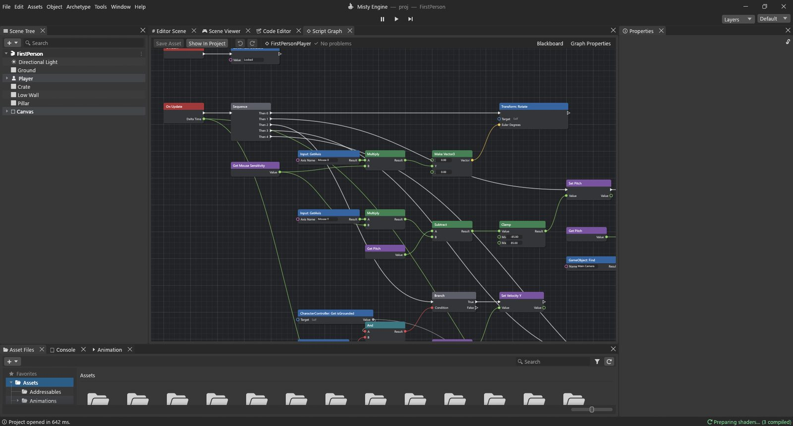

# Guide: a first-person player

In this guide you build the classic first-person controls: **W A S D** to walk, the **mouse**
to look around, **Space** to jump, with the camera at eye height. It is one Script Graph of
about fifty nodes, built in seven small steps.

**The example:** `Assets/Guides/FirstPerson/FirstPerson.scene` and its graph
`FirstPersonPlayer.vgraph`. Open it, press Play, walk around.



## The setup

The player is one object with a child camera:

- **Player**: tag *Player*, a **Character Controller** archetype (Height 1.8, Radius 0.35,
  Center Y 0.9: the capsule stands on the object's origin), the Script Graph, and a capsule
  mesh as its body.
- **Main Camera**, a child of Player at **Y 1.6** (eye height), with a **Camera**.

Why a Character Controller? It moves a capsule through the world, sliding along walls and
climbing small steps, and it tells you whether it stands on the ground. You give it the
movement you want; it does the colliding.

Why is the camera a child? Children follow their parent. When the body turns left, the camera
turns with it. Only the up-and-down look is the camera's own.

## The variables

On the Blackboard:

| Name | Type | Scope | Start | Used for |
|---|---|---|---|---|
| Walk Speed | Float | Object | 5 | metres per second |
| Jump Speed | Float | Object | 5 | upward speed when jumping |
| Mouse Sensitivity | Float | Object | 2 | how fast the mouse turns |
| Gravity | Float | Graph | -15 | how fast falling speeds up |
| Velocity Y | Float | Graph | 0 | current up / down speed |
| Pitch | Float | Graph | 0 | how far the camera looks up or down, in degrees |

The first three are **Object** variables, so you can tune them in Properties for each player.

## Step 1: lock the mouse

**On Start ▸ Cursor: Set lockState** with **Value** = `Locked`.

- **On Start** runs once, when the game starts.
- **Cursor: Set lockState** hides the mouse pointer and keeps it in the window, so moving the
  mouse turns the view instead of leaving the window. `None` frees it again, `Confined` keeps
  it in the window but visible.

*Also useful for:* freeing the cursor when a pause menu opens (`None`) and locking it again
when it closes.

## Step 2: one event, five jobs in order

**On Update ▸ Sequence** (set its output count to **5** in the Graph Inspector).

- **On Update** runs every frame. Its **Delta Time** output is the time since the last frame,
  in seconds (about 0.016 at 60 FPS).
- **Sequence** runs **Then 0**, **Then 1** … **Then 4** one after the other. We use one output
  per job: turn, tilt, jump, gravity, move. It does nothing by itself; it just keeps the
  graph readable.

*Also useful for:* any event that has several unrelated things to do.

## Step 3: look left and right (turn the body)

```
Input: GetAxis ("Mouse X") ─► Multiply ◄─ Get Mouse Sensitivity
                                │
                     Make Vector3 (Y) ─► Transform: Rotate ◄── Then 0
```

- **Input: GetAxis** with **Axis Name** = `Mouse X` gives how far the mouse moved sideways
  this frame (about 0.1 per pixel; right is positive). The axes are set up in Project Settings
  ▸ Input: `Horizontal` and `Vertical` (A/D and W/S, or a stick) and `Mouse X` / `Mouse Y`.
- **Multiply** (Math ▸ Float) multiplies **A** by **B**: the mouse movement times the
  sensitivity.
- **Make Vector3** builds an X, Y, Z value. We only fill **Y**: turning around the up axis.
- **Transform: Rotate** turns its **Target** by **Euler Degrees**. The Target is unconnected,
  so it turns the Player itself.

*Also useful for:* Rotate is how you spin coins, fans and turrets. Make Vector3 is how you
build any position, direction or rotation from separate numbers.

## Step 4: look up and down (tilt the camera)

```
Get Pitch ─► Subtract ◄─ Multiply ◄─ Input: GetAxis ("Mouse Y"), Get Mouse Sensitivity
               │
            Clamp (-85, 85) ─► Set Pitch ◄── Then 1
                                   │
GameObject: Find ("Main Camera") ─► Transform: Set localEulerAngles ◄─ Make Vector3 (X ◄ Get Pitch)
```

- **Input: GetAxis** `Mouse Y`: how far the mouse moved up (positive) or down.
- **Subtract** gives **A − B**: the current Pitch minus the mouse movement. In a rotation,
  a *negative* X looks up, so moving the mouse up must make Pitch smaller.
- **Clamp** keeps **Value** between **Min** (−85) and **Max** (85). Without it you could look
  so far up that the view flips over.
- **Set Pitch** stores the result. We keep the angle in a variable instead of reading it
  back from the camera, because angles read back from a rotation can come back as different
  but equivalent numbers.
- **GameObject: Find** returns the object with that **Name** (`Main Camera`).
- **Transform: Set localEulerAngles** sets the camera's rotation *relative to its parent*:
  X = Pitch, Y and Z = 0. Because the body already turned left / right, the camera only adds
  the tilt.

*Also useful for:* Clamp limits health between 0 and 100 or keeps a camera inside a box.
Set localEulerAngles is how you turn a part of an object (a door on its hinge, a turret's
barrel) without turning the whole thing.

> [!TIP]
> Finding an object by name searches the whole scene. Here it is fine (one player), but on
> hundreds of objects, find once in **On Start**, keep the result in a GameObject variable and
> use that.

## Step 5: jump

```
CharacterController: Get isGrounded ─┐
Input: GetKeyDown ("space") ─────────┴► And ─► Branch ◄── Then 2
                                                 └ True ─► Set Velocity Y ◄─ Get Jump Speed
```

- **CharacterController: Get isGrounded** is true when the capsule touched the ground during
  its last move.
- **Input: GetKeyDown** with **Key** = `space` is true only on the frame the key goes down.
  (**Input: GetKey** is true *while* it is held, **GetKeyUp** on the frame it is released.)
- **And** is true only when **A** and **B** are both true: on the ground *and* Space pressed.
  No jumping in mid-air.
- **Branch** sends the flow out of **True** or **False** depending on its **Condition**.
- **Set Velocity Y** = Jump Speed: we are now moving up at 5 m/s.

*Also useful for:* GetKeyDown + Branch is the pattern for every "press a key to do
something" (open a door, fire, interact). And / Or / Not combine conditions.

## Step 6: gravity

```
Get Velocity Y ─► Add ◄─ Multiply ◄─ Get Gravity, On Update.Delta Time
                   │
                   ├─► Max (B = -1) ─► Select.True
                   └─────────────────► Select.False      Select.Condition ◄─ Get isGrounded
                                          │
                              Set Velocity Y ◄── Then 3
```

Each frame, gravity changes the vertical speed a little: *speed = speed + gravity × frame time*.

- **Multiply** Gravity × Delta Time: how much speed gravity adds this frame (−15 × 0.016 ≈
  −0.25).
- **Add** gives **A + B**: the new falling speed.
- **Max** gives the bigger of **A** and **B**. On the ground we don't want the fall speed to
  keep growing, so we keep it at no less than −1 (a small push down keeps the capsule in touch
  with the ground, so isGrounded stays true).
- **Select** picks **True** or **False** depending on **Condition**, like a Branch for
  values: on the ground use the capped speed, in the air the growing one.
- **Set Velocity Y** stores it.

*Also useful for:* Select is perfect for "this value or that one" (a speed for walking or
running, a colour for on or off). Max and Min keep values from going past a limit.

## Step 7: move

```
Transform: Get right ─► Scale ◄─ Input: GetAxis ("Horizontal")
Transform: Get forward ─► Scale ◄─ Input: GetAxis ("Vertical")
        both ─► Add ─► Scale (× Get Walk Speed) ─► Add ◄─ Make Vector3 (Y ◄ Get Velocity Y)
                                                 │
                                 Scale (× Delta Time) ─► CharacterController: Move.motion ◄── Then 4
```

- **Input: GetAxis** `Horizontal` is −1 (A), 0 or 1 (D); `Vertical` is −1 (S) to 1 (W). With
  keys it eases in and out over a moment, with a stick it follows the stick.
- **Transform: Get right** and **Get forward** are the directions the Player faces, as
  Vector3s of length 1. Because Step 3 turned the body, "forward" is where you look.
- **Scale** (Math ▸ Vector3) multiplies a **Vector** by a number (**Scale**): right × the
  A/D amount, forward × the W/S amount.
- **Add** (Math ▸ Vector3) adds two vectors: the walking direction. Then **Scale** by Walk
  Speed gives a velocity in metres per second.
- **Make Vector3** with only **Y** = Velocity Y, **added** to it, puts the jump and fall in.
- **Scale** by **Delta Time** turns "metres per second" into "metres this frame".
- **CharacterController: Move** moves the capsule by **motion**, sliding along walls. It adds
  no gravity of its own: that's why we did Step 6.

*Also useful for:* this "direction × speed × Delta Time" chain moves anything at a steady
speed: enemies, platforms, projectiles.

## Try it

Press Play: WASD walks, the mouse looks, Space jumps. Then experiment:

- Select the Player and change **Walk Speed**, **Jump Speed** or **Mouse Sensitivity** in
  its Script Graph card in Properties, even while playing.
- Set **Gravity** to −5 for moon jumps.
- Walking diagonally is a bit faster than straight, because the two directions add up. Put a
  **Normalize** after the first **Add** if you want the same speed in every direction.

> [!PROGRAMMERS]
> The same controller in Lua, for comparison:
> ```lua
> -- pitch, vy and gravity are fields of the script.
> function Update()
>     local dt = Time.deltaTime
>     local sens = self.mouseSensitivity
>     transform:Rotate(Vector3.new(0, Input.GetAxis("Mouse X") * sens, 0))
>     pitch = Mathf.Clamp(pitch - Input.GetAxis("Mouse Y") * sens, -85, 85)
>     camera.transform.localEulerAngles = Vector3.new(pitch, 0, 0)
>     local cc = gameObject:GetComponent("CharacterController")
>     if cc.isGrounded and Input.GetKeyDown("space") then vy = self.jumpSpeed end
>     vy = cc.isGrounded and math.max(vy + gravity * dt, -1) or vy + gravity * dt
>     local move = (transform.right * Input.GetAxis("Horizontal")
>         + transform.forward * Input.GetAxis("Vertical")) * self.walkSpeed
>     cc:Move((move + Vector3.new(0, vy, 0)) * dt)
> end
> ```
> In the graph, the `isGrounded` value feeds both the jump and the gravity steps; each action
> that reads it gets it computed when that action runs.
