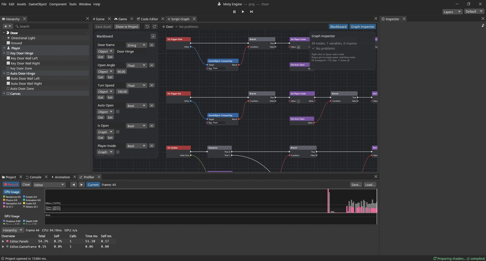

# Guide: a door that opens and closes

A door is the perfect second project: it needs a **zone** that notices the player, a **key
press**, a remembered **open / closed state** and a **smooth turn** on its hinge. The same
graph works two ways: press **E** to open and close, or (with **Auto Open** on) open by itself
when you walk up and close when you leave.

**The example:** `Assets/Guides/Door/Door.scene` and `Door.vgraph`. The scene has two doors
using the same graph: the left one waits for **E**, the right one has **Auto Open** ticked.
It reuses the first-person player from the previous guide.



## The setup

Each door is three objects:

- **Key Door Hinge**: an empty object standing where the hinge is. Turning it turns the door
  around its edge, not its middle.
- **Key Door**, a child of the hinge, moved 1 m to the side: the door panel (a box with a Box
  Collider and a kinematic Rigidbody, so the player bumps into it but it isn't pushed).
- **Key Door Zone**: an empty object in front of the doorway with a **Box Collider** that has
  **Is Trigger** ticked (3 × 2 × 3 m). A trigger doesn't block anything; it only reports who
  comes in and goes out. The Script Graph is on this object.

The player must have the tag **Player** (the first-person player does).

> [!TIP]
> The hinge trick works for anything that turns around an edge: lids, levers, drawbridges. Put
> an empty object at the pivot point and the moving part as its child.

## The variables

| Name | Type | Scope | Start | Used for |
|---|---|---|---|---|
| Door Name | String | Object | Door Hinge | the name of the hinge to turn |
| Open Angle | Float | Object | 90 | how far it opens, in degrees |
| Turn Speed | Float | Object | 180 | degrees per second |
| Auto Open | Bool | Object | false | open by walking in, instead of with E |
| Is Open | Bool | Graph | false | should the door be open? |
| Player Inside | Bool | Graph | false | is the player in the zone? |
| Angle | Float | Graph | 0 | where the door is now |

Because the first four are Object variables, each zone sets its own in Properties: the left
zone has *Door Name* = `Key Door Hinge`, the right one `Auto Door Hinge` and *Auto Open*
ticked.

Notice the difference between **Is Open** (what we *want*) and **Angle** (where the door
*is*). Pressing E changes the wish instantly; the door then turns towards it over a moment.
Keeping "state" and "motion" apart is what makes the turn smooth.

## Step 1: the player walks in

```
On Trigger Enter ─► Branch ◄─ GameObject: CompareTag (Target ◄ Other, Tag "Player")
                      └ True ─► Set Player Inside (true) ─► Branch ◄─ Get Auto Open
                                                              └ True ─► Set Is Open (true)
```

- **On Trigger Enter** runs when something enters this object's trigger. **Other** is what
  came in.
- **GameObject: CompareTag** is true when its **Target** has the **Tag** (`Player`). Other
  things (a rolling ball, an enemy) are ignored.
- **Branch** continues from **True** only for the player.
- **Set Player Inside** = true remembers it for Step 3.
- A second **Branch** on **Get Auto Open**: if the zone opens by itself, **Set Is Open** = true.

*Also useful for:* On Trigger Enter + CompareTag is how you make pick-ups, checkpoints,
damage zones, cut-scene triggers and "you win" flags.

## Step 2: the player walks out

The mirror image: **On Trigger Exit ▸ Branch (CompareTag Player) ▸ Set Player Inside (false)
▸ Branch (Auto Open) ▸ Set Is Open (false)**.

- **On Trigger Exit** runs when something leaves the trigger.
- With Auto Open the door closes behind you; without it, the door stays as you left it.

## Step 3: press E to toggle

```
On Update ─► Sequence ─ Then 0 ─► Branch ◄─ And ◄─ Get Player Inside, Input: GetKeyDown ("e")
                                    └ True ─► Set Is Open ◄─ Not ◄─ Get Is Open
                                                  └─► Debug: Log ◄─ Select (Is Open: "Door opened" / "Door closed")
```

- **On Update ▸ Sequence** with two outputs: Then 0 handles the key, Then 1 the turning.
- **Input: GetKeyDown** `e` is true on the frame E goes down.
- **And** with **Get Player Inside**: E only works near the door.
- **Not** turns true into false and false into true. Setting Is Open to *not Is Open* flips it:
  open becomes closed, closed becomes open. That's a toggle.
- **Select** picks the text by the new state, and **Debug: Log** writes it to the Console.
  Logging is the easiest way to check that your logic does what you think.

*Also useful for:* "Set X = Not X" toggles anything: a flashlight, a menu, a light switch. The
**Flip Flop** node does the same as a flow (A, B, A, B…).

## Step 4: turn smoothly

```
Get Is Open ─► Select (True ◄ Get Open Angle, False 0) ─► Move Towards.Target
Get Angle ───────────────────────────────────────────► Move Towards.Current
Get Turn Speed × On Update.Delta Time (Multiply) ─────► Move Towards.Max Delta
                                                            │
                                       Set Angle ◄── Then 1 ┘
                                           └─► Transform: Set localEulerAngles
                                                 Target ◄ GameObject: Find ◄ Get Door Name
                                                 Value  ◄ Make Vector3 (Y ◄ Get Angle)
```

- **Select** gives the target angle: Open Angle (90) when the door should be open, 0 when not.
- **Move Towards** moves **Current** towards **Target** by at most **Max Delta**, and never
  past it. With Max Delta = Turn Speed × Delta Time, the door turns at 180 degrees per second
  and stops exactly at 90 or 0.
- **Set Angle** stores the new angle.
- **GameObject: Find** with the **Door Name** variable finds this zone's hinge.
- **Transform: Set localEulerAngles** sets the hinge's rotation: Y = Angle.

*Also useful for:* Move Towards is the simplest way to animate a number at a steady speed: a
health bar draining, a light fading, a platform sliding (its Vector3 version moves positions).
For a gentler start and stop, use **Lerp** with a small T each frame instead.

## Try it

Press Play. Walk up to the left door and press **E**: it swings open, and the Console says
*Door opened*. Press E again to close it. Walk to the right door: it opens as you arrive and
closes when you walk away.

Ideas:

- Lower **Turn Speed** for a heavy castle gate, raise **Open Angle** to 120.
- Make a sliding door: replace the rotation with **Transform: Set localPosition** and the
  **Move Towards** with its Vector3 version.
- Lock a door until the player has a key: add a Bool Object variable *Has Key* on the player,
  read it with **Get Object Variable** (Target = Other), and **And** it into Step 3.

> [!PROGRAMMERS]
> Event order per frame: triggers are reported after each physics step, before On Update, so
> Step 3 always sees an up-to-date Player Inside. The zone's graph instance is per object:
> the two doors share the asset but not their Graph variables.
