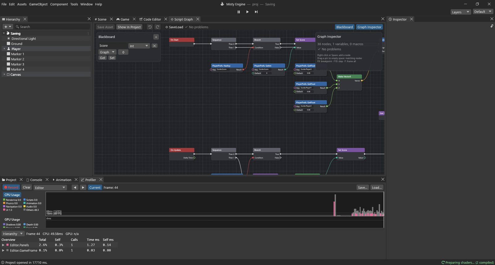

# Guide: saving and loading

Games remember things: the high score, the volume, where you were. In this guide the player
earns points with **F**, saves with **F5**, and the next time the game starts, the score and
the player's position come back.

**The example:** `Assets/Guides/Saving/Saving.scene` and `SaveLoad.vgraph`. The player has two
graphs: the first-person controls from guide 5, and this one. An object can carry as many
graphs as you like; each does its own job.



## PlayerPrefs in one minute

**PlayerPrefs** is a small notebook the game keeps on the player's computer. Each line has a
**key** (a name you choose, like `Guide.Score`) and a value: a whole number (Int), a number
with decimals (Float) or text (String).

| Node | What it does |
|---|---|
| PlayerPrefs: SetInt / SetFloat / SetString | Writes **Value** under **Key**. |
| PlayerPrefs: GetInt / GetFloat / GetString | Reads the value of **Key**; gives **Default** if there is none. |
| PlayerPrefs: HasKey | True when something was saved under **Key**. |
| PlayerPrefs: DeleteKey | Forgets **Key**. |
| PlayerPrefs: Save | Writes the notebook to disk now. |

> [!WARNING]
> The Set nodes change the notebook in memory. **PlayerPrefs: Save** writes it to the file.
> If the game crashes before a Save, the changes are lost. A built game also saves when it
> quits normally.

Where is the file? In the editor, `Library/PlayerPrefs.json` in your project (so it never ends
up in your game). In a built game, the player's settings folder (on Windows,
`%APPDATA%\<Company>\<Product>\prefs.json`).

> [!TIP]
> Start your keys with the game or system name (`Guide.Score`, `Options.Volume`) so they never
> clash with others. The engine keeps its own under `Misty.` (the quality level, the window
> size).

## The variable

One Graph variable: **Score** (Int, starts at 0).

## Step 1: load on start

```
On Start ─► Sequence ─ Then 0 ─► Branch ◄─ PlayerPrefs: HasKey ("Guide.Score")
                                   └ True ─► Set Score ◄─ PlayerPrefs: GetInt ("Guide.Score")
                                               └─► Transform: Set position ◄─ Make Vector3
                                                     X ◄ PlayerPrefs: GetFloat ("Guide.PlayerX")
                                                     Y ◄ PlayerPrefs: GetFloat ("Guide.PlayerY")
                                                     Z ◄ PlayerPrefs: GetFloat ("Guide.PlayerZ")
                                                   └─► Debug: Log ("Loaded the saved game")
                    └ Then 1 ─► Text: Set text ◄─ Append ("Score: " + Get Score)
                                  Target ◄ GameObject: Find ("Score Text")
```

- **Sequence** first loads (Then 0), then shows the score (Then 1), whether or not there was a
  save.
- **PlayerPrefs: HasKey** checks that a save exists. The first time you play there is none,
  and **Branch** skips the loading: the player starts where the scene puts it.
- **PlayerPrefs: GetInt** reads the score into **Set Score**.
- Three **PlayerPrefs: GetFloat** read X, Y and Z; **Make Vector3** puts them together, and
  **Transform: Set position** moves the player there. (PlayerPrefs can't store a Vector3, so we
  store its three numbers.)
- **Append** joins two texts: `Score: ` and the score (the Int becomes text by itself).
- **Text: Set text** changes a UI Text's words. Its Target is the **Score Text** object, found
  by name.

*Also useful for:* HasKey + Branch is how you show "Continue" only when a save exists, or a
tutorial only the first time.

## Step 2: earn points

```
On Update ─► Sequence ─ Then 0 ─► Branch ◄─ Input: GetKeyDown ("f")
                                    └ True ─► Set Score ◄─ Add (Get Score + 10)
                                                └─► Text: Set text ◄─ Append ("Score: " + Get Score)
```

- **Add** (Math ▸ Int) adds two whole numbers: Score + 10.
- The text is updated right away, the same way as on start.

In a real game, points come from coins or enemies; a **Custom Event** sent by the coin would
start this flow instead of the key.

## Step 3: save with F5

```
          Then 1 ─► Branch ◄─ Input: GetKeyDown ("f5")
                      └ True ─► PlayerPrefs: SetInt ("Guide.Score", Get Score)
                                 └─► PlayerPrefs: SetFloat ("Guide.PlayerX", X)
                                      └─► PlayerPrefs: SetFloat ("Guide.PlayerY", Y)
                                           └─► PlayerPrefs: SetFloat ("Guide.PlayerZ", Z)
                                                └─► PlayerPrefs: Save ─► Debug: Log ("Game saved")
Transform: Get position ─► Break Vector3 ─► X, Y, Z
```

- **Transform: Get position** is where the player stands, and **Break Vector3** splits it into
  **X**, **Y** and **Z** for the three SetFloat nodes. (Make Vector3 builds one, Break
  Vector3 takes one apart.)
- The Set nodes write the values; **PlayerPrefs: Save** writes the file.

*Also useful for:* save at a checkpoint (On Trigger Enter), every minute (**On Timer**), or
when a level ends. Use the same keys in Step 1 and Step 3: a typo in a key means the value is
never found.

## Try it

1. Press Play. Press **F** a few times: the score goes up.
2. Walk somewhere else and press **F5**. The Console says *Game saved*.
3. Stop, and press Play again. The Console says *Loaded the saved game*, the score is back and
   you stand where you saved.

To start over, delete `Library/PlayerPrefs.json` while not playing, or add a key (say F8)
that runs **PlayerPrefs: DeleteKey** for the four keys and then **PlayerPrefs: Save**.

## Bigger saves

PlayerPrefs is for a handful of values: settings, a high score, the last level. For a whole
game state (every enemy, every opened chest, many slots with thumbnails) use the **Save
System**: give objects a **Saveable** archetype and call `SaveSystem.Save(slot)` /
`SaveSystem.Load(slot)` (these are also available as engine nodes, *SaveSystem: Save* and
*SaveSystem: Load*). Window ▸ General ▸ **Save Data** shows what's in the slots.

> [!PROGRAMMERS]
> The PlayerPrefs nodes are native with typed pins (`Key: String`, `Value: Int/Float/String`,
> `Default`), the same store as Lua's `PlayerPrefs.SetInt(k, v)` / `GetInt(k, d)`. Values live
> in one process-wide map; `Save` writes JSON only when something changed.
