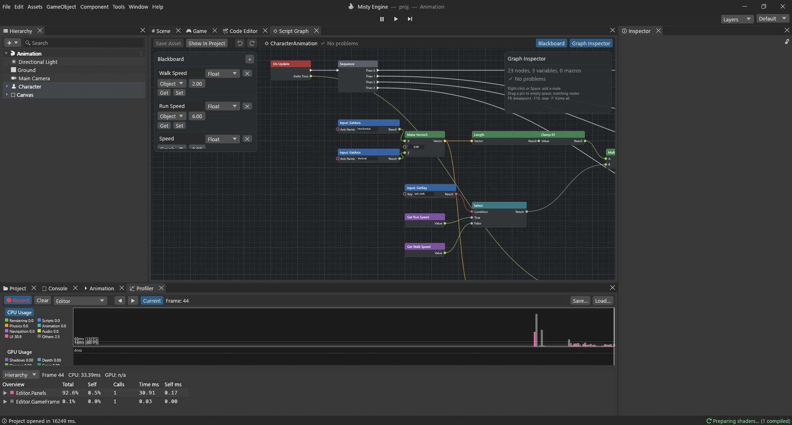
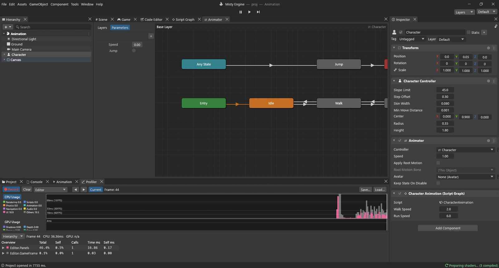

# Guide: animation transitions

A character should stand still when you don't touch anything, walk when you push forward, run
when you hold Shift, and jump when you press Space. Two things work together for that:

- an **Animator Controller**: a map of the animations (*states*) and the rules for going from
  one to another (*transitions*);
- a **Script Graph** that measures how fast the character moves and tells the Animator.

The graph doesn't pick animations itself. It only reports *facts* ("the speed is 2.3", "jump
now") and the Animator's rules decide what to play. That split keeps both simple.

**The example:** `Assets/Guides/Animation/Animation.scene`, its graph
`CharacterAnimation.vgraph` and the controller `Character.controller`, with four little clips
(`Idle`, `Walk`, `Run`, `Jump`) that move the box-shaped character's **Body**.



## The Animator Controller

Double-click `Character.controller` to open it in the **Animator** window.



**Parameters** are the values the graph sets:

| Parameter | Type | Meaning |
|---|---|---|
| Speed | Float | how fast the character moves, in metres per second |
| Jump | Trigger | a one-shot signal: "jump now" |

A **Trigger** is like a Bool that switches itself off as soon as a transition uses it, so one
press causes one jump.

**States**: **Idle** (the starting state), **Walk**, **Run** and **Jump**, each
playing its clip.

**Transitions** (the arrows), each with a condition:

| From | To | When |
|---|---|---|
| Idle | Walk | Speed greater than 0.5 |
| Walk | Idle | Speed less than 0.5 |
| Walk | Run | Speed greater than 4 |
| Run | Walk | Speed less than 4 |
| Any State | Jump | Jump (trigger) |
| Jump | Exit | at 90% of the clip (exit time) |

**Any State** means "from wherever we are", so you can jump while standing, walking or
running. **Exit** goes back to the starting state, Idle, and from there the Speed rules take
over again. Each transition blends for 0.15 s (0.1 s for Jump) so the change isn't a pop.

The **Character** object has a **Character Controller** archetype (to move) and an
**Animator** archetype with this controller. The clips move the child **Body**.

## The variables

| Name | Type | Scope | Start | Used for |
|---|---|---|---|---|
| Walk Speed | Float | Object | 2 | metres per second when walking |
| Run Speed | Float | Object | 6 | metres per second when running |
| Speed | Float | Graph | 0 | this frame's speed |

## Step 1: how fast?

```
Input: GetAxis ("Horizontal") ─► Make Vector3.X
Input: GetAxis ("Vertical") ───► Make Vector3.Z ─► Length ─► Clamp 01 ─► Multiply.A
Input: GetKey ("left shift") ─► Select.Condition (True ◄ Get Run Speed, False ◄ Get Walk Speed) ─► Multiply.B
                                                                          │
                                         On Update ─► Sequence ─ Then 0 ─► Set Speed
```

- **Make Vector3** puts the two axes into one direction (X sideways, Z forward).
- **Length** (Math ▸ Vector3) is how long that vector is: 0 when nothing is pressed, 1 when W
  is held, a bit more than 1 diagonally, anything in between with a stick.
- **Clamp 01** keeps it between 0 and 1: the "how much" of the input.
- **Input: GetKey** `left shift` is true while Shift is held.
- **Select** picks Run Speed or Walk Speed.
- **Multiply** gives the speed: 0 standing, 2 walking, 6 running.

*Also useful for:* Length measures any distance or speed (how far the enemy is, how fast a car
goes). Clamp 01 turns any amount into a safe 0-to-1 value, ready for **Lerp**.

## Step 2: move

```
Make Vector3 ─► Normalize ─► Scale (× Get Speed) ─► Scale (× Delta Time) ─► CharacterController: Move ◄── Then 1
```

- **Normalize** makes the direction exactly 1 long (and leaves "nothing pressed" at zero), so
  diagonal moves aren't faster.
- **Scale** by Speed, then by **Delta Time**: how far to move this frame.
- **CharacterController: Move** moves the character.

## Step 3: tell the Animator

```
Then 2 ─► Animator: SetFloat (Name "Speed", Value ◄ Get Speed, Damp Time 0.1)
```

- **Animator: SetFloat** sets a Float parameter on the **Target**'s Animator (unconnected:
  this object). **Name** must match the parameter exactly.
- **Damp Time** eases the parameter towards the new value over about 0.1 s instead of jumping.
  When you let go of W, Speed slides from 2 to 0, passing 0.5 on the way: Walk ends just as
  the character stops. Set it to 0 to jump straight to the value.

The related nodes: **Animator: SetBool**, **SetInteger**, **SetTrigger**, **ResetTrigger**
to set parameters, and **Animator: GetFloat / GetBool / GetInteger** to read them back.

## Step 4: jump

```
Then 3 ─► Branch ◄─ Input: GetKeyDown ("space")
            └ True ─► Animator: SetTrigger (Name "Jump")
```

- **Animator: SetTrigger** fires the *Jump* trigger. The *Any State → Jump* transition uses
  it, the Jump clip plays once, and the *Jump → Exit* transition brings the character back.

*Also useful for:* triggers suit every one-off action: attack, open a chest, wave, take a hit.
Use a **Bool** for things that last (crouching, aiming, swimming) and a **Float** for things
that vary (speed, turning).

## Try it

Press Play and open **Window ▸ Animation ▸ Animator** next to the Scene Viewer. The current
state is highlighted, and the parameters show their live values.

- Stand still: **Idle**. Hold **W**: **Walk**. Add **Shift**: **Run**. Let go: back through
  Walk to Idle. Press **Space**: **Jump**.
- Change the thresholds in the Animator (click a transition) and see the switch points move.
- Change **Walk Speed** to 4.5 in Properties: walking is now fast enough to count as running.

> [!PROGRAMMERS]
> Lua equivalent of Steps 3 and 4:
> ```lua
> local anim = gameObject:GetComponent("Animator")
> anim:SetFloat("Speed", speed, 0.1, Time.deltaTime)
> if Input.GetKeyDown("space") then anim:SetTrigger("Jump") end
> ```
> The graph's Animator nodes are native: they talk to the same Animator player as Lua, and a
> Target without an Animator reports an error naming the object. Parameters are checked by
> name and type; a wrong name logs a warning instead of failing silently.
