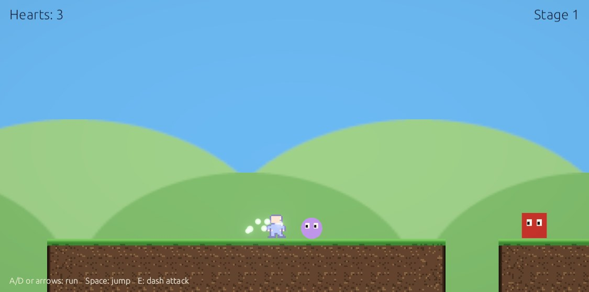

# A game made only with nodes

Can you make a whole game without writing code? Yes. **Lumo's Leap** is a short 2D platformer
in the sample project: a main menu, three stages, two kinds of enemies, a dash attack and a
win screen. Everything it does is Script Graphs. There is not one line of Lua in it.

**The example:** the folder `Assets/NodeGame` of the sample project. Open
`Scenes/NodeGameMenu.scene` and press **Play**. The graphs are in `Graphs/`: double-click one
to read it in the Script Graph window.



## Play it

- **A / D** or the arrow keys: run. **Space** (or W, Up): jump. Hold it for a high jump, tap it
  for a small hop.
- **E**: dash attack. Lumo glows white and flies forward. Enemies in the way take a hit.
- A **Puff** (round, purple) needs one hit: it is pushed away, fades and is gone. A **Brute**
  (square, red) needs two: each hit flashes it white and knocks it back.
- Touching an enemy without dashing, or falling into a pit, costs a heart. With no hearts
  left the stage starts again.
- Reach the flag to go to the next stage. After stage 3 comes the win screen.

## Small graphs that talk to each other

One big graph for a whole game would be impossible to read. The game uses thirteen small
ones, each with one job:

| Graph | On | Job |
|---|---|---|
| Player Input | Player | turns keys into two variables and two events |
| Player | Player | running, jumping, dashing, hearts |
| Patrol | each enemy | walks; turns round at a ledge or a wall |
| Enemy Touch | each enemy | tells a dash hit from a hurt |
| Brute | Brutes | two hits, flash, knock back |
| Puff | Puffs | one hit, pushed away, fades out |
| Goal | the flag | says "stage cleared" |
| Stage | one object per stage | hearts on screen, loads the next scene |
| Camera Follow | Main Camera | follows the player |
| Menu, Win | the two screens | Play, Quit, back to the menu |
| Vanish | the Burst prefab | removes the particles when they are done |
| Autopilot | nothing | plays the stage by itself (try it in place of Player Input) |

They talk in two ways, and you have met both in the earlier chapters:

- **Object variables** are shared by all the graphs on one object. Player Input writes *Move*
  and *Jump Held*; Player reads them. Patrol, Brute and Puff share *Dead* and *Knock*.
  Other objects read them with **Get Object Variable**: an enemy asks the player "are you
  *Dashing*?".
- **Custom events** are messages. Player Input sends *JumpPressed* and *DashPressed*; Enemy
  Touch sends *DashHit* to its own enemy and *Hurt* to the player; the flag broadcasts
  *StageCleared* to everyone with **Broadcast Custom Event**.

> [!TIP]
> Keeping the keyboard in its own graph has a nice side effect: swap Player Input for
> Autopilot on the Player and the game plays itself, because Autopilot writes the same
> variables and sends the same events.

## Running and jumping

The Player graph moves a **Rigidbody 2D** by setting its velocity in **On Fixed Update**.

```
On Fixed Update ─► Branch (Get Dead) ─ False ─► Sequence
  Then 0 ─► Branch (Hit of Physics2D: Raycast ×3, down from the feet) ─► Set Grounded At ◄─ Time: Get time
  Then 3 ─► Branch (Get Dashing)
              └ False ─► Branch (jump pressed lately And on the ground lately)
                           ├ True ─► Set VY ◄─ Get Jump Speed
                           └ False ─► Branch (Rising And moving up And Not Jump Held)
                                        ├ True ─► Set VY ◄─ velocity Y × Get Jump Cut
                                        └ False ─► Set VY ◄─ velocity Y
              all three ─► Rigidbody2D: Set velocity ◄─ Make Vector3 (Get Move × Get Speed, Get VY)
```

- **Physics2D: Raycast** looks for ground just under the feet. The game does not store "is on
  the ground"; it stores *when* it last was (**Set Grounded At**). The same for the jump key:
  *JumpPressed* stores **Time: Get time** in *Jump Pressed At*.
- A jump happens when both moments are recent. That one test gives two things good platformers
  have: **coyote time** (you can still jump a moment after running off a ledge) and a **jump
  buffer** (a press just before landing still counts).
- **Variable jump height**: letting go of the key while still rising multiplies the upward
  speed by *Jump Cut* (0.5), so a tap is a hop.
- **Rigidbody2D: Set velocity** applies the result; gravity is left to the physics.

## The dash attack

```
Custom Event: DashPressed ─► Branch (cooldown over) ─► Set Dashing (true) ─► Set Dash Until
    ─► SpriteRenderer: Set color ◄─ Color: new (4, 4, 4) ─► ParticleSystem: Play
```

- While *Dashing* is true, Then 3 above sets the velocity to *Facing* × *Dash Speed* and
  nothing else: Lumo flies straight, even over a gap.
- **SpriteRenderer: Set color** with a colour four times brighter than white makes the sprite
  glow (the scene has a Post-process Volume with Bloom), and **ParticleSystem: Play** starts
  the white trail. When *Dash Until* has passed, the colour goes back and the trail stops.
- The dash never touches the enemies itself. It only sets *Dashing*; the enemies look at it.

## Enemies

Each enemy has a Box Collider 2D with **Is Trigger** ticked and three graphs.

- **Patrol** casts two rays each physics step: one down in front of its feet (a ledge?) and
  one ahead (a wall?). If either says stop it flips *Direction*; otherwise
  **Transform: Translate** moves it.
- **Enemy Touch** uses **On Trigger Enter 2D** and **On Trigger Exit 2D** with
  **GameObject: CompareTag** to know while the player is inside. Then, each **On Update**: is the player
  *Dashing*? Yes: send *DashHit* to itself. No: send *Hurt* to the player.
- **Brute** answers *DashHit*: *Health* minus one, *Knock* set (Patrol slides it back), a white
  flash, and after a **Delay** its colour returns. At zero it calls **Instantiate** with the
  Burst prefab and **Destroy**.
- **Puff** answers *DashHit* by setting *Dead*. From then on its **On Update** pushes it away,
  lowers *Fade* with **Move Towards**, writes it into the sprite's alpha and grows the sprite
  a little. When *Fade* reaches zero: **Destroy**.

> [!NOTE]
> Patrol knows nothing about hits, and Brute knows nothing about walking. They only share the
> *Knock* and *Dead* variables. That is why the Puff can reuse Patrol and Enemy Touch
> unchanged.

## Stages, hearts and the next scene

- **Goal** is a trigger on the flag: **On Trigger Enter 2D ▸ Branch (CompareTag Player) ▸ Do
  Once ▸ Broadcast Custom Event** *StageCleared*.
- **Stage** hears it, shows "Stage clear!" with **Text: Set text**, waits with a **Delay** and
  calls **SceneManager: LoadScene** with its *Next Scene* variable. Each stage sets *This
  Scene* and *Next Scene* in Properties, so one graph serves all three stages.
- The Player graph counts *Hearts*. Each change is broadcast as *HeartsChanged*, and Stage
  writes it on the screen. At zero the player broadcasts *PlayerDied* and Stage loads *This
  Scene* again. A dash broadcasts *DashUsed* with the time the next one is ready, and Stage
  shows "Dash: ready" or "Dash: ..." under the hearts.

> [!WARNING]
> **SceneManager: LoadScene** only finds scenes listed in **File ▸ Build Settings**. The five
> scenes of the game are listed there.

## The menu and the win screen

- The **Play** and **Quit** buttons have an **On Click** entry that names the Menu object and
  the event to send: *Play* or *Quit*. The Menu graph answers with **Custom Event** nodes:
  *Play* loads stage 1, *Quit* calls **Application: Quit**. The Play button starts selected,
  so Enter presses it; Escape sends *Quit*.
- **Win** waits with a **Delay** and then loads the menu; any of Enter, Space or Escape does
  it at once.

## Try it

Ideas for changing the game without leaving the editor:

- Select the Player and change *Jump Speed*, *Dash Speed* or *Hearts* in Properties.
- Give a Brute *Health* 3, or a Puff more *Speed*.
- Paint more ground with the Tile Palette, duplicate an enemy, move the flag.
- Add a fourth stage: duplicate a stage scene, add it to Build Settings and set *Next Scene*
  on the Game object of stage 3.

> [!PROGRAMMERS]
> Raycasts, overlap queries and the Rigidbody 2D velocity use native typed nodes (a raycast
> gives Hit, Point, Normal, Distance and Collider); no Lua script exists in the game. The project test `sample_node_game.rs` plays stage 1 headlessly
> with simulated keys, and `tools/node_game` regenerates the files.
