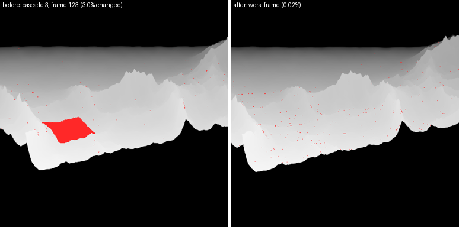
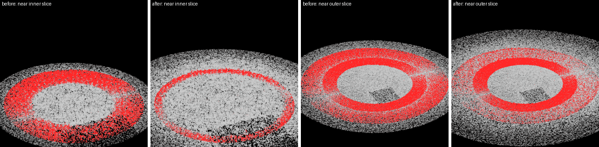
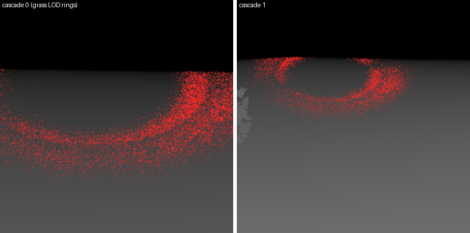
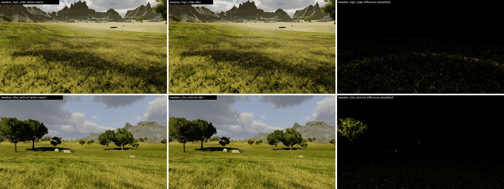

# Shadow stutter on the terrain (branch shadow-stutter)

Report: "The shadows on the terrain sometimes are stuttering. In some areas, I don't know why."
Goal: find what makes MeadowDemo's sun shadows change while the First Person Player walks and
turns (measured, not guessed), fix the real causes, keep the look where nothing was wrong.

## How it was measured

`render/shadow_stutter_tests.rs` (ignored GPU tests, run on purpose in release):

```
cargo test --release -p misty_engine --lib shadow_stutter_ -- --ignored --nocapture --test-threads=1
```

- **`shadow_stutter_maps`: is what the shadow maps hold independent of the camera?** The
  camera walks a scripted path: 60 frames a second, the player's 4 m/s walk (7 m/s run with
  `MISTY_STUTTER_SPEED=7`), a 3.5 cm stride bob, ±0.8° roll, ±1° pitch bob and ±12° of mouse
  drift; the wind clock is fixed. Every frame the four sun cascades and both near grass
  shadow map slices are read back (test builds give the shadow maps `COPY_SRC`). Cascades and
  near map are snapped to a texel grid fixed in the world, so for a static scene the same
  world texel must hold the same caster depth from one frame to the next. Every texel whose
  caster moved by more than 3 cm along the light, appeared or vanished is a caster that
  changed *because the camera moved*. That separates the causes from parallax exactly.
  Texels where the terrain crosses a cascade's far plane are left out: that plane follows the
  camera, and only receivers outside the cascade's sphere could read them. For the near map
  only the part the lit shaders read counts. A frozen camera gives 0 changed texels in every
  map. `MISTY_STUTTER_OFF=blades,trees` takes the grass or the tree shadows out to attribute
  the changes. `MISTY_STUTTER_DIR` writes change masks (red = changed).
- **`shadow_stutter_walk`: what the player sees.** It renders the same path twice per frame
  (as is, and with the sun's shadows off) at 1280×720. Every pixel is reprojected into the
  previous frame with the motion of its terrain point (a CPU ray march of the heightfield)
  and sampled there. The sums of each 8×8 block are compared, so the resampling noise of fine
  texture averages out. The shadow ratio `lum(on) / lum(off)` sorts blocks into shadow
  (< 0.5), penumbra (< 0.85) and lit. Per class the test reports the mean relative change,
  the share of blocks per frame that jump (change by more than 8 %), the spike frames and each
  frame's CPU events (terrain chunk LOD changes, tree LOD switches).
  - Paths: `walk`, `turn` (40°/s), `still` (fixed camera, clock running), `frozen`.
  - Places: the player's start, the oak, and the meadow under the north mountains' shadow
    (`-150,150,90`). That meadow is the only flat ground the terrain shadows: a CPU
    heightfield shadow map found it.

## Causes, one by one

Numbers: share of a map's texels whose caster changed per walking frame (High, 240 frames).
"Before" is main with the harness; "after" is this branch. The rocks merged from main are
included.

| candidate | measured | verdict |
|---|---|---|
| Grass casters in the **near grass shadow map** | inner slice: **12.3 %** of the read area changes every frame, outer slice 10.9 %, in rings around the camera | **cause** (fixed: inner 1.5 %, see below) |
| Grass casters in the **cascades** | cascade 0: 1.0 %/frame, cascade 1: 0.26 %, in a ring at 8.4–12 m (the hand-over from the near map) and in the grass LOD band | smooth LOD fades, not pops; left as is |
| **Terrain chunk LOD in the shadow passes** | High (150 m): 74 texels over 360 frames; one chunk flipped LOD 3 times in 5 frames with the stride bob (no hysteresis). With a 600 m shadow distance a whole 256 m chunk changed in one frame: **3.0 % of cascade 3** | **cause** "in some areas" (long shadow distances, local lights, virtual shadow map page re-renders); fixed |
| **Tree LOD switch** (cascade 0 used the camera's LOD, cross-fade off) | oak view, frame 0: **2,818 texels** of cascade 0 change in one frame (a tree crossing 45 m) | **cause**; fixed (0 after) |
| Cascade texel snapping / radius | frozen camera 0; cascades 2–3 while walking ≈ 1e-6 (rasterisation rounding of the alpha-tested leaves, ~65 texels) | stable |
| Near map re-centring | the map's centre never changes (masks) | stable |
| Alternating-frame updates | none found (per-frame series) | — |
| Cascade split / blend | view-depth based, moves with the camera by design (10 % blend band) | inherent; unchanged |
| TAA, temporal shadow mask, denoiser | fixed camera, fixed clock: 0.2 % block change (the floor) | not a cause |
| On-screen walk metric | dominated by the grass blades' own parallax (lit blocks 1–2 % change); the fixes do not move it measurably (oak: shadow jumps 0.0609 → 0.0607 per frame) | the map metric is the one that resolves the causes |

What the grass rings were:
- **Near map**: the casters faded out from 60 % of their reach (1.25 × the slice's half side),
  i.e. from 75 % of the half side. That is inside the part the lit shaders read (the inner
  slice to 95 % of its half side, the outer to its edge), so blades shrank within 3–4 m of
  the player and their crisp shadows changed every step.
- **Per-blade card re-cut**: shadow casters choose how many leaves a widened card shows with
  `round(fit)`, so a blade's shadow changed shape at once each time the LOD widening crossed
  a half, blade after blade.

## Fixes

1. **Terrain in the shadow maps at a camera-independent level of detail**
   (`terrain_lod::shadow_lods`, `ChunkDraw::shadow_lod`). Every chunk is drawn at full
   detail into the cascades, local light layers and virtual shadow map pages. The exception is
   a chunk inside the shadow distance that the camera sees coarser: it keeps the camera's level,
   so receivers match their own shadow-map surface, and its neighbours step up to it. With the
   presets' distances (≤ 250 m) no receiver is coarse, so nothing in the shadow maps follows the
   camera. Chunks are now culled per shadow map (before, every chunk went into every cascade),
   and the virtual shadow map's page invalidation follows the shadow-map detail, so a far
   chunk's LOD change no longer re-renders pages.
2. **Trees: a mesh LOD per shadow map, by its texel size** (`trees::shadow_lod`, shared with
   the virtual shadow map, which already chose this way): full mesh up to 3 cm texels, LOD 1
   up to 20 cm, impostors beyond. In practice High and Ultra get full meshes in cascades 0–1
   (cascade 1 was LOD 1), Medium in cascade 0 and Low LOD 1, all fixed per map.
3. **Near grass shadow map casters fade out past the part the lit shaders read**: the reach
   stays 1.25 × the half side, and the fade starts at 84 % of it, i.e. full height to
   1.05 × the half side. This works through a per-pass fade start in the grass uniform
   (`GrassParams::with_caster_fade`); the cascade casters keep 60 %.
4. **Grass shadow casters grow the next leaf in from the card's edge** (`repeat = fit` in
   shadow passes) instead of re-cutting the card.





## Before / after (High, after merging main with the rocks)

Share of each map's texels whose caster changed per frame, mean over 240 walking frames
(`shadow_stutter_maps`; 0 for a frozen camera).

| walk | map | before | after |
|---|---|---|---|
| start (4 m/s) | near map, inner slice (read area) | 12.35 % | **1.53 %** |
| | near map, outer slice | 10.89 % | 8.65 % |
| | cascade 0 / 1 | 1.00 % / 0.26 % | 1.00 % / 0.26 % (grass LOD fades) |
| | cascade 2 / 3 | 8e-6 / 2e-6 | 8e-6 / 2e-6 |
| oak (4 m/s) | near map, inner / outer | 11.99 % / 10.90 % | **1.61 %** / 8.74 % |
| oak, no grass (60 frames) | cascade 0, worst frame | 2,818 texels (tree LOD switch) | **0** |
| mountain meadow, 600 m shadow distance, no grass / trees (7 m/s) | cascade 3, worst frame | **3.02 %** (56,055 texels: a whole chunk) | 0.024 % (450 texels, rasterisation noise) |
| | cascade 3, mean | 0.0196 % | 0.0091 % |

The rocks merged from main (LOD Groups) add up to 0.01 % of cascade 2 in a frame. They
cross-fade with the camera's LOD like every LOD Group, the same before and after.

The on-screen metric (`shadow_stutter_walk`) can't separate these changes from the grass
blades' own parallax. Shadow-block jumps per frame at the oak: 6.09 % before, 6.07 % after.
In the mountain shadow: 2.4 % before, 2.7 % after, within run-to-run noise.

## Cost

`meadow_perf_times`, 1920×1080, GPU timestamps; before = main with the harness, two runs
each:

| | before | after |
|---|---|---|
| High wide, frame | 17.13 / 17.89 ms | 17.25 / 17.30 ms |
| High, shadow maps (cascades) | 0.59 ms | 0.54 ms (terrain culled per map) |
| High, near grass shadow map | 1.11 ms | 1.33 ms (taller blades near the slice edges) |
| High oak, frame | 15.48 / 15.49 ms | 15.62 / 15.71 ms |
| Medium wide: shadow maps / near map | 0.19 / 0.35 ms | 0.15 / 0.40 ms |
| Medium wide / oak, frame | 12.70 / 11.11 ms | 12.70 / 11.12 ms |
| Low oak, sum of parts | 7.42 ms | 7.40 ms |
| draws (High wide) | 685 | 453 |

Net: about +0.15 ms on High (the near map's taller blades, partly paid back by culling terrain
chunks per cascade) and ±0 on Medium and Low. The CPU cost is unchanged within noise.

## Golden shots

`cargo test --release -p misty_engine --lib golden_shots -- --ignored --nocapture --test-threads=1`
on main's references (with the rocks): CyclesRoom is unchanged at every level (mean 0.00). Four
MeadowDemo shots drift, as intended:
- `medium_close`, `high_close`, `ultra_close` (mean 0.86–1.03, 0.15–0.68 % of pixels): the
  near grass shadow map's blades now stand at full height around the crouching camera, and the
  shadow cards no longer re-cut, so the grass shadows differ in fine detail.
- `ultra_behind` (mean 0.55, 0.83 %): full tree meshes in cascade 1 shadow the crowns.

Every other shot stays within the tolerance. Only the meadow references were updated
(`MISTY_GOLDEN=update MISTY_GOLDEN_SHOTS=meadow`).



## Not done

- The cascade grass casters still fade in and out with the camera's distance: the hand-over
  from the near map (8.4–12 m) and the grass LOD thinning. These are smooth, a few
  millimetres per frame, not pops. Making them camera-independent would need the grass
  culling to draw every blade into the shadow maps.
- The outer near-map slice thins and widens its blades past the grass LOD distance (6.5 m),
  as the camera's grass does (8.7 % of its texels per frame, smooth).
- The camera's own terrain LOD still has no hysteresis: a far chunk can flip with the stride
  bob. That is now only visible in the main view (distant mountain silhouettes), not in the
  shadows.
- Tree mesh LOD switches in the main view (the cross-fade is still off).
