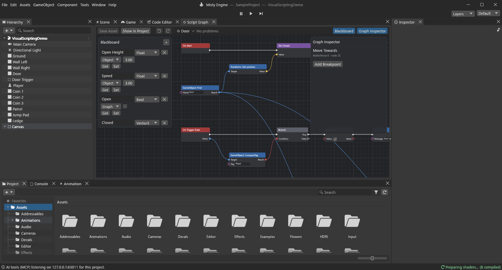
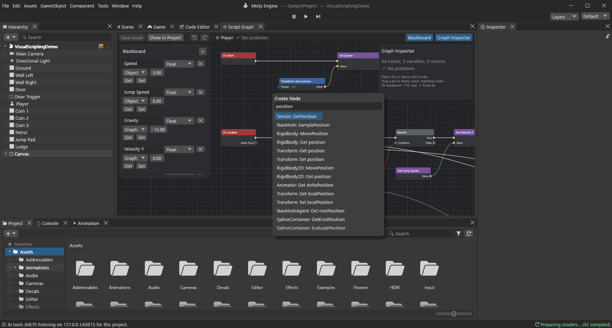
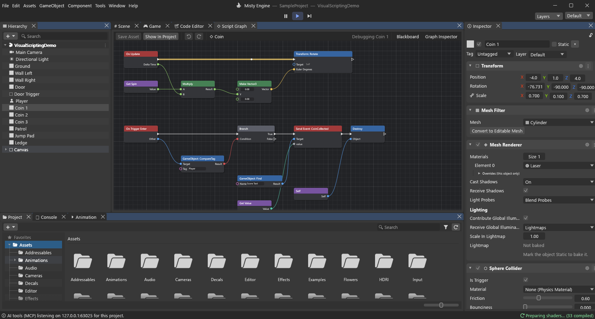
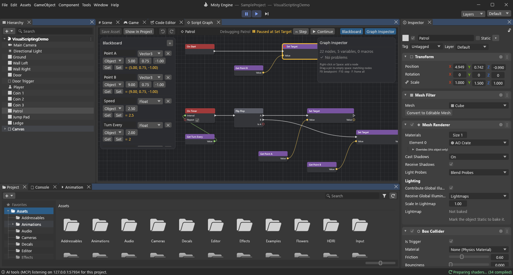
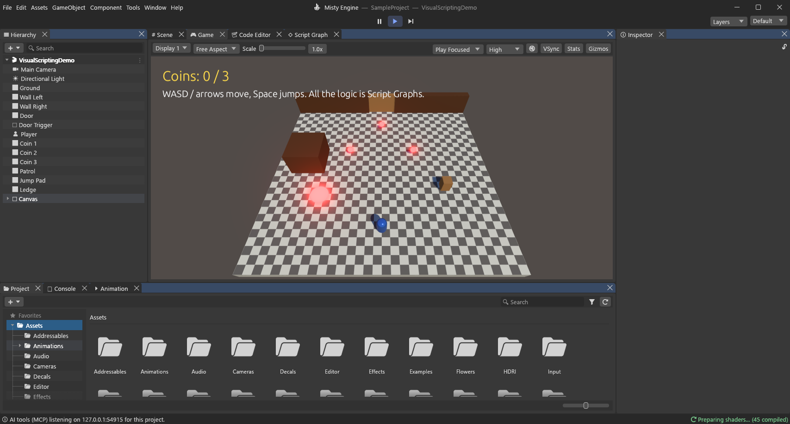

# Visual scripting

Script Graphs are node-based game logic: you connect nodes instead of writing code. A graph is an
asset (`.vgraph`, JSON) that runs on an object like a Lua script:
events start flows along white **exec** wires, and typed **data** wires carry values between
nodes. Graphs and Lua scripts work side by side and talk to each other.

## Making a graph

- **Assets ▸ Create ▸ Visual Script Graph** makes `New Script Graph.vgraph` with On Start and
  On Update events. Double-click a `.vgraph` to open it in the **Script Graph** window (also
  Window ▸ Visual Scripting ▸ Script Graph).
- Attach it like a script: **Add Archetype ▸ Scripts** lists graphs next to Lua scripts, or drag
  the asset onto an object in the Scene Tree. The Properties panel shows it as *Name (Script Graph)*; its fields are the
  graph's **Object variables**, set per object.
- **Save Asset** (Ctrl+S) writes the file. The window has its own undo / redo (Ctrl+Z / Ctrl+Y).

## The window

- **Right-click** or **Space**: the node search. With no text it lists the nodes by category
  (Events, Flow, Variables, Math, Logic, Comparison, Constants, String, Random, List, Engine,
  Lua, Subgraphs); type to filter everything, arrows + Enter to pick.
- **Drag a pin** onto another pin to wire it; wires are type-checked (ints widen to floats,
  anything converts to a string, Any meets every type; exec only meets exec). A refused wire
  says why at the bottom of the canvas. **Drop a wire on empty canvas** to get the search
  filtered to nodes with a pin that fits; the new node comes wired.
- Right-click (or Alt+click) a pin to break its wires. Unconnected inputs have inline value
  fields; an unconnected GameObject input means the graph's own object (*Self*).

- Select with click, Ctrl/Shift+click or a rubber band; drag to move; Delete, Ctrl+D duplicate,
  Ctrl+C / Ctrl+X / Ctrl+V (also through the system clipboard as JSON), Ctrl+G group, F frame
  all, wheel to zoom, middle mouse or Alt+drag to pan. Right-click the canvas for sticky notes.
- Nodes with a problem get a red **!** badge with the message (unknown node, missing variable,
  a wire whose types don't fit, data wires that loop, a For Each without a list…); the toolbar
  shows the first problem and the **Graph Properties** lists them all.
- **Blackboard** (left): the graph's variables — name, type, scope (Graph or Object), starting
  value — with Get / Set buttons. **Graph Properties** (right): settings of the selected node
  (variable, event name and arguments, input action, pin counts, Lua script and function,
  subgraph pins).

## Running graphs

Graphs are not turned into Lua. When Play starts each graph is checked and compiled to a compact
bytecode: a flat list of ops over a register file per instance. Pure nodes (no exec pins) are
**lazy**: they are flattened into the ops of the action node that reads them, so they compute
only when that node runs, once per run. Flow control (Sequence, loops) uses a small call stack;
a Delay schedules a continuation. Common math nodes run as direct float ops.

Measured on the benchmark test (`a_hundred_node_graph_on_a_thousand_objects…`): a 100-node graph
running On Update on 1,000 objects costs about 1 ms per frame in a release build (see
`docs/pending/r22-visual-scripting.md` for the numbers).

Events run in the frame like their Lua callbacks: On Start (first frame the object is active),
On Enable / On Disable, input actions, On Fixed Update (per physics step), triggers and
collisions (after each step), On Update, timers and Delays, On Late Update, On Destroy (before
the object goes). A flow that loops forever stops with an error after 20 million steps; a While
stops after its Max Iterations (10,000 by default). Run-time errors are logged once per node
with the object, graph and node names, and shown as badges while playing.

## Nodes

| Category | Nodes |
|---|---|
| Events | On Start, On Update (Delta Time), On Fixed Update, On Late Update, On Enable, On Disable, On Trigger Enter / Exit and On Collision Enter / Exit (Other), On Input Action (performed / held / released, with Value and Vector), Custom Event (named, with arguments), On Timer (Interval, Repeat), On Destroy, Send Custom Event, Broadcast Custom Event |
| Flow | Branch, Sequence (n outputs), For Loop (Break input), For Each, While (iteration guard), Do Once (Reset), Gate (Enter / Open / Close / Toggle, start closed), Flip Flop (Is A), Delay |
| Variables | Get / Set for each Blackboard variable, Get / Set Object Variable (any object, by name), Self |
| Math | Float: add … modulo, abs, min, max, clamp, lerp, inverse lerp, sin, cos, tan, atan2, sqrt, pow, floor, ceil, round, sign, move towards, ping pong, degrees to radians, pi. Int: add … modulo, min, max, abs, clamp, to float, truncate / round to int. Vector3: make, break, add, subtract, scale, negate, dot, cross, length, normalize, distance, lerp, move towards. Quaternion: euler, to euler, combine, rotate vector, look rotation, slerp, angle axis, inverse |
| Logic / Comparison | and, or, xor, not, select, is valid; less, greater, (or equal), equal, not equal, approximately equal |
| Constants, String, Random, List | Float / Int / Bool / String / Vector3 / Quaternion; append, to string, length; random float, random int; make list, count, get item |
| Engine | One node per member of the Lua API (see below) |
| Lua | Call Lua Function, Get Lua Field |
| Subgraphs | Graph Input, Graph Output, a node per macro and per project subgraph asset |

### Engine API nodes

The Engine categories are generated from the same binding table as the
[Lua API reference](api/lua-api.md): every property gets a *Get* node (and a *Set* node when it is
settable) and every function a node, so most Lua members are available — GameObject, Transform,
Rigidbody, Physics, Audio, UI, SceneManager, Time, Input, Debug and the rest. Object members have
a **Target** input (unconnected = the graph's own object; components are found with
`GetComponent`).

The common members run natively with typed pins: Transform position / localPosition /
eulerAngles / localEulerAngles / localScale / forward / right / up / rotation (a Quaternion, graph
only), Translate, Rotate, LookAt; GameObject name, tag, activeSelf, SetActive, CompareTag,
GameObject.Find, Destroy; Rigidbody velocity and AddForce; Physics.Raycast (Hit, Point, Normal,
Distance, Collider); Time; Input.GetKey / GetKeyDown / GetKeyUp / GetMouseButton(Down) /
GetAxis; Debug.Log / LogWarning / LogError. The others call the Lua binding: their pins take any
value, numbers, strings, booleans, Vector3, GameObjects and lists convert both ways, rotations
travel as Euler angles, and other Lua values (a hit table, a component) pass through as opaque
values you can read with **Get Lua Field**.

## Variables

- **Graph** variables are private to one running graph.
- **Object** variables live on the GameObject: the Properties panel sets them per object, the object's
  other graphs share them, other objects reach them with Get / Set Object Variable, and Lua reads
  and writes them with `gameObject:GetVariable(name)` / `gameObject:SetVariable(name, value)`.

## Graphs and Lua

- **Call Lua Function** calls `function` of the `script` instance on the Target (a Lua script
  on that object), with arguments; its Result is the first return value.
- **Send Custom Event** runs the Custom Event nodes of that name in the Target's graphs, and calls
  the Lua function of that name on the Target's scripts with the arguments. **Broadcast** does it
  for every object. Events are delivered right after the flow that sent them, in the same frame.
- Lua sends events to graphs with `gameObject:SendCustomEvent(name, ...)`.

## Subgraphs and macros

A subgraph is a graph with a **Graph Input** node (its pins become the Subgraph node's inputs)
and a **Graph Output** node (outputs). Pins are written `Name:type`, for example
`In:exec, Speed:float`; exec pins make the Subgraph node an action with exec in and out, so a
subgraph can contain flow control and Delays. A Subgraph node uses either a **macro** stored in
the graph file (select nodes ▸ right-click ▸ Collapse To Macro; double-click the node to edit
it, the toolbar's path goes back) or another `.vgraph` asset. Subgraphs are inlined when the
graph compiles, so they cost nothing at run time; each use has its own copy of the subgraph's
Graph variables. A subgraph that uses itself is refused.

## Debugging

While playing, the window shows the instance on the selected object (else the first object using
the graph): exec wires that just carried the flow glow, with a dot running along them; hovering a
pin shows its last value; the Blackboard shows live variable values. **F9** (or the node menu)
toggles a **breakpoint**: when a flow reaches the node, Play pauses before it runs and the node is
outlined. **Step** (F10) runs that node and stops at the next one; **Continue** lets the flow run
on and resumes Play. A flow still paused when the next frame runs carries on first.

## Sample

`Scenes/VisualScriptingDemo.scene` (graphs in `Assets/VisualScripting`) has no Lua at all: a
player on a Character Controller (axes, jump, gravity; `Launch` and `Respawn` events), a door
that opens while the player stands in its trigger, spinning coins that send `CoinCollected` to
the score text (formatted by a macro), a patrol that turns on a timer and sends the player back
when it catches it, and a jump pad.

## Design note: a block mode (not built yet)

A Scratch-like mode would be another view of the same `.vgraph` files, not a second runtime:

- **Blocks are exec chains.** A stack of blocks is a run of action nodes joined by exec wires;
  C-shaped blocks are flow nodes whose exec outputs hold nested stacks (Branch: *then* / *else*,
  For Loop: *body*, Sequence: one slot per output). Hat blocks are event nodes.
- **Reporter blocks are pure subtrees.** Rounded slots are data inputs; dropping a reporter into
  a slot is a data wire; an empty slot shows the inline literal. Shapes follow pin types
  (hexagon = Bool, round = number / string, square = GameObject).
- **Variables** are the Blackboard; "set / change by" blocks are Set Variable plus Add.
- **What doesn't fit**: graphs where one data output feeds several nodes, or exec inputs reached
  from two places, have no single tree. The block view shows such a node once and the other uses
  as a "use *name*" reference block (or offers to switch to the node view for that graph).
- **Layout** is derived (stack order = exec order), so switching views only needs node positions
  recomputed for the node view; the file format doesn't change.
- **Palette**: the same catalog and API entries as the node search, grouped into the usual
  colour-coded block categories, with a simpler subset shown by default.
